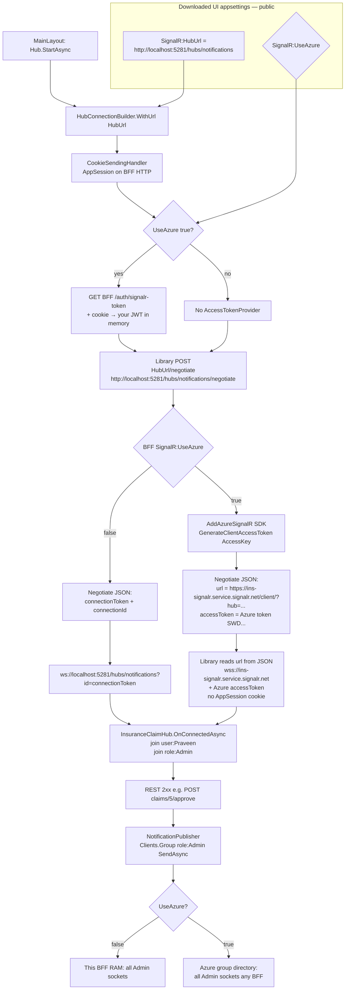

# Azure SignalR — paste guide (feature flag)

You paste these changes. Default is **off**: localhost keeps today’s in-process hub (cookie on `ws://localhost:5281`).  
When **`SignalR:UseAzure` is `true`** and the Azure connection string is set, the BFF uses Azure SignalR and the UI sends a short JWT.

**Keep both flags in sync:** BFF `appsettings.json` and WASM `wwwroot/appsettings.json`.

| Flag | Behaviour |
| --- | --- |
| `"UseAzure": false` | Current app. Cookie + local hub. `GET /auth/signalr-token` returns 404. |
| `"UseAzure": true` | `AddAzureSignalR()`. UI `AccessTokenProvider` calls `GET /auth/signalr-token`. Browser socket goes to `*.service.signalr.net`. |

Hub class, groups (`role:Admin`), and `PublishAsync` **do not change**.

Paste **Step 3** as well (`JwtOptions`, `CreateSignalRToken`, `SignalRTokenResponse.cs`). Those helpers are not in the repo until you add them.

---

## Concept: what changes when the flag is on

```text
UseAzure = false
  Browser → POST BFF /hubs/notifications/negotiate  + cookie
  Browser → ws://localhost:5281/hubs/notifications?id=...  + cookie
  Groups live in that one BFF process

UseAzure = true
  Browser → POST BFF /hubs/notifications/negotiate  + cookie
  Browser → GET  BFF /auth/signalr-token            + cookie  → 5-min JWT
  Browser → wss://<name>.service.signalr.net        + JWT (no cookie)
  Azure holds sockets; any BFF can PublishAsync to role:Admin
```

Cookie still proves who you are **to the BFF**. It cannot be sent to Azure’s host, which is why the JWT exists.

---

## Method flow (HubUrl vs Azure URL)

WASM `wwwroot/appsettings.json` is public. It only stores **BFF `HubUrl`**. It never stores `wss://*.service.signalr.net`.  
`StartAsync` always POSTs **`{HubUrl}/negotiate`**. If Azure is on, the **negotiate JSON** returns Azure `url` + `accessToken`. The client library then opens that WebSocket.



**Connect (methods)**

1. `NotificationHubClient.StartAsync` → `WithUrl(config["SignalR:HubUrl"])`.
2. If UI `UseAzure` → `GET /auth/signalr-token` (BFF JWT, cookie). Else skip.
3. Library → `POST {HubUrl}/negotiate` (**always BFF**, always `:5281` locally).
4. If BFF `UseAzure` → SDK returns **Azure `url` + `accessToken`**. Else local `connectionToken`.
5. Library connects to that URL. Azure hostname is **only** in that response, not in `wwwroot/appsettings.json`.
6. `OnConnectedAsync` → groups `user:{name}` and `role:{role}`.

**Publish (same API in both modes)**

7. REST 2xx → `TryPublishEventAsync` → `PublishAsync` → `Clients.Group("role:Admin")`.
8. Flag off: this BFF process. Flag on: Azure fans out to every Admin socket on any BFF.

Keep **both** `SignalR:UseAzure` flags in sync (BFF + WASM).

---


## Order (do in this order, with why)

### Step 0 — Azure resource (portal, not code)

**Why first:** `AddAzureSignalR()` needs a real endpoint. Without it, `UseAzure: true` will throw at BFF startup.

1. Azure Portal → Create **SignalR Service**.
2. Mode: **Default** (not Serverless). Hub stays in `Authentication.Bff.Api`.
3. Copy **Connection string** (Primary).
4. Resource → **CORS**: add `http://localhost:5280` (and later your HTTPS UI).
5. Your PC/BFF must reach `*.service.signalr.net` (HTTPS outbound).

Do **not** turn the flag on until Steps 1–6 are pasted and the connection string is in appsettings.

---

### Step 1 — Package on BFF

**File:** `Authentication.Bff.Api\Authentication.Bff.Api.csproj`  
**Why:** SDK that redirects negotiate to Azure and lets `IHubContext` publish across instances.

Add inside `<ItemGroup>` with the other `PackageReference`:

```xml
<PackageReference Include="Microsoft.Azure.SignalR" Version="1.32.0" />
```

Then restore:

```bat
dotnet restore Authentication.Bff.Api\Authentication.Bff.Api.csproj
```

Use a newer 1.x version if NuGet offers one.

---

### Step 2 — Feature flag + connection string (BFF)

**File:** `Authentication.Bff.Api\appsettings.json`  
**Why:** One switch. Empty connection string + `UseAzure: true` should fail fast so you do not run a split brain (half local, half Azure).

Replace the `Jwt` and `SignalR` blocks with:

```json
  "Jwt": {
    "Issuer": "InsurancePlatform",
    "Audience": "InsuranceApis",
    "SignalRAudience": "InsuranceSignalR",
    "SigningKey": "InsurancePlatform-dev-signing-key-32ch",
    "AccessTokenMinutes": 30,
    "SignalRTokenMinutes": 5
  },
  "SignalR": {
    "Enabled": true,
    "UseAzure": false,
    "HubPath": "/hubs/notifications",
    "ClientMethodName": "ReceiveNotification",
    "PersistToSql": true
  },
  "Azure": {
    "SignalR": {
      "ConnectionString": ""
    }
  }
```

Leave `"UseAzure": false` and `"ConnectionString": ""` until you are ready to test Azure.  
Production: put the connection string in **User Secrets / App Settings / Key Vault**, not git.

---

### Step 3 — JWT helper (skip if already in your tree)

**Why:** Azure’s socket is not on `:5281`, so `Clients.User` / `UserIdentifier` need `ClaimTypes.NameIdentifier` on a **short** token. Do **not** reuse the Ocelot access token (`Audience: InsuranceApis`).

**File:** `Insurance.Helpers\JwtTokenFactory.cs` — add to `JwtOptions`:

```csharp
public string SignalRAudience { get; set; } = "InsuranceSignalR";
public int SignalRTokenMinutes { get; set; } = 5;
```

Add method on `JwtTokenFactory`:

```csharp
public string CreateSignalRToken(string userName, IEnumerable<string> roles, IEnumerable<string> permissions)
{
    var minutes = _options.SignalRTokenMinutes <= 0 ? 5 : _options.SignalRTokenMinutes;
    var claims = new List<Claim>
    {
        new(ClaimTypes.NameIdentifier, userName),
        new(ClaimTypes.Name, userName),
        new(JwtRegisteredClaimNames.Sub, userName)
    };
    claims.AddRange(roles.Select(role => new Claim(ClaimTypes.Role, role)));
    claims.AddRange(permissions.Select(permission => new Claim("permission", permission)));

    var key = new SymmetricSecurityKey(Encoding.UTF8.GetBytes(_options.SigningKey));
    var token = new JwtSecurityToken(
        _options.Issuer,
        string.IsNullOrWhiteSpace(_options.SignalRAudience) ? "InsuranceSignalR" : _options.SignalRAudience,
        claims,
        expires: DateTime.UtcNow.AddMinutes(minutes),
        signingCredentials: new SigningCredentials(key, SecurityAlgorithms.HmacSha256));
    return new JwtSecurityTokenHandler().WriteToken(token);
}
```

**File:** `Authentication.Bff.Api\Services\TokenService.cs` — add:

```csharp
public string CreateSignalRToken(string userName, IEnumerable<string> roles, IEnumerable<string> permissions) =>
    _factory.CreateSignalRToken(userName, roles, permissions);
```

**New file:** `Insurance.Contracts\Auth\SignalRTokenResponse.cs`

```csharp
namespace Insurance.Contracts.Auth;

public sealed class SignalRTokenResponse
{
    public string AccessToken { get; set; } = "";
    public int ExpiresInSeconds { get; set; }
}
```

---

### Step 4 — `GET /auth/signalr-token` (BFF)

**File:** `Authentication.Bff.Api\Controllers\AuthController.cs`  
**Why:** Only a valid **session cookie** can mint the Azure JWT. The UI never invents roles. If the flag is off, return 404 so the client stays on cookie-only hub.

Change the constructor to inject `TokenService` and `IConfiguration`:

```csharp
private readonly LoginService _login;
private readonly TokenService _tokens;
private readonly IConfiguration _config;

public AuthController(LoginService login, TokenService tokens, IConfiguration config)
{
    _login = login;
    _tokens = tokens;
    _config = config;
}
```

Paste **above** `Logout`:

```csharp
[HttpGet("signalr-token")]
public async Task<ActionResult<SignalRTokenResponse>> SignalRToken()
{
    if (!_config.GetValue("SignalR:UseAzure", false))
        return NotFound(new ApiMessage { Message = "Azure SignalR is off (SignalR:UseAzure)." });

    if (!TryReadSession(out var sessionId, out var rawToken))
        return Unauthorized();

    var user = await _login.GetCurrentAsync(sessionId, rawToken);
    if (user is null)
        return Unauthorized();

    var minutes = _config.GetValue("Jwt:SignalRTokenMinutes", 5);
    if (minutes <= 0)
        minutes = 5;

    var jwt = _tokens.CreateSignalRToken(user.UserName, user.Roles, user.Permissions);
    return Ok(new SignalRTokenResponse
    {
        AccessToken = jwt,
        ExpiresInSeconds = minutes * 60
    });
}
```

`InsuranceClaimHub` and `NotificationPublisher`: **no paste**. Groups and `SendAsync("role:Admin")` stay.

---

### Step 5 — Wire Azure only when the flag is on (BFF `Program.cs`)

**File:** `Authentication.Bff.Api\Program.cs`  
**Why:** `AddAzureSignalR()` must not run on your laptop with an empty string. Flag false = today’s `AddSignalR()` only.

Replace:

```csharp
builder.Services.AddSignalR();
```

with:

```csharp
var useAzureSignalR = builder.Configuration.GetValue("SignalR:UseAzure", false);
var azureSignalRConnection = builder.Configuration["Azure:SignalR:ConnectionString"];
var signalR = builder.Services.AddSignalR();
if (useAzureSignalR)
{
    if (string.IsNullOrWhiteSpace(azureSignalRConnection))
        throw new InvalidOperationException(
            "SignalR:UseAzure is true but Azure:SignalR:ConnectionString is empty.");
    signalR.AddAzureSignalR();
}
```

Keep:

```csharp
app.MapHub<InsuranceClaimHub>("/hubs/notifications").RequireAuthorization();
```

`AddAzureSignalR()` reads `Azure:SignalR:ConnectionString` by convention.

---

### Step 6 — UI flag + `AccessTokenProvider`

**File:** `Insurance.UI.BlazorWasm\wwwroot\appsettings.json`  
**Why:** WASM cannot see BFF appsettings. Same flag name so you turn both on together.

```json
{
  "BffBaseUrl": "http://localhost:5281",
  "SignalR": {
    "Enabled": true,
    "UseAzure": false,
    "HubUrl": "http://localhost:5281/hubs/notifications",
    "ClientMethodName": "ReceiveNotification"
  }
}
```

**HubUrl stays the BFF** even when Azure is on. After negotiate, the client library follows Azure’s URL. Do **not** put `wss://xxx.service.signalr.net` here.

**File:** `Insurance.UI.BlazorWasm\Services\NotificationHubClient.cs`  
**Why:** Cookie handler = negotiate to BFF (same as today). `AccessTokenProvider` = JWT for the Azure WebSocket **only when the flag is true**.

1. Add usings if missing:

```csharp
using System.Net.Http.Json;
using Insurance.Contracts.Auth;
```

2. Inject `HttpClient` (the BFF client already registered in `Program.cs`):

```csharp
private readonly IConfiguration _config;
private readonly HttpClient _http;
private HubConnection _hubConnection;

public NotificationHubClient(IConfiguration config, HttpClient http)
{
    _config = config;
    _http = http;
}
```

3. Inside `WithUrl`, keep the cookie handler and add the token provider:

```csharp
_hubConnection = new HubConnectionBuilder()
    .WithUrl(url, options =>
    {
        options.HttpMessageHandlerFactory = inner => new CookieSendingHandler { InnerHandler = inner };
        if (_config.GetValue("SignalR:UseAzure", false))
        {
            options.AccessTokenProvider = async () =>
            {
                var token = await _http.GetFromJsonAsync<SignalRTokenResponse>("auth/signalr-token");
                return token?.AccessToken;
            };
        }
    })
    .WithAutomaticReconnect()
    .Build();
```

Leave `On(...)`, `StartAsync` try/catch, and `CookieSendingHandler` as they are.

---

## Turning the feature **on** (after all pastes compile)

1. Paste the Azure connection string into BFF `Azure:SignalR:ConnectionString`.
2. Set BFF `"SignalR": { "UseAzure": true }`.
3. Set WASM `"SignalR": { "UseAzure": true }`.
4. Restart **BFF** then **UI** (WASM reads `wwwroot/appsettings.json` at start).
5. Login → Network: `negotiate` still hits `:5281`, then **WS host is `*.service.signalr.net`**.
6. `GET /auth/signalr-token` → 200 JSON `accessToken`.
7. Approve a claim; Admin tabs still get the message.

**Turn off:** both `"UseAzure": false`, connection string can stay. Restart BFF + UI. WS is `:5281` again.

If only BFF is `true` and UI is `false`: Azure on server, UI still cookie-only to `:5281` → broken. **Set both.**

---

## Prove one BFF, then two

| Test | Flag off | Flag on (Azure) |
| --- | --- | --- |
| WS URL | `ws://localhost:5281/hubs/notifications?id=` | `wss://<name>.service.signalr.net` |
| Two Admin tabs, one BFF | Both get live events | Both get live events |
| Two BFF processes | **Broken** (memory on one process) | Both Admins get events |

---

## Do not change

- `InsuranceClaimHub` group names
- `NotificationPublisher.SendAsync`
- `TargetRole = "Admin"`
- Ocelot / Claims / Policies
- Putting the hub behind Ocelot

---

## Checklist

- [ ] Step 0 Azure resource + CORS  
- [ ] Step 1 package  
- [ ] Step 2 BFF appsettings (`UseAzure: false` until ready)  
- [ ] Step 3 JWT helpers (skip if already present)  
- [ ] Step 4 `GET auth/signalr-token`  
- [ ] Step 5 `Program.cs` `AddAzureSignalR` behind flag  
- [ ] Step 6 WASM appsettings + `NotificationHubClient`  
- [ ] Build BFF + UI  
- [ ] Turn **both** flags on + connection string → restart → check WS host  
- [ ] Optional: second BFF instance  
