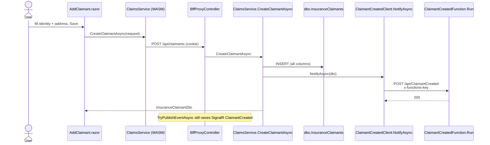

# Plan: Claimant page (extra fields) + Azure Function (HTTP trigger)

Status: **plan only** — not implemented until you say go.

**Change from the earlier draft:** no new `Customers.Api` for v1. The Function runs when a **claimant** is saved (existing Claims + BFF path). A separate customer microservice can come later.

The browser still talks **only to the BFF**. Blazor never calls the Function URL and never holds a Function key.

```text
User → UI /claimants (expanded form)
     → BFF cookie  POST /api/claimants
     → ClaimsService.CreateClaimantAsync
     → INSERT dbo.InsuranceClaimants  (new columns)
     → HTTP POST Function /api/ClaimantCreated  (x-functions-key)
     → 200 ClaimantDto to UI
```

If the Function is down or slow: **still save the claimant** (3 second timeout, log warning).

---

## 1. Why this shape

| Choice | Why |
|---|---|
| Hook on **claimant**, not a new microservice | Form already exists; one SQL table; one BFF route |
| **HTTP trigger** | Simplest Function; no queue to learn first |
| Call from **`ClaimsService.CreateClaimantAsync`** | Same method is used by Claims.Api, BFF in-process proxy, and the assistant tools |

**Hard rule:** no Function URL in `wwwroot/appsettings*.json`.

---

## 2. Runtime flow (method names)



Password vs OAuth: no change. Cookie is enough. This does **not** create `dbo.Users` or call Entra.

---

## 3. Extra data captures on the claimant page

Today the UI only has **Full name, Email, Phone**. Expand the form (and SQL) to capture identity + address.

### Form fields (`AddClaimant.razor`)

| Field | Required | Notes |
|---|---|---|
| First name | Yes | |
| Last name | Yes | |
| Full name | No (derived) | `FirstName + " " + LastName` if left blank |
| Date of birth | No | `date` input |
| Gender | No | Select: Male / Female / Other / Prefer not to say |
| Email | No | |
| Phone | No | Mobile |
| Alternate phone | No | |
| Address line 1 | Yes | |
| Address line 2 | No | |
| City | Yes | |
| State | No | |
| PIN / postal code | No | |
| Country | No | Default `India` |
| ID type | No | Select: Aadhaar / PAN / Passport / Other |
| ID number | No | Store as NVARCHAR; do not log in Function v1 |
| Notes | No | Short text |

List table on the same page: Id, Full name, Email, Phone, City, PIN (not ID number).

### SQL (`Sql/007_ClaimantsExtended.sql`) — Azure SQL + LocalDB `DemoDataBase`

Keep existing rows. **Do not** re-run `001` (drops tables).

```sql
USE DemoDataBase;
GO

-- Existing: ClaimantId, FullName, Email, Phone, CreatedUtc
IF COL_LENGTH('dbo.InsuranceClaimants', 'FirstName') IS NULL
    ALTER TABLE dbo.InsuranceClaimants ADD FirstName NVARCHAR(100) NULL;
IF COL_LENGTH('dbo.InsuranceClaimants', 'LastName') IS NULL
    ALTER TABLE dbo.InsuranceClaimants ADD LastName NVARCHAR(100) NULL;
IF COL_LENGTH('dbo.InsuranceClaimants', 'DateOfBirth') IS NULL
    ALTER TABLE dbo.InsuranceClaimants ADD DateOfBirth DATE NULL;
IF COL_LENGTH('dbo.InsuranceClaimants', 'Gender') IS NULL
    ALTER TABLE dbo.InsuranceClaimants ADD Gender NVARCHAR(30) NULL;
IF COL_LENGTH('dbo.InsuranceClaimants', 'AlternatePhone') IS NULL
    ALTER TABLE dbo.InsuranceClaimants ADD AlternatePhone NVARCHAR(50) NULL;
IF COL_LENGTH('dbo.InsuranceClaimants', 'AddressLine1') IS NULL
    ALTER TABLE dbo.InsuranceClaimants ADD AddressLine1 NVARCHAR(200) NULL;
IF COL_LENGTH('dbo.InsuranceClaimants', 'AddressLine2') IS NULL
    ALTER TABLE dbo.InsuranceClaimants ADD AddressLine2 NVARCHAR(200) NULL;
IF COL_LENGTH('dbo.InsuranceClaimants', 'City') IS NULL
    ALTER TABLE dbo.InsuranceClaimants ADD City NVARCHAR(100) NULL;
IF COL_LENGTH('dbo.InsuranceClaimants', 'StateName') IS NULL
    ALTER TABLE dbo.InsuranceClaimants ADD StateName NVARCHAR(100) NULL;
IF COL_LENGTH('dbo.InsuranceClaimants', 'PinCode') IS NULL
    ALTER TABLE dbo.InsuranceClaimants ADD PinCode NVARCHAR(20) NULL;
IF COL_LENGTH('dbo.InsuranceClaimants', 'Country') IS NULL
    ALTER TABLE dbo.InsuranceClaimants ADD Country NVARCHAR(100) NULL;
IF COL_LENGTH('dbo.InsuranceClaimants', 'IdType') IS NULL
    ALTER TABLE dbo.InsuranceClaimants ADD IdType NVARCHAR(30) NULL;
IF COL_LENGTH('dbo.InsuranceClaimants', 'IdNumber') IS NULL
    ALTER TABLE dbo.InsuranceClaimants ADD IdNumber NVARCHAR(50) NULL;
IF COL_LENGTH('dbo.InsuranceClaimants', 'Notes') IS NULL
    ALTER TABLE dbo.InsuranceClaimants ADD Notes NVARCHAR(500) NULL;
GO

UPDATE dbo.InsuranceClaimants
SET FirstName = FullName
WHERE FirstName IS NULL AND FullName IS NOT NULL;
GO
```

Run this on **local** `DemoDataBase` and **Azure** `pk-ins-demodb` / `DemoDataBase`.

### Contracts

Update `CreateClaimantRequest` and `InsuranceClaimantDto` with the same properties.

**Function payload** `ClaimantCreatedHookRequest` (small, no ID number in v1):

`ClaimantId, FullName, FirstName, LastName, Email, Phone, City, PinCode`

---

## 4. Code hooks (when implementing)

| File | Change |
|---|---|
| `Sql/007_ClaimantsExtended.sql` | New |
| `Insurance.Contracts/Claims/InsuranceClaimDto.cs` | Extra properties |
| `Claims.Api/Services/ClaimsService.cs` | INSERT/SELECT new columns; after insert `NotifyAsync` |
| `ClaimantsController` | Validate FirstName/LastName/AddressLine1 |
| `AddClaimant.razor` | Full form + wider table |
| `Agent/ClaimantsTools.cs` | Optional: extra fields later |

**This repo has no Function project.** You create the Function App and HTTP trigger yourself (portal + VS). After it works, we can wire `ClaimsService` to POST `ClaimantCreatedHookRequest`.

JSON the Function should accept (same as `ClaimantCreatedHookRequest`):

```json
{
  "claimantId": 1,
  "fullName": "Maya Patel",
  "firstName": "Maya",
  "lastName": "Patel",
  "email": "maya@test.local",
  "phone": "999",
  "city": "Pune",
  "pinCode": "411001"
}
```

Do **not** include `idNumber`.

---

## 5. You create the Function (no code in this solution)

| Item | Value |
|---|---|
| Function App name | `pk-ins-fn-claimants` |
| Plan | **Consumption (Y1)** — not F1 `plan-ins-dev` |
| Function name | `ClaimantCreated` |
| Method | **POST** |
| Route | `/api/ClaimantCreated` |
| Authorization | **Function** (key required) |
| Region | South India |
| Resource group | `pk-insurance-dev` |

Portal + Visual Studio steps are in **section 7**.

---

## 6. Config (no secrets in git)

### BFF and Claims.Api (same keys)

| Key | Local | Azure App Setting |
|---|---|---|
| `Functions:ClaimantCreatedUrl` | `http://localhost:7071/api/ClaimantCreated` | `https://pk-ins-fn-claimants.azurewebsites.net/api/ClaimantCreated` |
| `Functions:HostKey` | empty or user-secrets | Function **function key** |

Azure names: `Functions__ClaimantCreatedUrl`, `Functions__HostKey`.

Set on **pk-ins-bff** (in-process claimant create) **and** **pk-ins-claims** (if the request is proxied to Claims.Api).

UI Production json: **no** Function keys. Only `BffBaseUrl`.

---

## 7. Azure Function — create and deploy (all steps)

Resource group: **`pk-insurance-dev`**. Region: **South India**. Do **not** put the Function on App Service plan **F1** (`plan-ins-dev`). Use **Consumption** so it does not share the Free plan RAM.

### 7.1 Storage account (required even for HTTP)

1. Portal → **Create** → **Storage account**.
2. Resource group: `pk-insurance-dev`.
3. Name: e.g. `pkinsfnclaimants` (globally unique, 3–24 lowercase).
4. Region: South India. Performance: Standard. Redundancy: LRS.
5. Review + create. Wait until **Go to resource**.

### 7.2 Function App

1. Portal → **Create** → **Function App**.
2. **Host on:** Consumption (serverless) / **Y1**.
3. **Subscription:** Azure subscription 1.
4. **Resource group:** `pk-insurance-dev`.
5. **Function App name:** `pk-ins-fn-claimants`.
6. **Runtime stack:** .NET. **Version:** isolated (8 or 10 to match the project).
7. **Region:** South India.
8. **Storage:** the account from 7.1.
9. Review + create.
10. Overview → copy **Default domain**  
    `https://pk-ins-fn-claimants.azurewebsites.net`  
    (if Azure adds a stamp, copy the **full** hostname — same lesson as UI NXDOMAIN).

### 7.3 Function key (after first successful publish)

1. Function App → **Functions** → `ClaimantCreated` (appears after deploy).
2. **Function Keys** → copy **default** key (or App keys → **default** host key).
3. This value is **`Functions__HostKey`**. Not git.

### 7.4 Create the HTTP function yourself (Visual Studio)

There is **no** `Insurance.Functions` project in git. You add it.

1. Visual Studio → **File → New → Project**.
2. Search **Azure Functions** → **Azure Functions** (C#).
3. Name: `Insurance.Functions`. Location: your `insuranceplateform` folder (do not add to git until you want to).
4. **Functions worker:** .NET isolated. **Function:** **Http trigger**. **Authorization level:** **Function**.
5. Name the function **`ClaimantCreated`**.
6. In `Run`, read the JSON body (fields in section 4). Log `claimantId` and `fullName`. Return HTTP 200 `{ "ok": true }`. Do not write SQL. Do not put the Function key in the UI.
7. F5 locally → URL like `http://localhost:7071/api/ClaimantCreated`.
8. Test with Postman/curl POST that JSON (no key locally if you used Anonymous; with `x-functions-key` if Function level).
9. Right-click the Function project → **Publish** → **Azure Function App** → select `pk-ins-fn-claimants` from 7.2 → **Publish**.

First publish was done from Visual Studio. GitHub CD: `deploy-azure.yml` publishes `ClaimantCreated` to `pk-ins-fn-claimants` using secret `AZURE_PUBLISH_PROFILE_FN_CLAIMANTS`. CI (`ci.yml`) restores/builds the solution (needs .NET 8 + .NET 10). Do not put Function keys in git.

### 7.5 App Settings on BFF (and Claims)

1. **pk-ins-bff** → **Environment variables** → **App settings** → **Add**:
   - `Functions__ClaimantCreatedUrl` = `https://<function-default-host>/api/ClaimantCreated`
   - `Functions__HostKey` = key from 7.3
2. **Apply** (restart).
3. Repeat on **pk-ins-claims** if you use downstream Claims.Api for POST claimants.

### 7.6 CORS on the Function

Leave default. The caller is **server-side** (BFF/Claims), not the browser. Do not add the UI origin unless you later break the hard rule (do not).

### 7.7 Test on Azure

1. Run `Sql/007` on Azure `DemoDataBase`.
2. Deploy **BFF + UI + Claims** with the extra claimant columns (GitHub `main` or VS Publish).
3. Open the **working** UI host `/claimants` (not a NXDOMAIN stamp).
4. Sign in (password or Microsoft).
5. Save a claimant with address fields.
6. Function App → **Invocations** / **Log stream**: one POST, 200, ClaimantId in the log.
7. SQL: new row with FirstName, City, etc.
8. Stop the Function App, save another claimant → **row still appears**; BFF log “hook failed”. Start Function again.

### 7.8 What “deployed” looks like

| Check | OK |
|---|---|
| Portal Function App **Running** | Yes |
| `GET https://<fn-host>/api/ClaimantCreated` without key | 401 |
| POST with `x-functions-key` from API | 200 |
| UI Save | 200 + SQL row |
| Chrome Network | only `…/api/claimants` to **BFF**, no Function host |

---

## 8. Local demo order

1. Run `Sql/007_ClaimantsExtended.sql` on LocalDB `DemoDataBase`.
2. `func start` in `Insurance.Functions`.
3. `dotnet run` BFF (`5281`) + UI (`5280`). Claims.Api optional if BFF uses in-process `ClaimsService`.
4. Login → **Claimants** → fill new fields → Save.
5. Function terminal shows ClaimantId.
6. Stop `func start`, Save again → claimant still in the table.

---

## 9. Build order (when you say go)

| Step | Done when |
|---|---|
| **1** | SQL 007 on local + Azure; DTOs; INSERT/SELECT; form fields; list columns |
| **2** | Function project; `func start`; log-only HTTP |
| **3** | `ClaimantCreatedClient` on create; timeout 3s; save always |
| **4** | Portal: storage + Function App Consumption; VS Publish |
| **5** | BFF/Claims App Settings URL + key; Azure Save + Monitor |
| **6** | Optional: email inside Function |

Do not create the Function App until step 2 works on localhost.

---

## 10. Security and failures

| Case | Behaviour |
|---|---|
| Function cold start | Claimant saved; hook skipped |
| Wrong HostKey | 401; claimant saved; fix App Setting |
| ID number on form | Stored in SQL; **omit from Function payload v1** |
| User not logged in | BFF 401; Function never called |
| UI NXDOMAIN | Unrelated; fix UI hostname first (recreate Web App) |

---

## 11. Out of scope

- New `Customers.Api` Web App (deferred)
- Queue / Timer / Blob triggers
- Function as the public `POST /api/claimants`
- Auto-creating `dbo.Users` from claimant email
- Calling the Function from `Login.razor`

---

## 12. Confirm before coding

1. Extra fields list above is accepted (especially ID type/number).
2. Function name **`pk-ins-fn-claimants`**, Consumption, South India.
3. Save claimant even if Function fails (**yes**).
4. Implement **step 1 (form + SQL)** first, then Function.
