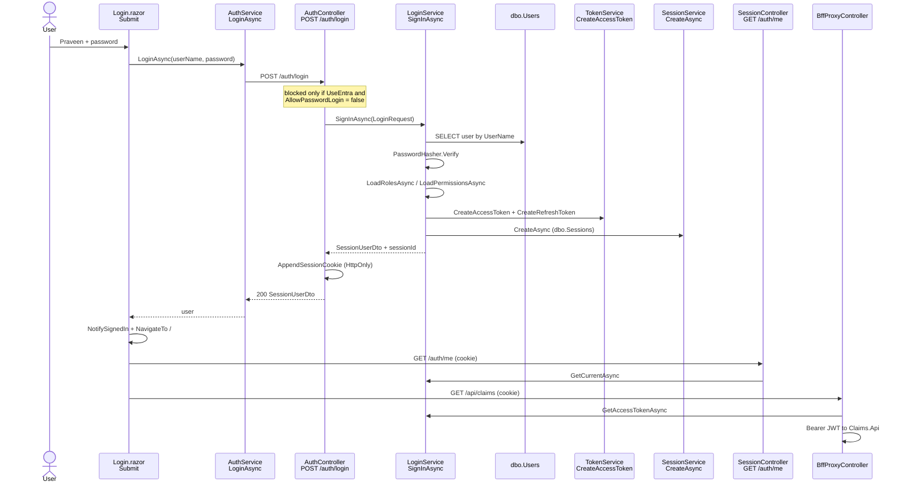
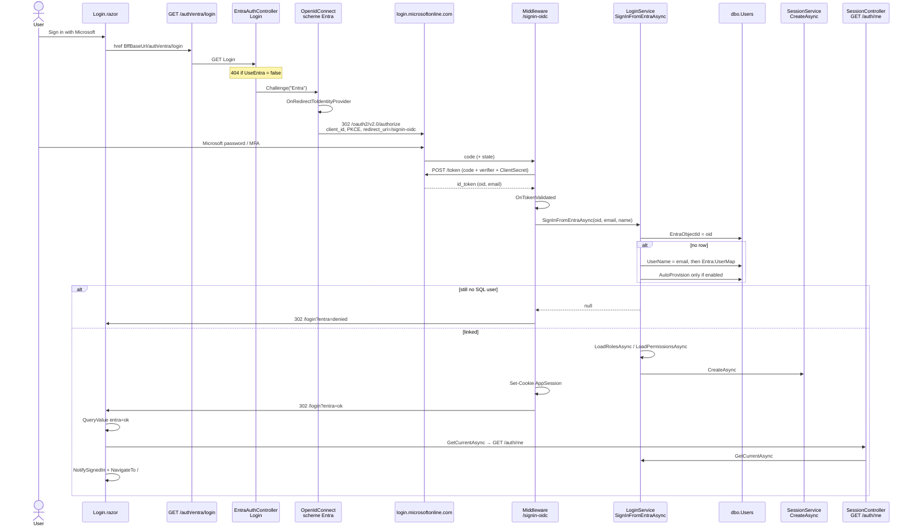

# Microsoft Entra ID + OAuth 2.0 — paste guide

You paste these changes. Default stays **off**: `UseEntra: false` keeps today’s SQL password login (`Praveen` / `Password@123`).

**Keep the BFF.** The browser still never holds an Entra access token or your API JWT. Entra proves **who the person is**. The BFF still sets **HttpOnly `AppSession` / `__Host-AppSession`** and still sends **your** JWT to Claims / Policies / Billing.

| Flag | Behaviour |
|---|---|
| `"UseEntra": false` | Current app. `POST /auth/login` + SQL `dbo.Users`. |
| `"UseEntra": true` | UI button redirects to BFF → Microsoft login → BFF callback → same session cookie. Password login can stay for demo. |

Related flags (do not mix them up):

| Flag | What it switches |
|---|---|
| `UseEntra` | **Who signs the user in** (SQL password vs Microsoft). This document. |
| `Entra:AllowPasswordLogin` | When Entra is on, still show `POST /auth/login` (demo JWT/password). |
| `UseApim` | **Which host** the UI and BFF call (App Service vs APIM). Already in the repo. |
| `UseGateway` | Ocelot. Leave `false`. |

---

## Entra ID vs OAuth 2.0 vs JWT — do you need both?

They are **not three competing products**. They are **layers**. One can work without the others depending which layer you mean.

```text
Layer A  How the HUMAN signs in
         ├─ Password  →  POST /auth/login  (today)
         └─ Entra ID  →  OAuth 2.0 + OpenID Connect  (Microsoft login page)
              Entra is the identity provider.
              OAuth 2.0 / OIDC is the protocol Entra uses.
              You cannot "turn on Entra" without OAuth/OIDC.
              You CAN use OAuth with a different provider (Google, etc.) without Entra.

Layer B  How the BROWSER talks to the BFF
         Always: HttpOnly cookie (not a JWT in Blazor). Same for password or Entra.

Layer C  How the BFF talks to Claims / Policies / Billing
         Always: your API JWT (JwtTokenFactory). Same for password or Entra.
```

| Question | Answer |
|---|---|
| Is OAuth a separate feature from Entra? | **No for this app.** Entra web login **is** OAuth 2.0 Authorization Code + OIDC. Implement Entra = implement OAuth against Microsoft. |
| Can OAuth work without Entra? | Yes, but only if you pick another IdP. Not needed. |
| Can Entra work without OAuth? | **No.** There is no supported “Entra login” for this BFF that is not OAuth/OIDC. |
| Can JWT work without Entra? | **Yes. That is today.** Password → cookie → BFF mints JWT → APIs. |
| Can Entra work without your API JWT? | Yes in theory (APIs would validate Entra tokens). **Do not do that in v1.** Keep Layer C JWT so Claims/Policies/Billing stay unchanged. |
| Do both need to be “on” at once? | **Code:** implement both **paths**, switch with appsettings. **Runtime:** only one human-login path is required. APIs always use JWT. |

**Implement both login paths in code. Switch with config. Downstream JWT always stays on.**

---

## Build status and what you still paste

`dotnet build` (after Login.razor query fix): **BFF succeeded**, **UI succeeded** (0 errors). First UI build failed with `CS0234` (`Microsoft.AspNetCore.WebUtilities` is not in the WASM project). Do not paste `QueryHelpers`. Use `QueryValue` in Step 7.

Code for Entra login/logout is already in the repo. **You still paste/run these yourself** (not compile errors):

| # | Where | What to paste / do | Why |
|---|---|---|---|
| 1 | SSMS / Azure SQL `DemoDataBase` | Step 2 SQL: `EntraObjectId` column + unique index | First Microsoft login looks up this column |
| 2 | Same SQL | `UPDATE dbo.Users SET EntraObjectId = '<Object ID from Entra Users>' WHERE UserName = 'Praveen'` | `Praveen` ≠ Hotmail UPN; without this → `entra=denied` |
| 3 | User Secrets (local) | `dotnet user-secrets set "Entra:ClientSecret" "VALUE-not-Secret-ID" --project Authentication.Bff.Api` | Never git. Production json `ClientSecret` stays `""` |
| 4 | UI `wwwroot/appsettings.json` and/or `appsettings.Development.json` | `"UseEntra": true` when you want the Microsoft button locally | WASM does not read BFF `.local.json` |
| 5 | Keep Production | `"UseEntra": false` until local Microsoft login works | Azure stays password login |
| 6 | Azure BFF App Settings (later) | `Entra__ClientSecret` = Value; then `UseEntra` = true + UI Production `UseEntra` true + redeploy | No APIM for this cutover |

If your tree does not have the agent edits, also paste **Step 4–5 and 7** (csproj OpenIdConnect, one `AddAuthentication`, `EntraAuthController` login+logout, `AuthService` Entra logout, `Login.razor` `QueryValue`). Do **not** add `/signin-oidc` controllers.

---

## Switch with `appsettings` (like `UseApim`)

You already flip APIM with `UseApim`. Entra is the same idea: **keep both login implementations**, pick one (or both on the login page) in JSON / Azure App Settings. **No comment-swapping URLs.**

### BFF `appsettings.json` / Production / Azure

```json
"UseEntra": false,
"Entra": {
  "AllowPasswordLogin": true,
  "TenantId": "b4d8e18d-f2f9-4129-813d-e995dff76059",
  "ClientId": "6676525c-9bdc-47f6-b9ac-664b52631ff2",
  "ClientSecret": "",
  "Instance": "https://login.microsoftonline.com/",
  "CallbackPath": "/signin-oidc",
  "SignedOutCallbackPath": "/signout-oidc"
}
```

Azure names: `UseEntra`, `Entra__AllowPasswordLogin`, `Entra__TenantId`, `Entra__ClientId`, `Entra__ClientSecret`, `Entra__Instance`, `Entra__CallbackPath`, `Entra__SignedOutCallbackPath`.

### What each Entra setting means

Parent key in JSON is `Entra`. In Azure App Settings use `Entra__` + the name (double underscore).

| JSON key | Azure App Setting | Meaning | Where you copy it from | Safe in git? |
|---|---|---|---|---|
| `UseEntra` (root, not inside `Entra`) | `UseEntra` | Master switch. `false` = SQL password login only. `true` = BFF runs OAuth/OIDC against Entra (Microsoft button). | You set this. | Yes |
| `AllowPasswordLogin` | `Entra__AllowPasswordLogin` | When `UseEntra` is `true`, whether `POST /auth/login` (Praveen / password) still works. `true` = both logins (cutover). `false` = Microsoft only. Ignored if `UseEntra` is `false`. | You set this. | Yes |
| `TenantId` | `Entra__TenantId` | Your Entra **directory** (organization). Tells OIDC which tenant’s `/authorize` and `/token` URLs to use. Also called Directory ID. | Entra **App registration → Overview → Directory (tenant) ID** (a GUID). | Yes (id, not a password) |
| `ClientId` | `Entra__ClientId` | This **app’s** id in Entra. Sent on the authorize URL as `client_id`. Entra will only issue codes to this app. Also called Application ID. | Entra **App registration → Overview → Application (client) ID** (a GUID). | Yes (id, not a password) |
| `ClientSecret` | `Entra__ClientSecret` | Password for the BFF as a **confidential client**. Used only on the server when exchanging `code` for tokens (`POST /token`). The browser never sees it. | Entra **Certificates & secrets → New client secret → Value** (copy once). | **No.** User Secrets / App Settings only |
| `Instance` | `Entra__Instance` | Entra **login host**. Combined as `{Instance}{TenantId}/v2.0` = OIDC authority. Keep `https://login.microsoftonline.com/` for workforce (work/school) accounts. Use `https://login.microsoftonline.com/organizations/` only if you know you need it. National clouds differ (e.g. US Gov). | Almost always the default below. | Yes |
| `CallbackPath` | `Entra__CallbackPath` | Path on **this BFF** where Entra sends the user back with `?code=`. Must match an Entra **Redirect URI** exactly, including host: `https://<bff-or-apim-host>/signin-oidc`. Middleware listens here; you do not write a controller for it. | You choose the path; default `/signin-oidc`. Host comes from Step 0. | Yes |
| `SignedOutCallbackPath` | `Entra__SignedOutCallbackPath` | Path Entra calls after **Microsoft logout**. Pair with Entra **Front-channel logout URL**. Default `/signout-oidc`. | Same as CallbackPath: you pick the path; register the full URL in Entra. | Yes |

Defaults:

```text
Instance                 = https://login.microsoftonline.com/
CallbackPath             = /signin-oidc
SignedOutCallbackPath    = /signout-oidc
AllowPasswordLogin       = true
UseEntra                 = false
TenantId / ClientId      = empty until Step 1
ClientSecret             = empty until User Secrets / Azure
```

**Authority URL the BFF builds:** `https://login.microsoftonline.com/{TenantId}/v2.0`  
**Full redirect URI Entra must list:** `{https://bff-host}{CallbackPath}`  
Example Azure without APIM: `https://pk-ins-bff-c7d5a5fzfsh7gzch.southindia-01.azurewebsites.net/signin-oidc`

WASM may copy only `UseEntra` and `AllowPasswordLogin` (to show/hide buttons). It must **not** contain `ClientSecret`, and does not need TenantId / ClientId / Instance / callback paths (the BFF owns those).

### UI `wwwroot/appsettings.json` / Production

```json
"UseEntra": false,
"Entra": {
  "AllowPasswordLogin": true
}
```

WASM has **no** client secret. Booleans only.

### What each combination does

| `UseEntra` | `AllowPasswordLogin` | Login page | APIs (Claims/Policies/Billing) |
|---|---|---|---|
| `false` | ignored | Password only (today). | Your JWT from BFF |
| `true` | `true` | Microsoft button **and** password form (dev / cutover). | Your JWT from BFF |
| `true` | `false` | Microsoft only. `POST /auth/login` returns 404 or 403. | Your JWT from BFF |

BFF must enforce `AllowPasswordLogin` on `AuthController.Login`, not only hide the form in Blazor.

**Whenever you want password/JWT login:** `UseEntra: false` (or Entra on + `AllowPasswordLogin: true`). Restart BFF; redeploy UI if you change the WASM json.

**Whenever you want Entra:** `UseEntra: true` plus Tenant/Client/Secret. Same cookie + same API JWT after Microsoft returns.

Local: `UseEntra: false` in committed json; `true` only in gitignored `.local.json`. Azure: overlay `UseEntra` on **pk-ins-bff** and in UI `wwwroot/appsettings.Production.json`.

---


## Is this only for security?

No. Security is the main reason, but Entra also changes **how you run the company login**, not only encryption.

| You get | Why it is not “just a lock icon” |
|---|---|
| Single sign-on | One Microsoft login for Outlook, Azure, and this app. |
| No app passwords to store for staff | HR offboards in Entra; this app stops working without deleting `dbo.Users` rows by hand. |
| MFA / Conditional Access | Entra P1+ can require phone MFA, managed device, named location. Your Login.razor cannot do that. |
| Audit | Entra sign-in logs (who, from where, failed MFA). Your SQL session table only knows “a cookie was created”. |
| Guest / partner logins | External users via Entra B2B if you allow them. |
| App roles / groups | Admin vs Adjuster can live in Entra instead of only `UserRoles`. |

What Entra does **not** replace on day one:

- Claim / policy / billing **business data** (still SQL).
- Your **permission** checks (`ClaimsApprove`, etc.).
- BFF cookie and downstream JWT.

---

## Where everything is stored (read this before coding)

```text
BROWSER
  • Never stores Entra access token, Entra refresh token, or API JWT
  • Stores only HttpOnly cookie: AppSession (HTTP) or __Host-AppSession (HTTPS)
  • Cookie value: {sessionId}.{opaque random token}  — not a JWT

BFF PROCESS (RAM, seconds)
  • OIDC correlation / nonce cookies during the Microsoft redirect only
  • Then throws them away after callback

SQL DemoDataBase (source of truth for THIS app session)
  • dbo.Sessions     session id, hash of cookie token, user id, expiry
  • dbo.Users        local demo users; add EntraObjectId for Microsoft users
  • dbo.UserRoles    Admin / ClaimsAdjuster
  • dbo.RolePermissions   ClaimsView, ClaimsApprove, ...

ENTRA ID (Microsoft cloud)
  • User accounts, passwords, MFA
  • App registration (client id)
  • Client secret or certificate  → you COPY the secret into BFF App Settings only
  • Optional: app roles / groups
  • Optional: refresh tokens if you set SaveTokens (we do NOT save Entra tokens in the browser)

BFF APP SETTINGS / User Secrets (never wwwroot, never git)
  • Entra__ClientSecret
  • Jwt__SigningKey (already used to mint API JWT)
  • ConnectionStrings__DemoDataBase

CLAIMS / POLICIES / BILLING APIs
  • Do not talk to Entra on day one
  • Validate JWT issued by BFF (Issuer InsurancePlatform, Audience InsuranceApis)
  • JWT lives in BFF memory for that HTTP call, then discarded
  • APIs do not store the JWT
```

### Token types (do not mix)

| Token | Who creates it | Who sees it | Lifetime | Stored where |
|---|---|---|---|---|
| Entra **id token** | Entra | BFF only, during callback | Minutes | Not in SQL; used once to read `oid` / email |
| Entra **access token** | Entra | BFF only if you request Graph later | Minutes | Do **not** put in cookie or WASM |
| Entra **refresh token** | Entra | BFF only if `SaveTokens = true` | Days | Avoid for v1; not needed if we mint our own session |
| **App session cookie** | BFF | Browser (HttpOnly) + BFF | 8 hours (current cookie) | Browser + hash in `dbo.Sessions` |
| **API JWT** | BFF `JwtTokenFactory` | BFF → Claims/Policies/Billing | 30 minutes | Not stored; minted per proxy call (`GetAccessTokenAsync`) |

---

## How it works (runtime)

Both paths end the same way: **HttpOnly session cookie** on the BFF + **your API JWT** to Claims/Policies/Billing. The browser never stores the Microsoft token or the API JWT.

| | Password (normal) | Entra OAuth |
|---|---|---|
| Switch | Always, unless `UseEntra` and `AllowPasswordLogin=false` | `UseEntra: true` |
| UI start | `Login.razor` **Submit** → `AuthService.LoginAsync` | Microsoft button → `GET {Bff}/auth/entra/login` |
| BFF entry | `AuthController.Login` `POST /auth/login` | `EntraAuthController.Login` then OpenIdConnect middleware |
| Who you are | `LoginService.SignInAsync` + `PasswordHasher.Verify` | `LoginService.SignInFromEntraAsync` (id token `oid`) |
| Session | `SessionService.CreateAsync` + `AppendSessionCookie` | same cookie in `OnTokenValidated` |
| After login | `ApiAuthenticationStateProvider.NotifySignedIn` | UI `/login?entra=ok` → `AuthService.GetCurrentAsync` |

### Password login — method call chain



### Entra OAuth 2.0 + OIDC — method call chain

Authorization Code + PKCE. Local HTTP uses `response_mode=query`; Azure HTTPS uses `form_post` (IIS 404s a long `?code=`). `/signin-oidc` is **middleware**, not an MVC action.



### What OAuth is doing (short)

1. **Authorize** — BFF (`Challenge`) sends the browser to Entra. Entra authenticates the human. This app never sees the Microsoft password.
2. **Code** — Entra returns a one-time `code` to **the BFF** `/signin-oidc` (redirect URI in the app registration).
3. **Token** — BFF exchanges `code` + PKCE verifier + **`Entra:ClientSecret`** at Entra `/token`. Gets **id token**. WASM never sees this.
4. **Map** — `SignInFromEntraAsync` maps `oid` → `dbo.Users` (`EntraObjectId`, else email, else `UserMap`, else AutoProvision).
5. **Same session as password** — `SessionService.CreateAsync` + HttpOnly cookie. APIs still get **your** JWT from `GetAccessTokenAsync`.

Logout: `AuthService.LogoutAsync` → `GET /auth/entra/logout` → `EntraAuthController.Logout` → `LoginService.SignOutAsync` + `SignOut("EntraCookie","Entra")` → middleware `/signout-oidc` → UI `/login`.

**Link:** Step 1 (UI button) → Step 2–5 (OIDC on BFF) → Step 6 (SQL session, same as password login) → existing `/auth/me` and proxy.

If `UseApim` is true, every URL the **browser** uses in steps 1 and 4 is the APIM host (`…azure-api.net/bff/...`). Entra still talks to the BFF **through APIM**. Details in [APIM](#can-we-implement-this-with-apim).

---

## Step map (why + what it unlocks)

| Step | You do | Why | Unlocks |
|---|---|---|---|
| **0** | Read this file; leave `UseEntra: false` | No production outage while pasting | All later steps |
| **1** | Entra app registration | Microsoft must know this app’s client id and redirect URL | Step 3 config, Step 4 OIDC |
| **2** | SQL `EntraObjectId` | Tie a Microsoft user to `dbo.Users` / roles | Step 6 `SignInFromEntraAsync` |
| **3** | BFF `Entra` config + secret | Tenant, client id, secret, redirect — no secret in WASM | Step 4 |
| **4** | NuGet + `Program.cs` OIDC | Middleware that runs authorize + token + PKCE | Step 5 controller |
| **5** | `GET /auth/entra/login` | UI cannot talk to Entra itself (SPA would get tokens in the browser) | Step 7 button |
| **6** | `LoginService.SignInFromEntraAsync` | Same session cookie as password login so proxy/SignalR stay unchanged | Step 8 |
| **7** | Login.razor Microsoft button | User starts the redirect | Needs 5 |
| **8** | Keep `/auth/me` + cookie | UI already works this way | Needs 6 |
| **9** | Do **not** change Claims JWT | Downstream APIs already trust BFF JWT | Needs 6 |
| **10** | Azure App Settings + test | Production HTTPS cookie + real tenant | After 1–9 locally |
| **11** | Optional APIM | Same Entra flow; redirect URI becomes APIM | After 10 works without APIM |
| **12** | Optional: APIM `validate-jwt` | Extra check that Entra/BFF JWT is real | Only if you want APIM to reject junk before BFF |

Do **not** skip 1→4→5. Portal without OIDC does nothing. OIDC without SQL mapping logs in at Microsoft then 500 on callback.

---

## Step 0 — Decide hosts (do this first)

**Why:** Entra redirect URI must **exactly** match what the browser sees (scheme, host, path). Wrong host = `AADSTS50011`.

**Links to:** Step 1 (paste these URIs), Step 11 (APIM).

| Mode | Browser origin (UI) | BFF URL the browser uses | Entra redirect URI |
|---|---|---|---|
| Local | `http://localhost:5280` | `http://localhost:5281` | `http://localhost:5281/signin-oidc` |
| Azure, `UseApim: false` | `https://pk-ins-ui-a7aebdgfsdecmah.southindia-01.azurewebsites.net` | `https://pk-ins-bff-c7d5a5fzfsh7gzch.southindia-01.azurewebsites.net` | `https://pk-ins-bff-c7d5a5fzfsh7gzch.southindia-01.azurewebsites.net/signin-oidc` |
| Azure, `UseApim: true` | same UI stamp | `https://pk-ins-apim-dev.azure-api.net/bff` | `https://pk-ins-apim-dev.azure-api.net/bff/signin-oidc` |

Register **all** redirect URIs you will actually use (local + Azure). Logout URL: same host + `/signout-oidc`.

Local HTTP cannot use `__Host-` cookies. Entra still works on localhost with `AppSession`.

---

## Step 1 — Entra portal (no code)

**Why:** Creates the OAuth **client**. Entra will only send `code` to URIs you list.

**Links to:** Step 3 (copy Tenant ID, Client ID, secret).

1. [Azure Portal](https://portal.azure.com) → **Microsoft Entra ID** → **App registrations** → **New registration**.
2. Name: `pk-ins-bff-entra`.
3. Supported accounts: **Accounts in this organizational directory only** (single tenant) unless you need guests.
4. Platform: **Web** (not SPA, not Public client). Redirect URI = Step 0 table.
5. **Register**.
6. Overview: copy **Application (client) ID** and **Directory (tenant) ID**.
7. **Certificates & secrets** → **New client secret** → copy **Value** once. Store in BFF User Secrets / App Settings. Never commit. Never put in Blazor `wwwroot`.
8. **Authentication** → tab **Settings**. Tick **ID tokens**. Leave **Access tokens** off. **Allow public client flows** stays **Disabled**. Set front-channel logout to the BFF `/signout-oidc`. Click **Save**. Meanings are below.
9. **Token configuration** (optional): add optional claim `email`.
10. **App roles** (optional, later): `Admin`, `ClaimsAdjuster`. Until then, map users in SQL (Step 2).

Work: portal only. No repo files yet.

### Authentication → Settings (what these mean)

This tab is **not** “turn on SPA implicit login”. We still use **Authorization Code + PKCE** (BFF). You still click **Save** after the ticks below.

| Setting | Your value | Meaning | Why we set it this way |
|---|---|---|---|
| **Access tokens** (implicit grant) | **Off** | Would let a **browser** request an Entra **access token** from the authorize URL (old SPA implicit flow). | We do **not** want tokens in Blazor. The BFF uses `response_type=code` and the **client secret**, not implicit access tokens. |
| **ID tokens** (implicit and hybrid) | **On** | Allows Entra to issue an **id token** (who signed in: `oid`, email, name). OIDC hybrid/code flows can request this. | The BFF reads `oid` / email in `OnTokenValidated` to find `dbo.Users`. Without this, login may succeed at Microsoft but the BFF gets no identity claims. |
| **Front-channel logout URL** | `https://pk-ins-bff-….azurewebsites.net/signout-oidc` | When the user signs out of Microsoft (or another app in this tenant), Entra loads this URL in the browser so **this** app can clear its cookie. Must match `Entra:SignedOutCallbackPath` on that host. | One URL only. Use the **Azure BFF** for production. Local logout still works via your own `/auth/logout`; Microsoft will not call localhost unless you change this field while debugging. |
| **Allow public client flows** | **Disabled** | Public clients (mobile/desktop with no secret) can use this app. | Our BFF is a **confidential Web** client (it has a secret). Leave off so a native app cannot impersonate this Client ID without the secret. |
| **App instance property lock** | Leave default | Stops other people in the tenant from changing this app’s credentials/URIs. | Optional later for a shared tenant. Not required to Save. |

**Redirect URI configuration** (other tab) is a **whitelist**. Entra sends the user back only to URLs on that list. Local and Azure are **both** valid:

| Redirect URI | When it is used |
|---|---|
| `http://localhost:5281/signin-oidc` | You run the BFF on your PC. |
| `https://pk-ins-bff-c7d5a5fzfsh7gzch.southindia-01.azurewebsites.net/signin-oidc` | Users open the Azure UI. |

The BFF sends one of those as `redirect_uri` on the Microsoft authorize URL. Entra does not choose; it only checks the list.

Click **Save** on Settings after ID tokens are ticked. Until you Save, Entra still has the old values.

### Your registered app (from portal Overview)

Do **not** put `ClientSecret` in this file or in git. Copy the secret only into User Secrets / Azure App Settings.

| Portal field | Value |
|---|---|
| Display name | `pk-ins-bff-entra` |
| Application (client) ID | `6676525c-9bdc-47f6-b9ac-664b52631ff2` |
| Object ID | `24d7169b-6c2e-481e-b262-d790d419e925` |
| Directory (tenant) ID | `b4d8e18d-f2f9-4129-813d-e995dff76059` |
| Primary domain | `pkcTestSample.onmicrosoft.com` |
| Supported accounts | My organization only (single tenant **sample**) |
| Redirect URIs | Web: `http://localhost:5281/signin-oidc` and `https://pk-ins-bff-c7d5a5fzfsh7gzch.southindia-01.azurewebsites.net/signin-oidc` |
| ID tokens | On |
| Access tokens | Off |
| Public client flows | Disabled |
| Front-channel logout | `https://pk-ins-bff-c7d5a5fzfsh7gzch.southindia-01.azurewebsites.net/signout-oidc` |
| License | Microsoft Entra ID Free |

If Application (client) ID in the portal is 36 characters (`8-4-4-4-12`) and the last group has 12 hex digits, use the portal copy button. Screenshots can clip the last character.

Filled JSON for Step 3 (secret still empty here):

```json
"UseEntra": false,
"Entra": {
  "AllowPasswordLogin": true,
  "TenantId": "b4d8e18d-f2f9-4129-813d-e995dff76059",
  "ClientId": "6676525c-9bdc-47f6-b9ac-664b52631ff2",
  "ClientSecret": "",
  "Instance": "https://login.microsoftonline.com/",
  "CallbackPath": "/signin-oidc",
  "SignedOutCallbackPath": "/signout-oidc"
}
```

---

## Step 2 — SQL: link Entra user to existing roles

**Why:** Entra `oid` is a GUID. Your permissions live in `RolePermissions`. Without this column, Microsoft login has no `ClaimsApprove`.

**Links to:** Step 6 (lookup by `EntraObjectId`). Password login (existing `SignInAsync`) stays on `UserName`.

Paste in SSMS / Azure Query editor (`DemoDataBase`):

```sql
USE DemoDataBase;
GO

IF COL_LENGTH('dbo.Users', 'EntraObjectId') IS NULL
    ALTER TABLE dbo.Users ADD EntraObjectId UNIQUEIDENTIFIER NULL;
GO

IF NOT EXISTS (
    SELECT 1 FROM sys.indexes WHERE name = 'UX_Users_EntraObjectId' AND object_id = OBJECT_ID('dbo.Users'))
    CREATE UNIQUE INDEX UX_Users_EntraObjectId ON dbo.Users(EntraObjectId) WHERE EntraObjectId IS NOT NULL;
GO

-- After first Microsoft login you will see oid in BFF logs. Then bind:
-- UPDATE dbo.Users SET EntraObjectId = 'PASTE-OID-GUID' WHERE UserName = 'Praveen';
```

Save as `Sql/006_UsersEntraObjectId.sql` if you want it in git.

### First login: SQL is NULL — where does `objectId` come from?

`EntraObjectId` in SQL starts **null**. That is expected. You never get the first `oid` from the table.

**Entra already has the id.** Every user in tenant `sample` has an **Object ID** in Entra (Users → pick the user → Overview). The **id token** the BFF receives after `/signin-oidc` contains the same value as claim `oid`. Step 6 reads it from the **token**, then writes it into SQL.

```text
1st Microsoft login
  Entra id_token  →  oid = 1e3a49076-...   (always present, from Microsoft)
  SQL dbo.Users.EntraObjectId  →  NULL     (column unused yet)

  SignInFromEntraAsync:
    A. SELECT WHERE EntraObjectId = oid     →  no row
    B. SELECT WHERE UserName = email        →  maybe a row (see below)
    C. If B found and EntraObjectId is null
         UPDATE Users SET EntraObjectId = oid   ← first bind
         create session cookie  →  login works
    D. If A and B both miss  →  entra=denied  (no auto-Admin)

2nd login
    A. SELECT WHERE EntraObjectId = oid     →  hits Praveen
    session cookie  →  login works
```

So: **token first, SQL second.** Null in the table does not mean “no oid”; it means “not linked yet”.

**Your demo user will not match on email automatically.** SQL `UserName` is `Praveen`. Entra sign-in email is likely `praveen.kgaur@hotmail.com`. Step 6 `WHERE UserName = @Email` will **not** find `Praveen`. First login will go to **D** (`entra=denied`) until you bind once.

Pick **one** bootstrap (do not auto-create Admin):

| Option | What you do | When login works |
|---|---|---|
| **1. Entra portal (before first login)** | Entra → **Users** → that account → copy **Object ID** → `UPDATE dbo.Users SET EntraObjectId = 'that-guid' WHERE UserName = 'Praveen'` | First Microsoft click succeeds (path A). |
| **2. After a denied login** | BFF log / id_token `oid` → same `UPDATE` | Second Microsoft click succeeds. |
| **3. Email match (only if names match)** | Set SQL `UserName` (or a future `Email` column) to the Entra UPN, e.g. `praveen.kgaur@hotmail.com` | First login path B binds `oid` and succeeds. |

**Do not bind every Microsoft login to `Praveen`.** That was only a one-account shortcut and is removed as a default.

Per-user link order:

1. `dbo.Users.EntraObjectId` = id token `oid` (already linked).
2. `UserName` = Microsoft email/UPN (exact).
3. `Entra:UserMap` — `{ "email@tenant": "SqlUserName" }` e.g. map your Hotmail to `Praveen`, another account to `Adjuster`.
4. If still none and `Entra:AutoProvision` is true — **insert a new** `dbo.Users` row (`UserName` = email, `EntraObjectId` = oid, role `Entra:DefaultRole` default `ClaimsAdjuster`).

Each Microsoft account gets its **own** SQL user (or an explicit map). Two people must not share one `EntraObjectId`.

---

## Step 3 — Configuration (BFF only)

**Why:** OIDC middleware reads tenant/client/secret. WASM must not get the secret.

**Links to:** Step 4 (`builder.Configuration["Entra:…"]`).

### `Authentication.Bff.Api/appsettings.json` (safe defaults, no secret)

```json
"UseEntra": false,
"Entra": {
  "AllowPasswordLogin": true,
  "TenantId": "b4d8e18d-f2f9-4129-813d-e995dff76059",
  "ClientId": "6676525c-9bdc-47f6-b9ac-664b52631ff2",
  "ClientSecret": "",
  "Instance": "https://login.microsoftonline.com/",
  "CallbackPath": "/signin-oidc",
  "SignedOutCallbackPath": "/signout-oidc"
}
```

Field-by-field meaning is in **What each Entra setting means** (under *Switch with `appsettings`*). Short version: `TenantId` = directory, `ClientId` = this app, `ClientSecret` = BFF-only password, `Instance` = Microsoft login host, `CallbackPath` / `SignedOutCallbackPath` = BFF URLs Entra redirects to.

At the top of `AuthController.Login`, paste (so config, not only the UI, turns password off):

```csharp
if (_config.GetValue("UseEntra", false) && !_config.GetValue("Entra:AllowPasswordLogin", true))
    return StatusCode(StatusCodes.Status403Forbidden, new ApiMessage { Message = "Password login is off (UseEntra / Entra:AllowPasswordLogin)." });
```

### User Secrets (local) — never git

```text
dotnet user-secrets set "Entra:TenantId" "b4d8e18d-f2f9-4129-813d-e995dff76059" --project Authentication.Bff.Api
dotnet user-secrets set "Entra:ClientId" "6676525c-9bdc-47f6-b9ac-664b52631ff2" --project Authentication.Bff.Api
dotnet user-secrets set "Entra:ClientSecret" "YOUR-SECRET" --project Authentication.Bff.Api
```

Or gitignored `appsettings.Development.local.json`:

```json
{
  "UseEntra": true,
  "Entra": {
    "TenantId": "b4d8e18d-f2f9-4129-813d-e995dff76059",
    "ClientId": "6676525c-9bdc-47f6-b9ac-664b52631ff2",
    "ClientSecret": "YOUR-SECRET"
  }
}
```

### Azure App Settings on **pk-ins-bff** (names with `__`)

| Name | Value |
|---|---|
| `UseEntra` | `true` when you cut over |
| `Entra__TenantId` | `b4d8e18d-f2f9-4129-813d-e995dff76059` |
| `Entra__ClientId` | `6676525c-9bdc-47f6-b9ac-664b52631ff2` |
| `Entra__ClientSecret` | Secret value (portal only, never git) |
| `Entra__CallbackPath` | `/signin-oidc` |

UI `wwwroot` only needs a flag if you hide the Microsoft button:

```json
"UseEntra": true
```

No client secret in UI files.

---

## Step 4 — Packages + BFF `Program.cs`

**Why:** `AddOpenIdConnect` is the OAuth 2.0 + OIDC client. It does authorize redirect, PKCE, code→token, id_token validate.

**Links to:** Step 1 (authority = `Instance` + `TenantId`), Step 5 (scheme name `Entra`), Step 6 (`OnTokenValidated`).

### `Authentication.Bff.Api.csproj` — add (version matches existing 10.0.13)

```xml
<PackageReference Include="Microsoft.AspNetCore.Authentication.OpenIdConnect" Version="10.0.13" />
```

### `Program.cs` — keep `AddAuthorization()`, **one** `AddAuthentication` only

**Leave this ON** (SignalR / `[Authorize]`):

```csharp
builder.Services.AddAuthorization();
```

**Delete or leave commented** the old line (do not run it together with the block below):

```csharp
// builder.Services.AddAuthentication(SessionCookieAuthHandler.SchemeName)
//     .AddScheme<AuthenticationSchemeOptions, SessionCookieAuthHandler>(
//         SessionCookieAuthHandler.SchemeName, _ => { });
```

Paste **one** chain (SessionCookie is inside this block):

```csharp
builder.Services
    .AddAuthentication(options =>
    {
        options.DefaultScheme = SessionCookieAuthHandler.SchemeName;
        options.DefaultChallengeScheme = builder.Configuration.GetValue("UseEntra", false)
            ? "Entra"
            : SessionCookieAuthHandler.SchemeName;
    })
    .AddScheme<AuthenticationSchemeOptions, SessionCookieAuthHandler>(
        SessionCookieAuthHandler.SchemeName, _ => { })
    .AddCookie("EntraCookie")
    .AddOpenIdConnect("Entra", options =>
    {
        var tenant = builder.Configuration["Entra:TenantId"] ?? "";
        var instance = (builder.Configuration["Entra:Instance"] ?? "https://login.microsoftonline.com/").TrimEnd('/');
        options.Authority = $"{instance}/{tenant}/v2.0";
        options.ClientId = builder.Configuration["Entra:ClientId"];
        options.ClientSecret = builder.Configuration["Entra:ClientSecret"];
        options.CallbackPath = builder.Configuration["Entra:CallbackPath"] ?? "/signin-oidc";
        options.SignedOutCallbackPath = builder.Configuration["Entra:SignedOutCallbackPath"] ?? "/signout-oidc";
        options.ResponseType = "code";
        options.ResponseMode = "query";
        options.UsePkce = true;
        options.SaveTokens = false;
        options.GetClaimsFromUserInfoEndpoint = false;
        options.MapInboundClaims = false;
        options.Scope.Clear();
        options.Scope.Add("openid");
        options.Scope.Add("profile");
        options.Scope.Add("email");
        options.SignInScheme = "EntraCookie";
        var local = builder.Environment.IsDevelopment();
        options.CorrelationCookie.SecurePolicy = local ? CookieSecurePolicy.SameAsRequest : CookieSecurePolicy.Always;
        options.CorrelationCookie.SameSite = local ? SameSiteMode.Lax : SameSiteMode.None;
        options.NonceCookie.SecurePolicy = local ? CookieSecurePolicy.SameAsRequest : CookieSecurePolicy.Always;
        options.NonceCookie.SameSite = local ? SameSiteMode.Lax : SameSiteMode.None;
        options.Events = new Microsoft.AspNetCore.Authentication.OpenIdConnect.OpenIdConnectEvents
        {
            OnTokenValidated = async ctx =>
            {
                var login = ctx.HttpContext.RequestServices.GetRequiredService<LoginService>();
                var oid = ctx.Principal?.FindFirst("oid")?.Value
                    ?? ctx.Principal?.FindFirst("http://schemas.microsoft.com/identity/claims/objectidentifier")?.Value;
                var email = ctx.Principal?.FindFirst("preferred_username")?.Value
                    ?? ctx.Principal?.FindFirst("email")?.Value
                    ?? ctx.Principal?.Identity?.Name;
                var signed = await login.SignInFromEntraAsync(oid, email);
                if (signed is null)
                {
                    ctx.Response.Redirect((builder.Configuration["UiOrigin"] ?? "http://localhost:5280").TrimEnd('/') + "/login?entra=denied");
                    ctx.HandleResponse();
                    return;
                }

                var https = ctx.Request.IsHttps;
                var cookieName = CookieSettings.Name(https);
                ctx.Response.Cookies.Append(
                    cookieName,
                    $"{signed.Value.SessionId:N}.{signed.Value.RawToken}",
                    new CookieOptions
                    {
                        HttpOnly = true,
                        Secure = https,
                        SameSite = https ? SameSiteMode.None : SameSiteMode.Lax,
                        Path = "/",
                        Expires = DateTimeOffset.UtcNow.AddHours(8)
                    });

                var ui = (builder.Configuration["UiOrigin"] ?? "http://localhost:5280").TrimEnd('/');
                ctx.Response.Redirect(ui + "/login?entra=ok");
                ctx.HandleResponse();
            }
        };
    });
```

`UseAuthentication()` stays **before** `MapControllers`. Do not add a second `UseAuthentication`.

Work: `dotnet restore` + run BFF. Middleware idle until Step 5 is hit.

---

## Step 5 — Challenge endpoint

**Why:** Blazor WASM cannot safely be the OAuth client. The BFF issues the 302 to Microsoft.

**Links to:** Step 7 (button href). Scheme name must be `"Entra"` (Step 4).

Do **not** write MVC actions for `/signin-oidc` or `/signout-oidc`. `AddOpenIdConnect` registers those paths. A controller on the same path fights the middleware and login breaks.

| URL | Who implements it | What it does |
|---|---|---|
| `GET /auth/entra/login` | `EntraAuthController` | `Challenge("Entra")` → 302 to Microsoft |
| `GET/POST /signin-oidc` | **OIDC middleware** (`CallbackPath`) | Entra returns `code`; BFF calls `/token`; `OnTokenValidated` sets AppSession |
| `GET /auth/entra/logout` | `EntraAuthController` | Clears SQL session + AppSession, then `SignOut("Entra")` |
| `GET /signout-oidc` | **OIDC middleware** (`SignedOutCallbackPath`) | Entra front-channel logout lands here |
| `POST /auth/login` | `AuthController` | Password login (if `AllowPasswordLogin`) |
| `POST /auth/logout` | `AuthController` | Cookie logout only (no Microsoft) |

Replace `Authentication.Bff.Api/Controllers/EntraAuthController.cs` with this (login **and** logout). Still **no** `/signin-oidc` controller.

```csharp
using Authentication.Bff.Api.Services;
using Insurance.Helpers;
using Microsoft.AspNetCore.Authentication;
using Microsoft.AspNetCore.Authorization;
using Microsoft.AspNetCore.Mvc;

namespace Authentication.Bff.Api.Controllers;

[ApiController]
[Route("auth/entra")]
public sealed class EntraAuthController : ControllerBase
{
    private readonly IConfiguration _config;
    private readonly LoginService _login;

    public EntraAuthController(IConfiguration config, LoginService login)
    {
        _config = config;
        _login = login;
    }

    [AllowAnonymous]
    [HttpGet("login")]
    public IActionResult Login([FromQuery] string? returnUrl)
    {
        if (!_config.GetValue("UseEntra", false))
            return NotFound(new { message = "Entra login is off (UseEntra)." });

        var ui = (_config["UiOrigin"] ?? "http://localhost:5280").TrimEnd('/');
        var redirect = string.IsNullOrWhiteSpace(returnUrl) ? ui + "/" : returnUrl;
        return Challenge(new AuthenticationProperties { RedirectUri = redirect }, "Entra");
    }

    [AllowAnonymous]
    [HttpGet("logout")]
    [HttpPost("logout")]
    public async Task<IActionResult> Logout()
    {
        if (TryReadSession(out var sessionId, out _))
            await _login.SignOutAsync(sessionId);

        Response.Cookies.Delete(CookieSettings.Name(Request.IsHttps), new CookieOptions
        {
            HttpOnly = true,
            Secure = Request.IsHttps,
            SameSite = Request.IsHttps ? SameSiteMode.None : SameSiteMode.Lax,
            Path = "/"
        });

        var ui = (_config["UiOrigin"] ?? "http://localhost:5280").TrimEnd('/');
        if (!_config.GetValue("UseEntra", false))
            return Redirect(ui + "/login");

        return SignOut(new AuthenticationProperties { RedirectUri = ui + "/login" }, "EntraCookie", "Entra");
    }

    private bool TryReadSession(out Guid sessionId, out string rawToken)
    {
        sessionId = Guid.Empty;
        rawToken = "";
        if (!Request.Cookies.TryGetValue(CookieSettings.Name(Request.IsHttps), out var value))
            return false;
        var parts = value.Split('.', 2);
        return parts.Length == 2 && Guid.TryParse(parts[0], out sessionId) && !string.IsNullOrWhiteSpace(rawToken = parts[1]);
    }
}
```

Browser call (local): `http://localhost:5281/auth/entra/login`  
Azure direct: `https://pk-ins-bff-c7d5a5fzfsh7gzch.southindia-01.azurewebsites.net/auth/entra/login`  
Azure + APIM: `https://pk-ins-apim-dev.azure-api.net/bff/auth/entra/login`

Also add APIM Bff operations if you use APIM (Step 11): `GET /auth/entra/login`, `GET /signin-oidc`, `POST /signin-oidc` (OIDC callback is often POST).

---

## Step 6 — `LoginService.SignInFromEntraAsync`

**Why:** One session model. SignalR, `/auth/me`, and `BffProxyController` already read the SQL session cookie. Do not invent a second cookie for Entra.

**Links to:** Step 2 (column), Step 4 (`OnTokenValidated`), Step 8–9 (unchanged).

Add to `UserRecord`:

```csharp
public Guid? EntraObjectId { get; set; }
```

Add method on `LoginService` (same class as `SignInAsync`):

```csharp
public async Task<(SessionUserDto User, Guid SessionId, string RawToken)?> SignInFromEntraAsync(
    string? objectId,
    string? email)
{
    if (string.IsNullOrWhiteSpace(objectId) || !Guid.TryParse(objectId, out var oid))
        return null;

    var user = await _sql.QuerySingleAsync<UserRecord>(
        """
        SELECT UserId, UserName, DisplayName, PasswordHash, IsActive, EntraObjectId
        FROM dbo.Users
        WHERE EntraObjectId = @Oid AND IsActive = 1
        """,
        new { Oid = oid });

    if (user is null && !string.IsNullOrWhiteSpace(email))
    {
        user = await _sql.QuerySingleAsync<UserRecord>(
            """
            SELECT UserId, UserName, DisplayName, PasswordHash, IsActive, EntraObjectId
            FROM dbo.Users
            WHERE UserName = @Email AND IsActive = 1
            """,
            new { Email = email });
        if (user is not null && user.EntraObjectId is null)
        {
            await _sql.ExecuteAsync(
                "UPDATE dbo.Users SET EntraObjectId = @Oid WHERE UserId = @UserId",
                new { Oid = oid, user.UserId });
        }
    }

    if (user is null || !user.IsActive)
        return null;

    var roles = await LoadRolesAsync(user.UserId);
    var permissions = await LoadPermissionsAsync(user.UserId);
    var access = _tokens.CreateAccessToken(user.UserName, roles, permissions);
    var refresh = _tokens.CreateRefreshToken();
    var session = await _sessions.CreateAsync(user.UserId, access, refresh);
    var dto = new SessionUserDto
    {
        UserName = user.UserName,
        DisplayName = user.DisplayName,
        Roles = roles,
        Permissions = permissions
    };
    return (dto, session.SessionId, session.RawToken);
}
```

If `SqlCommandExecutor` has no `ExecuteAsync`, use the same helper `CreateAsync` already uses, or:

```csharp
await _sql.QuerySingleAsync<object>(
    "UPDATE dbo.Users SET EntraObjectId = @Oid WHERE UserId = @UserId; SELECT 1",
    new { Oid = oid, user.UserId });
```

**Fail closed:** unknown Entra user → `entra=denied`. Do not grant Admin by default. First-time `oid` still comes from the **id token**; SQL is only the link. See **First login: SQL is NULL** under Step 2. `Praveen` ≠ `praveen.kgaur@hotmail.com`, so email fallback will not bind until you `UPDATE EntraObjectId` or align the names.

Work: bind `Praveen`’s Entra `oid` after the first denied login (oid is in the id_token / BFF log).

---

## Step 7 — UI button (WASM still has no token)

**Why:** User must leave your origin to sign in at Microsoft. That is a **full redirect**, not `HttpClient` JSON.

**Links to:** Step 5. After callback, Step 4 redirects to `/login?entra=ok` → Step 8 `GET /auth/me`.

`Insurance.UI.BlazorWasm/Pages/Login.razor` — add below the existing form (keep password form while `UseEntra` is rolled out):

```razor
@inject IConfiguration Config

@if (Config.GetValue("UseEntra", false))
{
    <a class="btn btn-outline-primary w-100 mt-2" href="@EntraLoginUrl">Sign in with Microsoft</a>
}
```

```csharp
private string EntraLoginUrl
{
    get
    {
        var bff = (Config.GetValue("UseApim", false)
                ? Config["ApimBffBaseUrl"]
                : Config["BffBaseUrl"])
            ?? "http://localhost:5281";
        return $"{bff.TrimEnd('/')}/auth/entra/login";
    }
}

protected override async Task OnInitializedAsync()
{
    var entra = QueryValue(Navigation.Uri, "entra");
    if (entra == "ok")
    {
        var user = await Auth.GetCurrentAsync();
        if (user is not null)
        {
            ((ApiAuthenticationStateProvider)AuthState).NotifySignedIn(user);
            Navigation.NavigateTo("/");
        }
        else
            error = "Microsoft sign-in completed but no BFF session cookie. Check CORS, SameSite, and redirect host.";
    }
    else if (entra == "denied")
        error = "Microsoft account is not linked to dbo.Users. Set EntraObjectId (Sql/006).";
}

private static string? QueryValue(string uri, string key)
{
    var query = new Uri(uri).Query;
    if (string.IsNullOrEmpty(query))
        return null;
    foreach (var part in query.TrimStart('?').Split('&'))
    {
        var kv = part.Split('=', 2);
        if (kv.Length == 2 && string.Equals(Uri.UnescapeDataString(kv[0]), key, StringComparison.OrdinalIgnoreCase))
            return Uri.UnescapeDataString(kv[1]);
    }
    return null;
}
```

Do **not** use `Microsoft.AspNetCore.WebUtilities.QueryHelpers` in this WASM project — it is not referenced and the build fails (`CS0234`). Use `QueryValue` above.

`wwwroot/appsettings.json` (local) and Production:

```json
"UseEntra": false
```

Set `true` when you want the button. Production UI file is public — that is OK (boolean only).

### Wire Sign out to Entra

Password mode: `POST /auth/logout` (cookie only).  
Entra mode: **full browser** navigation to `GET {Bff}/auth/entra/logout` so Microsoft can sign out (`forceLoad`). Do not use `HttpClient` for Entra logout — OIDC returns 302s.

`AuthService.LogoutAsync`:

```csharp
public async Task LogoutAsync()
{
    if (_config.GetValue("UseEntra", false))
    {
        var bff = (_config.GetValue("UseApim", false)
                ? _config["ApimBffBaseUrl"]
                : _config["BffBaseUrl"])
            ?? "http://localhost:5281";
        _nav.NavigateTo($"{bff.TrimEnd('/')}/auth/entra/logout", forceLoad: true);
        return;
    }

    await _http.PostAsync("auth/logout", null);
}
```

Inject `IConfiguration` and `NavigationManager` into `AuthService`.

`MainLayout.razor` `Logout`:

```csharp
((ApiAuthenticationStateProvider)AuthState).NotifySignedOut();
await Auth.LogoutAsync();
if (!Config.GetValue("UseEntra", false))
    Navigation.NavigateTo("/login");
```

When `UseEntra` is true, do not navigate to `/login` yourself. The BFF `SignOut` → Entra → `/signout-oidc` → UI `/login`.

---

## Step 8 — `/auth/me` (no new endpoint)

**Why:** After Entra, the cookie is the same. `SessionController.Me` and `AuthService.GetCurrentAsync` stay.

**Links to:** Step 6 (session row must exist). GET `/auth/me` **401 on the login page before click is normal**.

Work: none if Step 6 sets the cookie with `Path=/` and (HTTPS) `SameSite=None; Secure` because UI host ≠ BFF host.

---

## Step 9 — Claims / Policies / Billing (no Entra)

**Why:** Those APIs already accept BFF JWT. Entra is not their identity provider in v1.

**Links to:** `BffProxyController` + `GetAccessTokenAsync` — unchanged.

Later work (optional): APIs validate Entra JWT. Then you must request a **scope** for your API in Step 4 and send Entra access token instead of `JwtTokenFactory`. Do not do this until BFF Entra login is stable.

---

## Step 10 — Test checklist

**Why:** Catch redirect mismatch before Azure.

Local (`UseEntra: true` in `.local.json` only):

1. Run BFF `:5281` and UI `:5280`.
2. Open login → Microsoft button → Entra page.
3. Fail once → copy `oid` → `UPDATE dbo.Users SET EntraObjectId=... WHERE UserName='Praveen'`.
4. Retry → land on UI home; Network `GET /auth/me` **200**.
5. Open Claims — still BFF JWT, not `login.microsoftonline.com`.
6. Password login still works if you leave the form.

Azure:

1. App Settings from Step 3.
2. Entra redirect URI = BFF stamp `/signin-oidc` (or APIM, Step 11).
3. Redeploy **BFF then UI**.
4. Incognito. `POST /auth/login` still for demo users; Microsoft button for Entra.

---

## Can we implement this with APIM?

**Yes.** APIM is a **front door**, not the identity provider. Entra still issues the auth code. Use **both flags**:

| Flag | Entra | Routing |
|---|---|---|
| `UseEntra: true`, `UseApim: false` | Microsoft login | Browser → BFF App Service |
| `UseEntra: true`, `UseApim: true` | Microsoft login | Browser → APIM `/bff` → BFF |
| `UseEntra: false`, `UseApim: true` | SQL password | Same as current APIM cutover |

### What APIM must allow (Bff product, subscription **off**)

| Operation | Why |
|---|---|
| `GET /auth/entra/login` | Start challenge |
| `GET /signin-oidc` | Entra redirect (some tenants GET) |
| `POST /signin-oidc` | Default OIDC callback |
| Existing `/auth/login`, `/auth/me`, `/api/{*path}` | Unchanged |

CORS on Bff **All operations** already needs the UI origin with credentials (you added this when creating APIM).

### Redirect URI when APIM is on

Entra **does not** call `pk-ins-bff-….azurewebsites.net` if the user is on APIM. Register:

`https://pk-ins-apim-dev.azure-api.net/bff/signin-oidc`

Cookie host becomes `pk-ins-apim-dev.azure-api.net` (same as login-through-APIM). `__Host-AppSession` is bound to that host.

### What **not** to put in APIM

- Entra **client secret** (BFF App Setting only).
- User passwords.
- `Ocp-Apim-Subscription-Key` on the **browser** (Bff product stays subscription off).

### Optional later: APIM `validate-jwt`

Only if you want APIM to reject calls **before** they hit Claims. Then APIM needs the JWT signing keys:

- Either BFF’s `Jwt:SigningKey` (symmetric — awkward in APIM; you’d switch to RSA), or
- Entra’s OpenID metadata if APIs use Entra tokens.

**v1 recommendation:** APIM **routes only**. JWT check stays on Claims/Policies/Billing. Entra stays on BFF.

### Order with APIM

Get Entra working **without** APIM (`UseApim: false`). Then add APIM operations + Entra redirect URI + `UseApim: true`. Mixing both untested hosts causes `AADSTS50011`.

If APIM is **deleted**, set `UseApim: false` (already done) and keep Entra redirect on the BFF stamp only.

---

## What you copy vs what stays in Azure

| Item | Git | Azure / secrets |
|---|---|---|
| `UseEntra`, TenantId, ClientId | OK in Production json (ids are not passwords) | Can overlay |
| Client secret | **No** | User Secrets / `Entra__ClientSecret` |
| `oid` in SQL | Data, not code | Query editor |
| Downstream JWT signing key | Already in appsettings (rotate for real prod) | Key Vault later |

---

## Work backlog (after paste)

1. Portal app registration + secret (Step 1).
2. `Sql/006_UsersEntraObjectId.sql` + bind Praveen `oid`.
3. Paste Program.cs OIDC + EntraAuthController + LoginService method + Login.razor.
4. Local test with `UseEntra: true` in `.local.json`.
5. Azure App Settings + redirect URI on BFF stamp.
6. Optional: Entra App roles instead of SQL `UserRoles`.
7. Optional: APIM operations + redirect URI on `azure-api.net/bff`.
8. Optional: disable password login in Production (`UseEntra` only).
9. Optional: Graph call for profile photo (needs Entra access token on BFF, still not in WASM).
10. Optional: APIM `validate-jwt` after you move APIs to RSA or Entra tokens.

---

## Troubleshooting

| Symptom | Likely cause | Related step |
|---|---|---|
| `AADSTS50011` redirect URI | URI in Entra ≠ browser callback host | 0, 1, 11 |
| `Correlation failed` on `/signin-oidc` | Microsoft used `form_post`; Lax cookies not sent on cross-site POST. Set `ResponseMode = "query"`. Do not refresh `/signin-oidc`; start again from the Microsoft button. | 4 |
| `AADSTS7000215` invalid secret | Secret not on BFF or extra space | 3 |
| Login loop on localhost | Secure/SameSite on correlation cookie | 4 |
| `entra=denied` | No `dbo.Users` row for `oid` | 2, 6 |
| `entra=ok` but `/auth/me` 401 | Cookie host ≠ BFF/APIM host; CORS; SameSite | 4, 8, 11 |
| Microsoft button 404 | `UseEntra` false or APIM missing `GET /auth/entra/login` | 3, 5, 11 |
| Claims 401 after Entra login | Session missing; JWT signing key mismatch | 6, 9 |

---

## File list you will touch

| File | Step |
|---|---|
| Entra portal | 1 |
| `Sql/006_UsersEntraObjectId.sql` (new) | 2 |
| `Authentication.Bff.Api/appsettings.json` | 3 |
| `appsettings.Development.local.json` / User Secrets | 3 |
| `Authentication.Bff.Api.csproj` | 4 |
| `Authentication.Bff.Api/Program.cs` | 4 |
| `Authentication.Bff.Api/Controllers/EntraAuthController.cs` (new) | 5 |
| `Authentication.Bff.Api/Services/LoginService.cs` | 6 |
| `Insurance.UI.BlazorWasm/Pages/Login.razor` | 7 |
| `Insurance.UI.BlazorWasm/wwwroot/appsettings*.json` | 7 |
| Azure BFF App Settings | 10 |
| APIM Bff operations + Entra redirect | 11 |

Do not start with Step 11. Finish Step 10 on the BFF stamp first.
