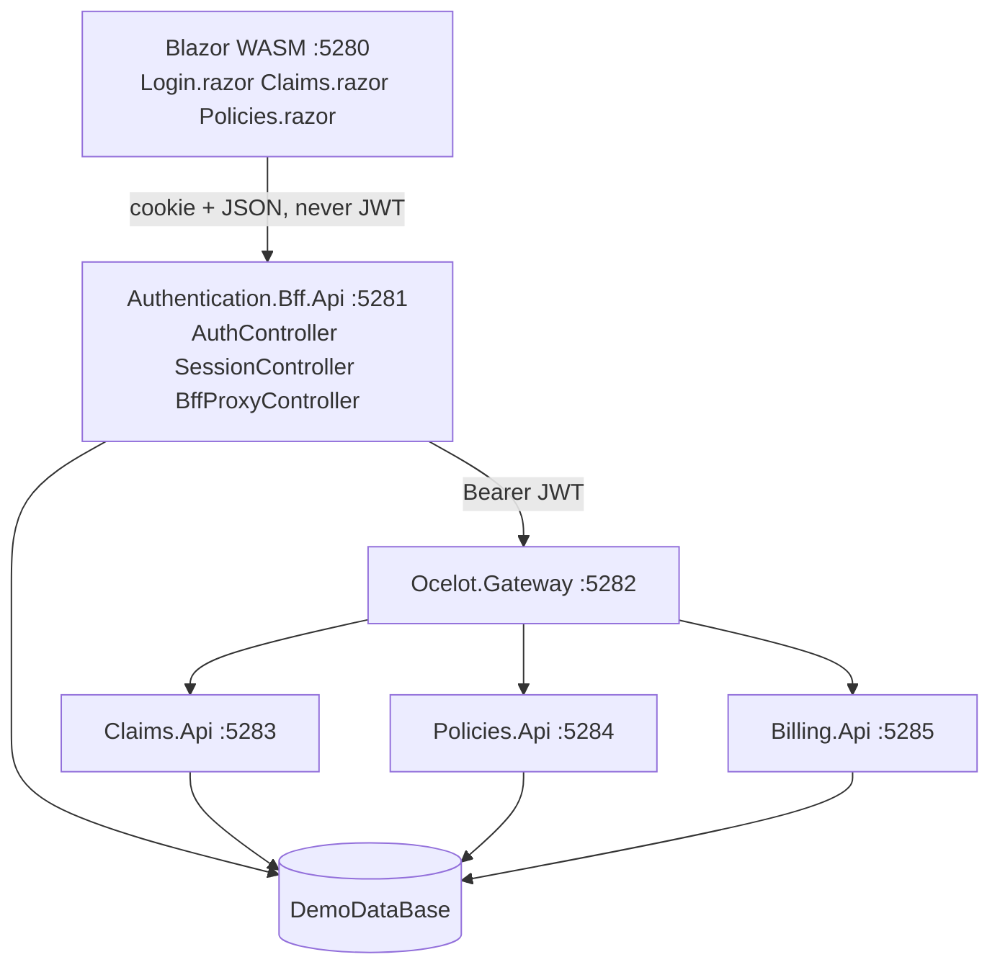
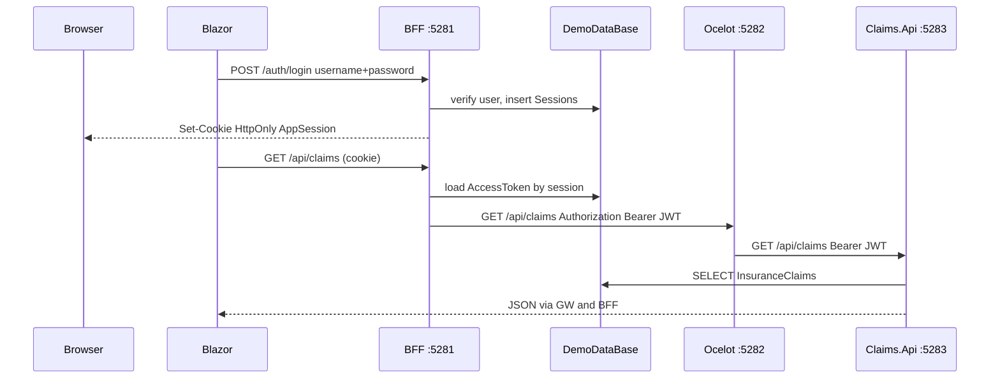

# Insurance Platform — UI, APIs, security, and HttpClientFactory

This document describes `D:\SampleProjects\GenAiUIApi\BffProjectWithCookie`. The Blazor UI never calls Claims, Policies, or Billing directly. It talks only to the BFF. The BFF holds the JWT and calls Ocelot. Ocelot routes to the domain APIs.

## 1. What runs where

| Process | Project | Port | Who calls it |
|---|---|---|---|
| Browser / Blazor WASM | `Insurance.UI.BlazorWasm` | 5280 | The user |
| Authentication / BFF API | `Authentication.Bff.Api` | 5281 | The Blazor UI only |
| API gateway | `Ocelot.Gateway` | 5282 | The BFF only |
| Claims API | `Claims.Api` | 5283 | Ocelot |
| Policies API | `Policies.Api` | 5284 | Ocelot |
| Billing API | `Billing.Api` | 5285 | Ocelot |
| SQL Server | LocalDB `DemoDataBase` | — | BFF and the three domain APIs |

Shared libraries:

- `Insurance.Contracts` — DTOs (`LoginRequest`, `SessionUserDto`, `InsuranceClaimDto`, `InsurancePolicyDto`, `InvoiceDto`, permission keys). Every API and the UI reference this project.
- `Insurance.Helpers` — `SqlCommandExecutor`, `PasswordHasher`, `JwtTokenFactory`, `CookieSettings`, JWT registration.



## 2. Which UI method calls which API

The Blazor `HttpClient` base address is `http://localhost:5281` (`wwwroot/appsettings.json` → `BffBaseUrl`). Every path below is on the BFF.

| UI page / service | HTTP from browser | BFF controller | Then BFF calls | Downstream API |
|---|---|---|---|---|
| `AuthService.LoginAsync` | `POST /auth/login` | `AuthController.Login` | SQL only | none |
| `ApiAuthenticationStateProvider` | `GET /auth/me` | `SessionController.Me` | SQL session + roles | none |
| `AuthService.LogoutAsync` | `POST /auth/logout` | `AuthController.Logout` | SQL delete session | none |
| `ClaimsService.GetAsync` | `GET /api/claims` | `BffProxyController.Forward` | Ocelot `GET /api/claims` | `ClaimsController.Get` |
| `ClaimsService.ApproveAsync` | `POST /api/claims/{id}/approve` | `BffProxyController.Forward` | Ocelot | `ClaimsController.Approve` |
| `ClaimsService.DeleteAsync` | `DELETE /api/claims/{id}` | `BffProxyController.Forward` | Ocelot | `ClaimsController.Delete` |
| `PoliciesService.GetAsync` | `GET /api/policies` | `BffProxyController.Forward` | Ocelot | `PoliciesController.Get` |
| `PoliciesService.CreateAsync` | `POST /api/policies` | `BffProxyController.Forward` | Ocelot | `PoliciesController.Create` |

There is no Blazor billing page yet. A future page would call `GET /api/billing` on the BFF, which forwards to `BillingController`.

Ocelot maps those paths in `ocelot.json`:

- `/api/claims` → `localhost:5283`
- `/api/policies` → `localhost:5284`
- `/api/billing` → `localhost:5285`

## 3. How code executes — login (Flow A)

1. User opens `/login` (`Login.razor`). `[AllowAnonymous]` lets this page load without a session.
2. Submit calls `AuthService.LoginAsync`. `CookieHandler` sets `BrowserRequestCredentials.Include` so the browser will store `Set-Cookie`.
3. `POST http://localhost:5281/auth/login` body `{ "userName": "Praveen", "password": "Password@123" }`.
4. `AuthController` → `LoginService.SignInAsync`:
   - Load `dbo.Users` by user name.
   - `PasswordHasher.Verify` (PBKDF2).
   - Load roles from `UserRoles` / `Roles`.
   - Load permissions from `RolePermissions` / `Permissions`.
   - `TokenService` / `JwtTokenFactory` creates an access JWT with `role` and `permission` claims.
   - `SessionService` inserts `dbo.Sessions` (session id, SHA-256 of the opaque cookie token, access JWT, refresh token, expiry).
5. Response is `200 OK` plus `Set-Cookie`. On HTTP localhost the cookie name is `AppSession`. On HTTPS it is `__Host-AppSession`. Flags: `HttpOnly`, `Path=/`, `SameSite=Lax`, `Secure` only when HTTPS.
6. Cookie value is `{sessionId}.{rawToken}`. JavaScript and Blazor cannot read `HttpOnly`. The browser stores it and sends it on later requests to `:5281`.
7. `ApiAuthenticationStateProvider.NotifySignedIn` builds a `ClaimsPrincipal` from the JSON body (`userName`, `roles`, `permissions`) so menus can render. That principal is UI state only.
8. Navigation goes to `/` (dashboard).

## 4. How code executes — current user (Flow B)

1. `App.razor` wraps the router in `CascadingAuthenticationState`.
2. `ApiAuthenticationStateProvider.GetAuthenticationStateAsync` calls `GET /auth/me`.
3. The browser attaches the session cookie automatically.
4. `SessionController` hashes the raw token, loads `dbo.Sessions`, and returns `{ userName, roles, permissions }`.
5. Admin menus use `AuthorizeView Roles="Admin"`. Approve/Delete buttons use `AuthorizeView Policy="Claims.Approve"` / `Claims.Delete`.
6. Hiding a button is not security. The Claims API still checks the JWT permission on every POST/DELETE.

## 5. How code executes — get claims (Flow C)

1. `Claims.razor` `[Authorize]` requires a signed-in principal. Then `ClaimsService.GetAsync` calls `GET /api/claims` on the BFF.
2. `BffProxyController.Forward`:
   - Rejects if the cookie is missing or the session row is expired → `401`.
   - Reads `AccessToken` from `dbo.Sessions`.
   - Creates an HTTP request to `http://localhost:5282/api/claims` with `Authorization: Bearer {jwt}`.
   - Uses `IHttpClientFactory.CreateClient("Gateway")`.
3. Ocelot requires Bearer authentication, then proxies to `Claims.Api`.
4. `ClaimsController.Get` has `[Authorize(Policy = "Claims.View")]`. The JWT must contain claim `permission` = `Claims.View`.
5. `ClaimsService` (API) reads `dbo.InsuranceClaims` through `SqlCommandExecutor`.
6. JSON returns through Ocelot → BFF → Blazor grid.

Approve (Flow D) is the same path with `POST /api/claims/123/approve` and policy `Claims.Approve`. If `Adjuster` is used, Approve can succeed and Delete returns `403` because that role has no `Claims.Delete`.

## 6. How security works

Two tokens, two trust boundaries.

| Piece | Where it lives | Who can see it | Purpose |
|---|---|---|---|
| Session cookie | Browser cookie jar | Browser and BFF only. Not readable by WASM | Proves the browser has a server session |
| Opaque session token | Hash in `dbo.Sessions`; raw value only in the cookie | BFF | Stops someone who stole a session id without the secret |
| Access JWT | `dbo.Sessions.AccessToken` and the `Authorization` header BFF → Ocelot → APIs | BFF and APIs, never the browser | Carries user, roles, permissions for the APIs |
| Refresh token | `dbo.Sessions.RefreshToken` | BFF | Reserved for later rotation |

Rules implemented:

- CORS on the BFF allows only `http://localhost:5280` with `AllowCredentials()`. A `*` origin cannot be used with cookies.
- WASM `CookieHandler` is required. Without `credentials: include`, the browser will not send or save the cookie on a different port.
- Domain APIs do not accept the cookie. They accept only JWT.
- Ocelot `AuthenticationOptions.AuthenticationProviderKey` is `Bearer`, same scheme as `AddJwtBearer`.
- Permission policies are registered in `Insurance.Helpers.JwtAuthentication.AddInsuranceJwt` and again in the WASM `AddAuthorizationCore` so UI policies match API policies.
- Passwords are PBKDF2 hashes in `dbo.Users`, not plain text.



## 7. How HttpClientFactory works in this solution

`IHttpClientFactory` does not create one `HttpClient` for the whole process and keep it forever. It creates named clients with a handler pipeline. Handlers are pooled and recycled so DNS and sockets stay healthy.

There are two factories: one in the browser (WASM) and one in the BFF process.

### 7.1 Blazor WASM — named client `Bff`

Registration in `Insurance.UI.BlazorWasm/Program.cs`:

```csharp
builder.Services.AddTransient<CookieHandler>();
builder.Services.AddHttpClient("Bff", client => client.BaseAddress = new Uri(bff))
    .AddHttpMessageHandler<CookieHandler>();
builder.Services.AddScoped(sp =>
    sp.GetRequiredService<IHttpClientFactory>().CreateClient("Bff"));
```

What happens at runtime:

1. `AddHttpClient("Bff")` stores a named configuration: base address `http://localhost:5281`.
2. `AddHttpMessageHandler<CookieHandler>()` inserts a `DelegatingHandler` in front of the inner handler.
3. `AuthService`, `ClaimsService`, and `PoliciesService` take `HttpClient` in the constructor. The container injects the named `Bff` client from `CreateClient("Bff")`.
4. On each call, `CookieHandler.SendAsync` runs first and sets `BrowserRequestCredentials.Include`. The WASM inner handler uses the browser `fetch` API, so the cookie for port 5281 is sent and `Set-Cookie` from login is stored.
5. WASM never puts a JWT on this client. There is no access token in JavaScript.

If you used `new HttpClient()` in each service:

- You would duplicate the base address.
- You would forget credentials on some calls.
- In a server app, long-lived `HttpClient` instances can exhaust sockets. Factory pooling avoids that. In WASM the main win is the named pipeline (cookie handler + base URL).

### 7.2 BFF — named client `Gateway`

Registration in `Authentication.Bff.Api/Program.cs`:

```csharp
builder.Services.AddHttpClient("Gateway", client => client.Timeout = TimeSpan.FromSeconds(30));
```

Use in `BffProxyController`:

```csharp
var client = _http.CreateClient("Gateway");
var response = await client.SendAsync(message);
```

What happens at runtime:

1. `IHttpClientFactory` is injected into `BffProxyController`.
2. `CreateClient("Gateway")` returns an `HttpClient` whose handler comes from the factory pool.
3. The controller sets `Authorization: Bearer {accessToken}` on that request only. The JWT is not a default header on the client, so it cannot leak onto a wrong URL.
4. Timeout 30 seconds is applied to every gateway call without copying it in the controller.
5. The factory rotates the inner `SocketsHttpHandler` (about every two minutes by default) so DNS changes and idle sockets are cleaned up.

Do not store that `HttpClient` in a static field. Create it per operation with `CreateClient`.

### 7.3 Factory compared with `new HttpClient()`

| | `new HttpClient()` | `IHttpClientFactory` named client |
|---|---|---|
| Base address | Set in every class | Set once in `Program.cs` |
| Cookie / JWT pipeline | Easy to forget | `CookieHandler` or per-request Bearer |
| Sockets (server) | Can exhaust if disposed badly or never disposed | Handler pool |
| Timeouts | Copied everywhere | One registration |
| This solution | Not used | WASM name `Bff`, BFF name `Gateway` |

### 7.4 Call chain for one claims GET

```
Claims.razor
  -> ClaimsService (injected HttpClient = factory "Bff")
    -> CookieHandler (credentials include)
      -> browser fetch http://localhost:5281/api/claims
        -> BffProxyController
          -> IHttpClientFactory.CreateClient("Gateway")
            -> http://localhost:5282/api/claims + Bearer JWT
              -> Ocelot
                -> Claims.Api ClaimsController
```

## 8. Demo users and permissions

| User | Password | Role | Can view claims | Can approve | Can delete |
|---|---|---|---|---|---|
| Praveen | Password@123 | Admin | yes | yes | yes |
| Adjuster | Password@123 | ClaimsAdjuster | yes | yes | no (API returns 403) |

Open http://localhost:5280/login after starting Billing, Policies, Claims, Gateway, BFF, then the UI.
