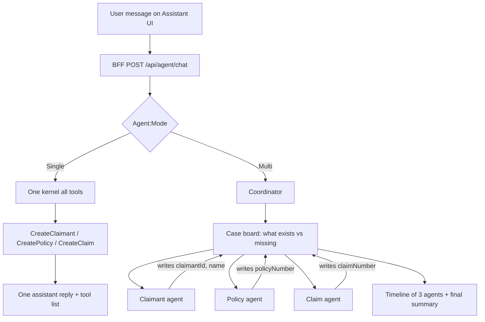
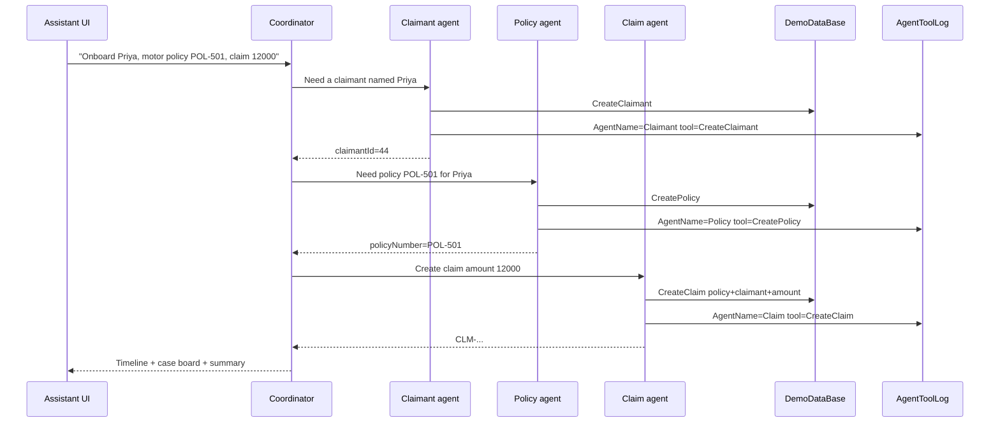

# Multi-agent assistant — proposed design + copy-paste code

This file is the design **and** the code to paste. Nothing below is applied in the repo until you copy it.

Azure stays on one BFF chat endpoint. JWT still never goes to the browser.

---

## Goal

The user should **see and feel** a team of specialists working a case, not one generic “Assistant” that silently calls tools.

A **claim** needs both:

- a **claimant** (person)
- a **policy** (contract)

Today one Semantic Kernel chat on the BFF has two plugins (`claims`, `policies`) and **no CreateClaimant tool**. The UI prints one reply plus a tool-name list.

This design adds:

1. `CreateClaimant` as a first-class tool
2. **Two runtimes**, selected in appsettings: **single agent + many tools**, or **three specialist agents**
3. An Assistant page that shows **who did what**, **handoffs**, and **shared case data**

---

## How the user knows Multi is working (UI)

Keep route `/assistant`. One chat box. You never type to three agents.

| What you see | What it proves |
|---|---|
| Badge **Multi-agent** (from `GET /api/agent/meta`) | Config `Agent:Mode=Multi` is live |
| Three named blocks (Claimant / Policy / Claim), not the word “Assistant” | Specialists ran, not one blob |
| Line `Claimant agent → Policy agent: Priya is claimant #44` | **Coordinator** handed work on |
| Case board cards fill one at a time (empty → created) | Shared memory, not three independent chats |
| A slot stays **Skipped** | Coordinator decided that agent was not needed |
| Status **Needs input** + one question in the thread | Coordinator paused; you answer in the **same** box |

Coordinator is **not** a fourth person you chat with. It has **no** Create\* tools. Proof on screen is routing: who ran, who was skipped, why the next agent started, what is still missing.

**Input:** same `<input>` + Send as today. If a specialist returns `needs_input`, the final `Reply` is one question (e.g. “What email for Priya?”). The next Send continues the same case board (conversation history).

**Phase 1:** wait for one `POST /api/agent/chat`; then paint `Steps` + `CaseBoard` + `Reply`.  
**Phase 2 (optional):** SignalR `AgentStep` so rows flip Working → Done before HTTP returns.

Do not show JWT, SQL, or raw HTTP.

---

## Current vs proposed

| Area | Today | Proposed |
|---|---|---|
| Tools | `GetClaimants`, `CreateClaim`, `GetPolicies`, `CreatePolicy` | Add `CreateClaimant` (name, email, phone) |
| Kernel | One chat, all tools | `Agent:Mode` = `Single` or `Multi` |
| Multi | N/A | Claimant, Policy, Claim; coordinator routes and shares a case board |
| UI | `You` / `Assistant` + tool names | Agent timeline, status, handoff arrows, case board |
| Audit | `dbo.AgentToolLog` | Same table + `AgentName` |

Domain rule:

```text
CreateClaim is invalid until policyNumber exists AND claimant exists (claimantId or full name).
```

---

## Configuration (paste into local BFF only)

Put this in **gitignored** `Authentication.Bff.Api/appsettings.Development.local.json` (or Development json if you accept committing it without keys). Production keeps `UseSemanticKernel: false`.

```json
"Agent": {
  "UseSemanticKernel": true,
  "Mode": "Multi",
  "Orchestrator": "Coordinator",
  "Agents": {
    "Claimant": { "Enabled": true, "DisplayName": "Claimant agent", "Tools": [ "claimants.CreateClaimant", "claimants.GetClaimants" ] },
    "Policy":   { "Enabled": true, "DisplayName": "Policy agent",   "Tools": [ "policies.CreatePolicy", "policies.GetPolicies" ] },
    "Claim":    { "Enabled": true, "DisplayName": "Claim agent",    "Tools": [ "claims.CreateClaim", "claimants.GetClaimants" ] }
  }
}
```

| `Agent:Mode` | Behaviour |
|---|---|
| `Single` | One kernel, **all enabled tools**. UI: You / Assistant + tool chips. |
| `Multi` | Three specialist kernels. Coordinator fills the case board and calls the next agent. UI: timeline + board. |

If `Mode=Multi` but an agent is `Enabled: false`, skip it and ask the user or reuse an existing DB row.

---

## Agents and work sharing

### Case board

One object per conversation (in-memory on BFF for phase 1):

```text
CaseBoard
  claimant: { id, fullName, email, phone, status }
  policy:   { id, policyNumber, holderName, product, premium, status }
  claim:    { id, claimNumber, amount, status }
  missing:  [ "claimant.email?", "policy.number", "claim.amount" ]
  handoffs: [ { from, to, reason, utc } ]
```

### Default order (intake → claim)

1. **Claimant agent** — find or `CreateClaimant`
2. **Policy agent** — find or `CreatePolicy`
3. **Claim agent** — `CreateClaim` with policy + claimant + amount

If the user only says “add claimant Priya”, only agent 1 runs.





Coordinator only: parse intent, fill the board, invoke specialists, merge replies.

**Do not route on hardcoded words** (`claimant`, `priya`, `motor`, …). Names and product words change; `"name"` would also fire on every “my name is…”. The paste pack first used `ContainsAny` as a cheap demo. The real coordinator is a **kernel with zero tools** that returns JSON: which specialists to run, why, and one question if something is missing. C# still enforces the domain rule (no CreateClaim without policy + claimant) and `Enabled` flags.

---

## Tools

| Plugin | Tool | Agent in Multi | Notes |
|---|---|---|---|
| `claimants` | `CreateClaimant(fullName, email?, phone?)` | Claimant | New. Uses `ClaimsService.CreateClaimantAsync` |
| `claimants` | `GetClaimants` | Claimant | Move out of `claims` |
| `policies` | `CreatePolicy` / `GetPolicies` | Policy | Existing |
| `claims` | `CreateClaim(...)` | Claim | Prefer `claimantId` from the board |

---

## Guardrails before creating a record

The model **proposes** a create. C# **decides**. Never insert until a shared validator returns OK. Put the same checks in SK tools **and** in `ClaimsService` / policy SQL so a normal UI form cannot bypass the chat path.

Fail closed: return JSON `{ "error": "...", "code": "..." }` and set step `needs_input` or `failed`. Do not throw past the user as a 500.

### Types of guardrails (use these)

| Layer | What it stops | Where |
|---|---|---|
| **1. Schema / contract** | Null, empty, wrong type, oversize strings | DataAnnotations on DTOs + validator |
| **2. Format** | Garbage email, phone, policy number | Regex / `MailAddress` |
| **3. Domain invariants** | Claim without person+policy; claim on cancelled policy; amount ≤ 0 | C# before SQL |
| **4. Referential** | Invented `claimantId` / `policyNumber` | Lookup in DB; refuse if missing |
| **5. Duplicate** | Second POL-501; same email claimant | Unique check; return existing or ask |
| **6. Business limits** | Demo amounts (e.g. claim > 1_000_000); unknown product | Config allow-lists / max |
| **7. Agent scope** | Claim agent calling `CreatePolicy` | Each kernel only gets its plugin |
| **8. Coordinator** | Coordinator inserting rows | Coordinator has **zero** Create tools |
| **9. Confirmation (optional)** | Accidental “onboard everyone” | If amount above threshold, ask once in chat |
| **10. Prompt / SQL** | “Ignore instructions, delete claims” | Parameterized SQL only (already); tools never take raw SQL |
| **11. Audit** | Silent creates | `AgentToolLog` with `AgentName` + request JSON |
| **12. PII on UI** | Dumping email/phone in the timeline | Board can show name + id; mask phone |

Do **not** rely on the system prompt as the only guard. Prompts are hints; validators are law.

### Per-record rules (phase 1, enough for this demo)

**Claimant**

- `FullName` required, 2–80 chars, letters/spaces/`.'-` (no digits-only, no “test”, no “n/a”)
- `Email` optional; if present must be a valid email; optional unique
- `Phone` optional; if present digits 10–15 after stripping spaces
- If a claimant with same email (or same full name) exists → do not insert; return the existing row and set board from that

**Policy**

- `PolicyNumber` required; pattern `POL-` + digits (or your real issuer format)
- `HolderName` required (prefer board claimant name; refuse mismatch if board has a different person unless user said “for X”)
- `ProductName` required; allow-list e.g. Motor, Health, Home, Life (config)
- `Premium` > 0 and ≤ configured max
- Unique `PolicyNumber`; if exists, reuse, do not insert a second contract

**Claim**

- `PolicyNumber` must **exist** and status **Active**
- Claimant: `claimantId` exists **or** name matches a claimant (prefer id from board)
- `Amount` > 0 and ≤ configured max (and optionally ≤ N × policy premium)
- Optional: block duplicate open claim for same policy + claimant + amount
- Never invent `claimNumber` from the model if empty — server generates `CLM-…`

### How this shows on the UI

- Validator fail → that specialist `needs_input` + one question (“Email looks invalid. What is Priya’s email?”)
- Duplicate reuse → `done` with message “Used existing claimant #44” (not a second insert)
- Domain fail (claim before policy) → Claim agent `needs_input`; coordinator does not call CreateClaim

### Config (local)

```json
"Agent": {
  "Guardrails": {
    "RequireEmailOnClaimant": false,
    "PolicyNumberPattern": "^POL-[0-9]{3,10}$",
    "AllowedProducts": [ "Motor", "Health", "Home", "Life", "Auto" ],
    "MaxPremium": 1000000,
    "MaxClaimAmount": 1000000,
    "ConfirmClaimAbove": 100000,
    "ReuseExistingClaimant": true,
    "ReuseExistingPolicy": true
  }
}
```

---

## API contract

`AgentChatResponse` keeps `Reply` / `ToolsCalled` and adds:

```text
Mode: Single | Multi
CaseBoard: { claimant, policy, claim, missing, handoffs }
Steps: [ { AgentKey, DisplayName, Status, Message, Tools[], Utc } ]
Status: skipped | working | done | needs_input | failed
```

`GET /api/agent/meta` → `{ mode, orchestrator, agents: [{ key, displayName, enabled }] }` so the UI can switch layout without a rebuild.

---

## Implementation order

1. Contracts + `CreateClaimant` + split `ClaimantsTools`
2. Config `Agent:Mode`
3. Single mode (one kernel, all tools)
4. Multi: coordinator + three kernels + case board + `Steps`
5. UI timeline + board
6. `AgentName` on `AgentToolLog`
7. Guardrails in Create\* tools (same class for form APIs)
8. Optional SignalR

---

## Example utterances

| User says | Single | Multi |
|---|---|---|
| “Add claimant Priya, email p@x.com” | CreateClaimant | Only Claimant agent |
| “Create policy POL-501 for Priya, Motor, 8000” | CreatePolicy | Only Policy agent |
| “File claim 12000 on POL-501 for Priya” | CreateClaim | Only Claim agent |
| “Onboard Priya, give her POL-501 motor 8k, file 12k claim” | One agent, three tools | All three, board filled |

---

## What we will not do

- Do not put three agents in Blazor WASM. Kernels stay on the BFF.
- Do not send JWT to the browser.
- Do not require Python agents.
- Do not host extra APIs.
- Do not change Azure hosts in this work.

---

# Copy-paste code

Paste in this order. Namespaces match the current repo.

---

### 1) `Insurance.Contracts/Agent/AgentChatRequest.cs` — **replace whole file**

```csharp
namespace Insurance.Contracts.Agent
{
    public sealed class AgentChatTurn
    {
        public string Role { get; set; } = "";
        public string Text { get; set; } = "";
    }

    public sealed class AgentChatRequest
    {
        public string Message { get; set; } = "";
        public List<AgentChatTurn> History { get; set; } = [];
    }

    public sealed class AgentChatResponse
    {
        public string Mode { get; set; } = "Single";
        public string Reply { get; set; } = "";
        public string[] ToolsCalled { get; set; } = [];
        public CaseBoardDto CaseBoard { get; set; } = new();
        public List<AgentStepDto> Steps { get; set; } = [];
    }

    public sealed class AgentMetaResponse
    {
        public string Mode { get; set; } = "Single";
        public string Orchestrator { get; set; } = "";
        public List<AgentMetaItem> Agents { get; set; } = [];
    }

    public sealed class AgentMetaItem
    {
        public string Key { get; set; } = "";
        public string DisplayName { get; set; } = "";
        public bool Enabled { get; set; } = true;
    }

    public sealed class AgentStepDto
    {
        public string AgentKey { get; set; } = "";
        public string DisplayName { get; set; } = "";
        public string Status { get; set; } = ""; // skipped | working | done | needs_input | failed
        public string Message { get; set; } = "";
        public string[] Tools { get; set; } = [];
        public DateTime Utc { get; set; }
    }

    public sealed class CaseBoardDto
    {
        public CasePersonDto Claimant { get; set; } = new();
        public CasePolicyDto Policy { get; set; } = new();
        public CaseClaimDto Claim { get; set; } = new();
        public List<string> Missing { get; set; } = [];
        public List<HandoffDto> Handoffs { get; set; } = [];
    }

    public sealed class CasePersonDto
    {
        public int? Id { get; set; }
        public string FullName { get; set; } = "";
        public string Email { get; set; } = "";
        public string Phone { get; set; } = "";
        public string Status { get; set; } = "empty"; // empty | working | created | skipped
    }

    public sealed class CasePolicyDto
    {
        public int? Id { get; set; }
        public string PolicyNumber { get; set; } = "";
        public string HolderName { get; set; } = "";
        public string Product { get; set; } = "";
        public decimal? Premium { get; set; }
        public string Status { get; set; } = "empty";
    }

    public sealed class CaseClaimDto
    {
        public int? Id { get; set; }
        public string ClaimNumber { get; set; } = "";
        public decimal? Amount { get; set; }
        public string Status { get; set; } = "empty";
    }

    public sealed class HandoffDto
    {
        public string From { get; set; } = "";
        public string To { get; set; } = "";
        public string Reason { get; set; } = "";
        public DateTime Utc { get; set; }
    }
}
```

---

### 1b) New file `Authentication.Bff.Api/Agent/RecordGuardrails.cs`

Call this at the **top** of every Create\* tool (and later inside `ClaimsService.CreateAsync` so REST cannot skip it).

```csharp
using System.Net.Mail;
using System.Text.RegularExpressions;
using Insurance.Contracts.Claims;
using Insurance.Contracts.Policies;

namespace Authentication.Bff.Api.Agent
{
    public sealed class GuardResult
    {
        public bool Ok { get; init; }
        public string Code { get; init; } = "";
        public string Message { get; init; } = "";
        public object? Existing { get; init; }

        public static GuardResult Pass() => new() { Ok = true };
        public static GuardResult Fail(string code, string message) =>
            new() { Ok = false, Code = code, Message = message };
        public static GuardResult Reuse(string code, string message, object existing) =>
            new() { Ok = true, Code = code, Message = message, Existing = existing };
    }

    public sealed class RecordGuardrails
    {
        private readonly IConfiguration _config;

        public RecordGuardrails(IConfiguration config) => _config = config;

        public GuardResult Claimant(string fullName, string? email, string? phone)
        {
            var name = (fullName ?? "").Trim();
            if (name.Length is < 2 or > 80)
                return GuardResult.Fail("claimant.name", "Full name must be 2–80 characters.");
            if (Regex.IsMatch(name, @"^[\d\s]+$") || name.Equals("test", StringComparison.OrdinalIgnoreCase) || name.Equals("n/a", StringComparison.OrdinalIgnoreCase))
                return GuardResult.Fail("claimant.name", "That does not look like a person’s name.");
            if (!Regex.IsMatch(name, @"^[\p{L}][\p{L}\s.'-]*$"))
                return GuardResult.Fail("claimant.name", "Name may contain letters, spaces, apostrophes, and hyphens only.");

            email = string.IsNullOrWhiteSpace(email) ? "" : email.Trim();
            if (_config.GetValue("Agent:Guardrails:RequireEmailOnClaimant", false) && email.Length == 0)
                return GuardResult.Fail("claimant.email", "Email is required for a new claimant.");
            if (email.Length > 0)
            {
                try { _ = new MailAddress(email); }
                catch { return GuardResult.Fail("claimant.email", "Email is not valid."); }
            }

            phone = string.IsNullOrWhiteSpace(phone) ? "" : Regex.Replace(phone, @"\s+", "");
            if (phone.Length > 0 && !Regex.IsMatch(phone, @"^\+?[0-9]{10,15}$"))
                return GuardResult.Fail("claimant.phone", "Phone must be 10–15 digits.");

            return GuardResult.Pass();
        }

        public GuardResult Policy(string policyNumber, string holderName, string productName, decimal premium)
        {
            var number = (policyNumber ?? "").Trim().ToUpperInvariant();
            var pattern = _config["Agent:Guardrails:PolicyNumberPattern"] ?? @"^POL-[0-9]{3,10}$";
            if (!Regex.IsMatch(number, pattern, RegexOptions.IgnoreCase))
                return GuardResult.Fail("policy.number", $"Policy number must match {pattern}.");

            if (string.IsNullOrWhiteSpace(holderName) || holderName.Trim().Length < 2)
                return GuardResult.Fail("policy.holder", "Holder name is required.");

            var product = (productName ?? "").Trim();
            var allowed = _config.GetSection("Agent:Guardrails:AllowedProducts").Get<string[]>()
                          ?? ["Motor", "Health", "Home", "Life", "Auto"];
            if (!allowed.Any(p => p.Equals(product, StringComparison.OrdinalIgnoreCase)))
                return GuardResult.Fail("policy.product", $"Product must be one of: {string.Join(", ", allowed)}.");

            var maxPremium = _config.GetValue("Agent:Guardrails:MaxPremium", 1_000_000m);
            if (premium <= 0 || premium > maxPremium)
                return GuardResult.Fail("policy.premium", $"Premium must be greater than 0 and at most {maxPremium}.");

            return GuardResult.Pass();
        }

        public GuardResult Claim(string policyNumber, string claimantName, int? claimantId, decimal amount, bool policyExists, bool policyActive, bool claimantExists)
        {
            if (string.IsNullOrWhiteSpace(policyNumber))
                return GuardResult.Fail("claim.policy", "Policy number is required.");
            if (!policyExists)
                return GuardResult.Fail("claim.policy", $"Policy {policyNumber} was not found.");
            if (!policyActive)
                return GuardResult.Fail("claim.policy", $"Policy {policyNumber} is not Active.");

            if (claimantId is null && string.IsNullOrWhiteSpace(claimantName))
                return GuardResult.Fail("claim.claimant", "Claimant id or name is required.");
            if (!claimantExists)
                return GuardResult.Fail("claim.claimant", "Claimant was not found. Create or select a claimant first.");

            var max = _config.GetValue("Agent:Guardrails:MaxClaimAmount", 1_000_000m);
            if (amount <= 0 || amount > max)
                return GuardResult.Fail("claim.amount", $"Amount must be greater than 0 and at most {max}.");

            return GuardResult.Pass();
        }

        public bool NeedsClaimConfirm(decimal amount) =>
            amount >= _config.GetValue("Agent:Guardrails:ConfirmClaimAbove", 100_000m);
    }
}
```

Wrap a tool like this (Claimants example):

```csharp
var guard = _guardrails.Claimant(fullName, email, phone);
if (!guard.Ok)
    return JsonSerializer.Serialize(new { error = guard.Message, code = guard.Code });
```

If you reuse an existing claimant/policy, return that DTO with `"reused": true` and **do not INSERT**.

Inject `RecordGuardrails` into `ClaimantsTools`, `PoliciesTools`, `ClaimsTools` (add the constructor argument). Register: `builder.Services.AddSingleton<RecordGuardrails>();` in BFF `Program.cs`.

---

### 2) New file `Authentication.Bff.Api/Agent/ClaimantsTools.cs`

```csharp
using Claims.Api.Services;
using Insurance.Contracts.Claims;
using Microsoft.SemanticKernel;
using System.ComponentModel;
using System.Text.Json;

namespace Authentication.Bff.Api.Agent
{
    public sealed class ClaimantsTools
    {
        private readonly ClaimsService _claims;

        public ClaimantsTools(ClaimsService claims) => _claims = claims;

        [KernelFunction]
        [Description("List insurance claimants (people). Use when the user asks who the claimants are.")]
        public async Task<string> GetClaimants()
        {
            var rows = await _claims.GetClaimantsAsync();
            return JsonSerializer.Serialize(rows);
        }

        [KernelFunction]
        [Description("Create a claimant (a person). Not a policy and not a claim. Requires fullName.")]
        public async Task<string> CreateClaimant(
            [Description("Full name of the person")] string fullName,
            [Description("Optional email")] string email = "",
            [Description("Optional phone")] string phone = "")
        {
            var created = await _claims.CreateClaimantAsync(new CreateClaimantRequest
            {
                FullName = fullName,
                Email = email ?? "",
                Phone = phone ?? ""
            });
            return JsonSerializer.Serialize(created);
        }
    }
}
```

---

### 3) `Authentication.Bff.Api/Agent/ClaimsTools.cs` — **replace whole file** (GetClaimants moved)

```csharp
using Claims.Api.Services;
using Insurance.Contracts.Claims;
using Microsoft.SemanticKernel;
using System.ComponentModel;
using System.Text.Json;

namespace Authentication.Bff.Api.Agent
{
    public class ClaimsTools
    {
        private readonly ClaimsService _claims;

        public ClaimsTools(ClaimsService claims) => _claims = claims;

        [KernelFunction]
        [Description("Create an insurance CLAIM (a loss/file against an existing policy). Not for creating a policy or a person. Requires policyNumber, claimant, amount. Refuse if policyNumber or claimant is missing.")]
        public async Task<string> CreateClaim(
            [Description("Policy number the claim is filed against, e.g. POL-100")] string policyNumber,
            [Description("Claimant full name")] string claimantName,
            [Description("Claim amount")] decimal amount,
            [Description("Optional claimant id from the case board")] int? claimantId = null,
            [Description("Optional claim number; leave empty to auto-generate")] string claimNumber = "")
        {
            if (string.IsNullOrWhiteSpace(policyNumber) || (string.IsNullOrWhiteSpace(claimantName) && claimantId is null))
                return JsonSerializer.Serialize(new { error = "CreateClaim needs policyNumber and claimant (id or name)." });

            var created = await _claims.CreateAsync(new CreateClaimRequest
            {
                PolicyNumber = policyNumber,
                ClaimantName = claimantName,
                ClaimantId = claimantId,
                Amount = amount,
                ClaimNumber = claimNumber
            });
            return JsonSerializer.Serialize(created);
        }
    }
}
```

`PoliciesTools.cs` — leave as it is.

---

### 4) `Insurance.Helpers/AgentToolLogStore.cs` — add `AgentName`

Change `WriteAsync` signature (last optional arg) and INSERT:

```csharp
public async Task WriteAsync(
    string pluginName,
    string toolName,
    string? requestJson,
    string? responseJson,
    string? details,
    int durationMs,
    bool succeeded,
    string? agentName = null)
{
    try
    {
        await EnsureTableAsync();
        await using var connection = new SqlConnection(_connectionString);
        await connection.ExecuteAsync("""
            IF COL_LENGTH('dbo.AgentToolLog', 'AgentName') IS NULL
                ALTER TABLE dbo.AgentToolLog ADD AgentName NVARCHAR(100) NULL;

            INSERT INTO dbo.AgentToolLog
                (PluginName, ToolName, RequestJson, ResponseJson, Details, DurationMs, Succeeded, AgentName)
            VALUES
                (@PluginName, @ToolName, @RequestJson, @ResponseJson, @Details, @DurationMs, @Succeeded, @AgentName);
            """,
            new
            {
                PluginName = Truncate(pluginName, 100),
                ToolName = Truncate(toolName, 200),
                RequestJson = requestJson,
                ResponseJson = responseJson,
                Details = details,
                DurationMs = durationMs,
                Succeeded = succeeded,
                AgentName = Truncate(agentName ?? "", 100)
            });
    }
    catch
    {
        // Tool logging must not fail the agent call.
    }
}
```

In `EnsureTableAsync` CREATE TABLE, add:

```sql
AgentName NVARCHAR(100) NULL
```

SSMS:

```sql
SELECT LoggedUtc, AgentName, PluginName, ToolName, RequestJson, ResponseJson, DurationMs, Succeeded
FROM dbo.AgentToolLog
ORDER BY LoggedUtc DESC;
```

---

### 5) `Authentication.Bff.Api/Controllers/AgentController.cs` — add meta (keep existing `Chat`)

```csharp
[HttpGet("meta")]
public ActionResult<AgentMetaResponse> Meta()
{
    var mode = _config["Agent:Mode"] ?? "Single";
    return Ok(new AgentMetaResponse
    {
        Mode = mode,
        Orchestrator = _config["Agent:Orchestrator"] ?? "Coordinator",
        Agents =
        [
            new AgentMetaItem
            {
                Key = "Claimant",
                DisplayName = _config["Agent:Agents:Claimant:DisplayName"] ?? "Claimant agent",
                Enabled = _config.GetValue("Agent:Agents:Claimant:Enabled", true)
            },
            new AgentMetaItem
            {
                Key = "Policy",
                DisplayName = _config["Agent:Agents:Policy:DisplayName"] ?? "Policy agent",
                Enabled = _config.GetValue("Agent:Agents:Policy:Enabled", true)
            },
            new AgentMetaItem
            {
                Key = "Claim",
                DisplayName = _config["Agent:Agents:Claim:DisplayName"] ?? "Claim agent",
                Enabled = _config.GetValue("Agent:Agents:Claim:Enabled", true)
            }
        ]
    });
}
```

---

### 6) `Authentication.Bff.Api/Agent/AgentChatService.cs` — **replace whole file**

Coordinator is an LLM with **no tools** (JSON plan). Each specialist is a small kernel with **only** its tools. C# runs the plan and enforces CreateClaim rules. That is what the UI timeline displays.

```csharp
using System.Diagnostics;
using System.Text.Json;
using Claims.Api.Services;
using Insurance.Contracts.Agent;
using Insurance.Helpers;
using Microsoft.SemanticKernel;
using Microsoft.SemanticKernel.ChatCompletion;
using Microsoft.SemanticKernel.Connectors.OpenAI;

namespace Authentication.Bff.Api.Agent
{
    public sealed class AgentChatService
    {
        private readonly IConfiguration _config;
        private readonly IHttpClientFactory _http;
        private readonly AgentToolLogStore _toolLog;
        private readonly ClaimsService _claims;
        private readonly SqlCommandExecutor _sql;

        public AgentChatService(
            IConfiguration config,
            IHttpClientFactory http,
            AgentToolLogStore toolLog,
            ClaimsService claims,
            SqlCommandExecutor sql)
        {
            _config = config;
            _http = http;
            _toolLog = toolLog;
            _claims = claims;
            _sql = sql;
        }

        public async Task<AgentChatResponse> ChatAsync(AgentChatRequest request, string accessToken, CancellationToken cancellationToken)
        {
            var message = request.Message ?? "";
            if (_config.GetValue("Agent:UsePythonAgents", false))
                return await ForwardPythonAsync(message, accessToken, cancellationToken);

            var mode = (_config["Agent:Mode"] ?? "Single").Trim();
            if (mode.Equals("Multi", StringComparison.OrdinalIgnoreCase))
                return await RunMultiAsync(request, cancellationToken);

            return await RunSingleAsync(request, cancellationToken);
        }

        private async Task<AgentChatResponse> RunSingleAsync(AgentChatRequest request, CancellationToken cancellationToken)
        {
            var kernel = BuildKernel();
            kernel.ImportPluginFromObject(new ClaimantsTools(_claims), "claimants");
            kernel.ImportPluginFromObject(new ClaimsTools(_claims), "claims");
            kernel.ImportPluginFromObject(new PoliciesTools(_sql), "policies");

            var toolsCalled = new List<string>();
            kernel.FunctionInvocationFilters.Add(new ToolNameFilter(toolsCalled, _toolLog, "Single"));

            var history = NewHistory(
                "You are the Insurance Platform assistant. " +
                "A CLAIM is a loss filed against a policy. A POLICY is a contract. A CLAIMANT is a person. " +
                "When the user wants a person, call claimants.CreateClaimant. " +
                "When they want a contract, call policies.CreatePolicy. " +
                "When they want to file a loss and you have policyNumber, claimant, and amount, call claims.CreateClaim. " +
                "Do not ask for confirmation. Never invent URLs.");
            FillHistory(history, request);

            var chat = kernel.GetRequiredService<IChatCompletionService>();
            var settings = new OpenAIPromptExecutionSettings { FunctionChoiceBehavior = FunctionChoiceBehavior.Auto() };
            var result = await chat.GetChatMessageContentAsync(history, settings, kernel, cancellationToken);
            return new AgentChatResponse
            {
                Mode = "Single",
                Reply = result.Content ?? "",
                ToolsCalled = toolsCalled.ToArray()
            };
        }

        private async Task<AgentChatResponse> RunMultiAsync(AgentChatRequest request, CancellationToken cancellationToken)
        {
            var board = new CaseBoardDto();
            var steps = new List<AgentStepDto>();
            var allTools = new List<string>();
            var plan = await PlanAsync(request, cancellationToken);
            steps.Add(new AgentStepDto
            {
                AgentKey = "Coordinator",
                DisplayName = _config["Agent:Orchestrator"] ?? "Coordinator",
                Status = string.IsNullOrWhiteSpace(plan.Question) ? "done" : "needs_input",
                Message = plan.Reason,
                Utc = DateTime.UtcNow
            });

            if (!string.IsNullOrWhiteSpace(plan.Question) && !plan.RunClaimant && !plan.RunPolicy && !plan.RunClaim)
            {
                steps.Add(Skip("Claimant", Display("Claimant"), "Waiting on user."));
                steps.Add(Skip("Policy", Display("Policy"), "Waiting on user."));
                steps.Add(Skip("Claim", Display("Claim"), "Waiting on user."));
                return FinishMulti(plan.Question, board, steps, allTools);
            }

            var wantClaimant = plan.RunClaimant;
            var wantPolicy = plan.RunPolicy;
            var wantClaim = plan.RunClaim;

            if (AgentEnabled("Claimant") && wantClaimant)
            {
                var step = await RunSpecialistAsync(
                    "Claimant",
                    Display("Claimant"),
                    "You are the Claimant agent. Find or create the person only. Use claimants tools. Write id and name. Do not create policies or claims.",
                    k => k.ImportPluginFromObject(new ClaimantsTools(_claims), "claimants"),
                    request,
                    "Claimant",
                    cancellationToken);
                steps.Add(step);
                MergeTools(allTools, step);
                ApplyClaimantToBoard(board, step);
                if (step.Status == "needs_input")
                    return FinishMulti("Need one more claimant field.", board, steps, allTools);
            }
            else
            {
                steps.Add(Skip("Claimant", Display("Claimant"), AgentEnabled("Claimant") ? plan.SkipReason("Claimant") : "Disabled."));
                board.Claimant.Status = "skipped";
            }

            if (AgentEnabled("Policy") && wantPolicy)
            {
                if (board.Claimant.Id is not null || !string.IsNullOrWhiteSpace(board.Claimant.FullName))
                    board.Handoffs.Add(new HandoffDto
                    {
                        From = "Claimant",
                        To = "Policy",
                        Reason = $"{board.Claimant.FullName} is claimant #{board.Claimant.Id}",
                        Utc = DateTime.UtcNow
                    });

                var step = await RunSpecialistAsync(
                    "Policy",
                    Display("Policy"),
                    "You are the Policy agent. Find or create the contract only. Holder can be the claimant name from the user message. Do not create claimants or claims.",
                    k => k.ImportPluginFromObject(new PoliciesTools(_sql), "policies"),
                    request,
                    "Policy",
                    cancellationToken);
                steps.Add(step);
                MergeTools(allTools, step);
                ApplyPolicyToBoard(board, step);
                if (step.Status == "needs_input")
                    return FinishMulti("Need one more policy field.", board, steps, allTools);
            }
            else
            {
                steps.Add(Skip("Policy", Display("Policy"), AgentEnabled("Policy") ? plan.SkipReason("Policy") : "Disabled."));
                board.Policy.Status = "skipped";
            }

            if (AgentEnabled("Claim") && wantClaim)
            {
                var policyOk = !string.IsNullOrWhiteSpace(board.Policy.PolicyNumber);
                var personOk = board.Claimant.Id is not null || !string.IsNullOrWhiteSpace(board.Claimant.FullName);
                if (!policyOk || !personOk)
                {
                    board.Missing.Clear();
                    if (!personOk) board.Missing.Add("claimant");
                    if (!policyOk) board.Missing.Add("policy.number");
                    steps.Add(new AgentStepDto
                    {
                        AgentKey = "Claim",
                        DisplayName = Display("Claim"),
                        Status = "needs_input",
                        Message = "CreateClaim needs a claimant and a policy number first.",
                        Utc = DateTime.UtcNow
                    });
                    return FinishMulti("I still need a claimant and a policy number before filing the claim.", board, steps, allTools);
                }

                board.Handoffs.Add(new HandoffDto
                {
                    From = "Policy",
                    To = "Claim",
                    Reason = $"File against {board.Policy.PolicyNumber} for {board.Claimant.FullName}",
                    Utc = DateTime.UtcNow
                });

                var extra = $" Case board: claimantId={board.Claimant.Id}, claimantName={board.Claimant.FullName}, policyNumber={board.Policy.PolicyNumber}.";
                var step = await RunSpecialistAsync(
                    "Claim",
                    Display("Claim"),
                    "You are the Claim agent. File a claim only. You MUST call claims.CreateClaim when policyNumber, claimant, and amount are known. Refuse if policy or claimant is missing." + extra,
                    k =>
                    {
                        k.ImportPluginFromObject(new ClaimsTools(_claims), "claims");
                    },
                    request,
                    "Claim",
                    cancellationToken);
                steps.Add(step);
                MergeTools(allTools, step);
                ApplyClaimToBoard(board, step);
            }
            else
            {
                steps.Add(Skip("Claim", Display("Claim"), AgentEnabled("Claim") ? plan.SkipReason("Claim") : "Disabled."));
                board.Claim.Status = "skipped";
            }

            var reply = BuildSummary(board, steps);
            return FinishMulti(reply, board, steps, allTools);
        }

        private async Task<AgentStepDto> RunSpecialistAsync(
            string key,
            string displayName,
            string system,
            Action<Kernel> import,
            AgentChatRequest request,
            string agentName,
            CancellationToken cancellationToken)
        {
            var kernel = BuildKernel();
            import(kernel);
            var toolsCalled = new List<string>();
            kernel.FunctionInvocationFilters.Add(new ToolNameFilter(toolsCalled, _toolLog, agentName));
            var history = NewHistory(system);
            FillHistory(history, request);
            try
            {
                var chat = kernel.GetRequiredService<IChatCompletionService>();
                var settings = new OpenAIPromptExecutionSettings { FunctionChoiceBehavior = FunctionChoiceBehavior.Auto() };
                var result = await chat.GetChatMessageContentAsync(history, settings, kernel, cancellationToken);
                var status = toolsCalled.Count == 0 && LooksLikeQuestion(result.Content) ? "needs_input" : "done";
                return new AgentStepDto
                {
                    AgentKey = key,
                    DisplayName = displayName,
                    Status = status,
                    Message = result.Content ?? "",
                    Tools = toolsCalled.ToArray(),
                    Utc = DateTime.UtcNow
                };
            }
            catch (Exception ex)
            {
                return new AgentStepDto
                {
                    AgentKey = key,
                    DisplayName = displayName,
                    Status = "failed",
                    Message = ex.Message,
                    Tools = toolsCalled.ToArray(),
                    Utc = DateTime.UtcNow
                };
            }
        }

        private Kernel BuildKernel()
        {
            var builder = Kernel.CreateBuilder();
            AddChatModel(builder);
            return builder.Build();
        }

        private bool AgentEnabled(string key) =>
            _config.GetValue($"Agent:Agents:{key}:Enabled", true);

        private string Display(string key) =>
            _config[$"Agent:Agents:{key}:DisplayName"] ?? $"{key} agent";

        private async Task<CoordinatorPlan> PlanAsync(AgentChatRequest request, CancellationToken cancellationToken)
        {
            var kernel = BuildKernel();
            var history = NewHistory(
                "You are the Insurance Platform coordinator. You have NO tools. " +
                "Decide which specialist agents must run for this user message. " +
                "Claimant agent = person records. Policy agent = insurance contracts. Claim agent = a loss filed against a policy. " +
                "Reply with JSON only, no markdown: " +
                "{\"runClaimant\":true|false,\"runPolicy\":true|false,\"runClaim\":true|false," +
                "\"reason\":\"short why\",\"question\":\"\"}. " +
                "Set a specialist true only if the user asked for that work or it is required to complete what they asked. " +
                "If you cannot tell what they want, set all run* false and put one question. " +
                "Never invent policy numbers or people.");
            FillHistory(history, request);
            var chat = kernel.GetRequiredService<IChatCompletionService>();
            var settings = new OpenAIPromptExecutionSettings
            {
                FunctionChoiceBehavior = FunctionChoiceBehavior.None()
            };
            var result = await chat.GetChatMessageContentAsync(history, settings, kernel, cancellationToken);
            return CoordinatorPlan.Parse(result.Content);
        }

        private static AgentStepDto Skip(string key, string display, string reason) =>
            new()
            {
                AgentKey = key,
                DisplayName = display,
                Status = "skipped",
                Message = reason,
                Utc = DateTime.UtcNow
            };

        private static AgentChatResponse FinishMulti(string reply, CaseBoardDto board, List<AgentStepDto> steps, List<string> tools) =>
            new()
            {
                Mode = "Multi",
                Reply = reply,
                ToolsCalled = tools.ToArray(),
                CaseBoard = board,
                Steps = steps
            };

        private static void MergeTools(List<string> all, AgentStepDto step)
        {
            foreach (var t in step.Tools)
                all.Add(t);
        }

        private static ChatHistory NewHistory(string system) => new(system);

        private static void FillHistory(ChatHistory history, AgentChatRequest request)
        {
            foreach (var turn in request.History ?? [])
            {
                if (string.IsNullOrWhiteSpace(turn.Text))
                    continue;
                if (turn.Role.Equals("assistant", StringComparison.OrdinalIgnoreCase))
                    history.AddAssistantMessage(turn.Text);
                else
                    history.AddUserMessage(turn.Text);
            }
            history.AddUserMessage(request.Message ?? "");
        }

        private static bool LooksLikeQuestion(string? content) =>
            !string.IsNullOrWhiteSpace(content) && content.Contains('?');

        private static void ApplyClaimantToBoard(CaseBoardDto board, AgentStepDto step)
        {
            TryJson(step.Message, out var doc);
            board.Claimant.FullName = ReadString(doc, "FullName") ?? board.Claimant.FullName;
            board.Claimant.Email = ReadString(doc, "Email") ?? board.Claimant.Email;
            board.Claimant.Phone = ReadString(doc, "Phone") ?? board.Claimant.Phone;
            board.Claimant.Id = ReadInt(doc, "ClaimantId") ?? board.Claimant.Id;
            board.Claimant.Status = step.Status == "done" ? "created" : step.Status;
        }

        private static void ApplyPolicyToBoard(CaseBoardDto board, AgentStepDto step)
        {
            TryJson(step.Message, out var doc);
            board.Policy.PolicyNumber = ReadString(doc, "PolicyNumber") ?? board.Policy.PolicyNumber;
            board.Policy.HolderName = ReadString(doc, "HolderName") ?? board.Policy.HolderName;
            board.Policy.Product = ReadString(doc, "ProductName") ?? board.Policy.Product;
            board.Policy.Id = ReadInt(doc, "PolicyId") ?? board.Policy.Id;
            board.Policy.Status = step.Status == "done" ? "created" : step.Status;
        }

        private static void ApplyClaimToBoard(CaseBoardDto board, AgentStepDto step)
        {
            TryJson(step.Message, out var doc);
            board.Claim.ClaimNumber = ReadString(doc, "ClaimNumber") ?? board.Claim.ClaimNumber;
            board.Claim.Id = ReadInt(doc, "ClaimId") ?? board.Claim.Id;
            board.Claim.Status = step.Status == "done" ? "created" : step.Status;
        }

        private static void TryJson(string? text, out JsonDocument? doc)
        {
            doc = null;
            if (string.IsNullOrWhiteSpace(text))
                return;
            var start = text.IndexOf('{');
            var end = text.LastIndexOf('}');
            if (start < 0 || end <= start)
                return;
            try { doc = JsonDocument.Parse(text[start..(end + 1)]); } catch { /* model prose */ }
        }

        private static string? ReadString(JsonDocument? doc, string name)
        {
            if (doc is null || !doc.RootElement.TryGetProperty(name, out var p))
                return null;
            return p.ValueKind == JsonValueKind.String ? p.GetString() : p.ToString();
        }

        private static int? ReadInt(JsonDocument? doc, string name)
        {
            if (doc is null || !doc.RootElement.TryGetProperty(name, out var p))
                return null;
            if (p.ValueKind == JsonValueKind.Number && p.TryGetInt32(out var n))
                return n;
            return int.TryParse(p.ToString(), out var i) ? i : null;
        }

        private static string BuildSummary(CaseBoardDto board, List<AgentStepDto> steps)
        {
            var parts = new List<string>();
            foreach (var s in steps.Where(x => x.Status is "done" or "needs_input" or "failed"))
                parts.Add($"{s.DisplayName}: {s.Status} — {Trim(s.Message, 180)}");
            if (!string.IsNullOrWhiteSpace(board.Claimant.FullName))
                parts.Add($"Claimant {board.Claimant.FullName} #{board.Claimant.Id}");
            if (!string.IsNullOrWhiteSpace(board.Policy.PolicyNumber))
                parts.Add($"Policy {board.Policy.PolicyNumber}");
            if (!string.IsNullOrWhiteSpace(board.Claim.ClaimNumber))
                parts.Add($"Claim {board.Claim.ClaimNumber}");
            return parts.Count == 0 ? "No specialist ran." : string.Join(" | ", parts);
        }

        private static string Trim(string s, int n) =>
            string.IsNullOrEmpty(s) || s.Length <= n ? s : s[..n] + "…";

        private void AddChatModel(IKernelBuilder builder)
        {
            var provider = (_config["Agent:Llm:Provider"]
                ?? (string.IsNullOrWhiteSpace(_config["Agent:AzureOpenAI:Endpoint"]) ? "OpenAI" : "AzureOpenAI"))
                .Trim();

            if (provider.Equals("AzureOpenAI", StringComparison.OrdinalIgnoreCase))
            {
                builder.AddAzureOpenAIChatCompletion(
                    _config["Agent:Llm:AzureDeployment"] ?? _config["Agent:AzureOpenAI:Deployment"] ?? "gpt-4o-mini",
                    _config["Agent:Llm:AzureEndpoint"] ?? _config["Agent:AzureOpenAI:Endpoint"] ?? "",
                    _config["Agent:Llm:ApiKey"] ?? _config["Agent:AzureOpenAI:ApiKey"] ?? "");
                return;
            }

            var apiKey = _config["Agent:Llm:ApiKey"] ?? _config["Agent:OpenAI:ApiKey"] ?? "";
            var model = _config["Agent:Llm:Model"] ?? _config["Agent:OpenAI:Model"] ?? "gpt-4o-mini";
            var baseUrl = (_config["Agent:Llm:BaseUrl"] ?? "").Trim().TrimEnd('/');

            if (provider.Equals("Groq", StringComparison.OrdinalIgnoreCase))
            {
                if (string.IsNullOrWhiteSpace(baseUrl))
                    baseUrl = "https://api.groq.com/openai/v1";
                if (model is "gpt-4o-mini" or "")
                    model = "llama-3.1-8b-instant";
            }
            else if (provider.Equals("OpenRouter", StringComparison.OrdinalIgnoreCase))
            {
                if (string.IsNullOrWhiteSpace(baseUrl))
                    baseUrl = "https://openrouter.ai/api/v1";
            }

            if (!string.IsNullOrWhiteSpace(baseUrl))
            {
                builder.AddOpenAIChatCompletion(model, new Uri(baseUrl), apiKey);
                return;
            }

            builder.AddOpenAIChatCompletion(model, apiKey);
        }

        private async Task<AgentChatResponse> ForwardPythonAsync(string message, string accessToken, CancellationToken cancellationToken)
        {
            var python = (_config["Agent:PythonBaseUrl"] ?? "http://localhost:5290").TrimEnd('/');
            var client = _http.CreateClient("AgentPython");
            using var req = new HttpRequestMessage(HttpMethod.Post, python + "/chat")
            {
                Content = JsonContent.Create(new AgentChatRequest { Message = message })
            };
            req.Headers.Authorization = new System.Net.Http.Headers.AuthenticationHeaderValue("Bearer", accessToken);

            var response = await client.SendAsync(req, cancellationToken);
            var body = await response.Content.ReadAsStringAsync(cancellationToken);

            if (!response.IsSuccessStatusCode)
                return new AgentChatResponse { Reply = $"Python agent HTTP {(int)response.StatusCode}: {body}" };

            return JsonSerializer.Deserialize<AgentChatResponse>(body,
                new JsonSerializerOptions { PropertyNameCaseInsensitive = true })
                ?? new AgentChatResponse { Reply = body };
        }
    }

    file sealed class CoordinatorPlan
    {
        public bool RunClaimant { get; set; }
        public bool RunPolicy { get; set; }
        public bool RunClaim { get; set; }
        public string Reason { get; set; } = "";
        public string Question { get; set; } = "";

        public string SkipReason(string key) =>
            $"Coordinator did not request {key}. {Reason}".Trim();

        public static CoordinatorPlan Parse(string? content)
        {
            var json = ExtractJson(content);
            if (json is null)
            {
                return new CoordinatorPlan
                {
                    Question = string.IsNullOrWhiteSpace(content) ? "What should I do for claimant, policy, or claim?" : content.Trim(),
                    Reason = "Coordinator reply was not JSON."
                };
            }

            try
            {
                return JsonSerializer.Deserialize<CoordinatorPlan>(json,
                    new JsonSerializerOptions { PropertyNameCaseInsensitive = true })
                    ?? new CoordinatorPlan { Question = "What should I do next?", Reason = "Empty plan." };
            }
            catch
            {
                return new CoordinatorPlan { Question = content?.Trim() ?? "", Reason = "Could not parse plan JSON." };
            }
        }

        private static string? ExtractJson(string? text)
        {
            if (string.IsNullOrWhiteSpace(text))
                return null;
            var start = text.IndexOf('{');
            var end = text.LastIndexOf('}');
            if (start < 0 || end <= start)
                return null;
            return text[start..(end + 1)];
        }
    }

    file sealed class ToolNameFilter : IFunctionInvocationFilter
    {
        private readonly List<string> _names;
        private readonly AgentToolLogStore _log;
        private readonly string _agentName;

        public ToolNameFilter(List<string> names, AgentToolLogStore log, string agentName = "Single")
        {
            _names = names;
            _log = log;
            _agentName = agentName;
        }

        public async Task OnFunctionInvocationAsync(FunctionInvocationContext context, Func<FunctionInvocationContext, Task> next)
        {
            var name = $"{context.Function.PluginName}.{context.Function.Name}";
            _names.Add(name);

            var requestJson = SerializeArguments(context.Arguments);
            var sw = Stopwatch.StartNew();
            var succeeded = true;
            string? responseJson = null;
            string? details = null;
            try
            {
                await next(context);
                responseJson = SerializeResult(context.Result);
            }
            catch (Exception ex)
            {
                succeeded = false;
                details = ex.ToString();
                throw;
            }
            finally
            {
                sw.Stop();
                details = succeeded
                    ? $"agent={_agentName}; plugin={context.Function.PluginName}; tool={context.Function.Name}; durationMs={sw.ElapsedMilliseconds}"
                    : details;
                await _log.WriteAsync(
                    context.Function.PluginName ?? "",
                    context.Function.Name,
                    requestJson,
                    responseJson,
                    details,
                    (int)sw.ElapsedMilliseconds,
                    succeeded,
                    _agentName);
            }
        }

        private static string SerializeArguments(KernelArguments args)
        {
            try
            {
                var map = args.ToDictionary(x => x.Key, x => x.Value);
                return JsonSerializer.Serialize(map);
            }
            catch
            {
                return args.ToString() ?? "";
            }
        }

        private static string? SerializeResult(FunctionResult? result)
        {
            if (result is null)
                return null;
            try
            {
                var value = result.GetValue<object>();
                return value is string s ? s : JsonSerializer.Serialize(value);
            }
            catch
            {
                return result.ToString();
            }
        }
    }
}
```

**Note:** `ApplyClaimantToBoard` reads JSON from the **model’s message**. If the model replies in prose, the board may stay empty even when the tool succeeded. If that happens, parse `context.Result` inside `ToolNameFilter` into a small callback, or ask the specialist system prompt: “After a tool call, reply with the tool JSON only.”

---

### 7) `Insurance.UI.BlazorWasm/Services/AgentApi.cs` — **replace whole file**

```csharp
using Insurance.Contracts.Agent;
using System.Net.Http.Json;

namespace Insurance.UI.BlazorWasm.Services
{
    public sealed class AgentApi
    {
        private readonly HttpClient _http;
        public AgentApi(HttpClient http) => _http = http;

        public async Task<AgentMetaResponse> MetaAsync()
        {
            return await _http.GetFromJsonAsync<AgentMetaResponse>("api/agent/meta")
                ?? new AgentMetaResponse();
        }

        public async Task<AgentChatResponse> ChatAsync(string message, IReadOnlyList<AgentChatTurn>? history = null)
        {
            var response = await _http.PostAsJsonAsync("api/agent/chat", new AgentChatRequest
            {
                Message = message,
                History = history?.ToList() ?? []
            });

            if (!response.IsSuccessStatusCode)
                return new AgentChatResponse { Reply = $"HTTP {(int)response.StatusCode} {await response.Content.ReadAsStringAsync()}" };

            return await response.Content.ReadFromJsonAsync<AgentChatResponse>()
                ?? new AgentChatResponse { Reply = "" };
        }
    }
}
```

---

### 8) `Insurance.UI.BlazorWasm/Pages/Assistant.razor` — **replace whole file**

This is how the user **sees** Multi vs Single, coordinator handoffs, and how they type.

```razor
@page "/assistant"
@using Insurance.Contracts.Agent
@using Insurance.UI.BlazorWasm.Services
@using Microsoft.AspNetCore.Authorization
@attribute [Authorize]
@inject AgentApi Agent
@inject IConfiguration Config

<PageTitle>Assistant</PageTitle>
<h1>Assistant</h1>

@if (!Config.GetValue("Agent:Enabled", false))
{
    <div class="alert alert-warning">Set Agent:Enabled true in UI appsettings and Agent:UseSemanticKernel true on BFF.</div>
}
else if (meta is null)
{
    <p class="text-muted">Loading agent mode…</p>
}
else
{
    <p class="mb-2">
        <span class="badge @(IsMulti ? "bg-primary" : "bg-secondary")">@(IsMulti ? "Multi-agent" : "Single agent")</span>
        @if (IsMulti)
        {
            <span class="text-muted ms-2">Coordinator routes Claimant → Policy → Claim. You type in one box.</span>
        }
        else
        {
            <span class="text-muted ms-2">One assistant, all tools.</span>
        }
    </p>

    <div class="row g-3">
        <div class="col-lg-7">
            <div class="mb-3">
                @foreach (var line in lines)
                {
                    <div class="mb-3 p-2 border rounded">
                        <strong>@line.Who</strong>
                        <div>@line.Text</div>
                        @if (line.Tools is { Length: > 0 })
                        {
                            <div class="form-text">Tools: @string.Join(", ", line.Tools)</div>
                        }
                        @if (line.Steps is { Count: > 0 })
                        {
                            <div class="mt-2">
                                @foreach (var step in line.Steps)
                                {
                                    <div class="small py-1">
                                        <span class="badge @StatusClass(step.Status)">@step.DisplayName</span>
                                        <span class="text-muted">@step.Status</span>
                                        @if (!string.IsNullOrWhiteSpace(step.Message))
                                        {
                                            <div>@step.Message</div>
                                        }
                                    </div>
                                    @if (HandoffAfter(line, step) is { } hop)
                                    {
                                        <div class="small text-primary">@hop.From agent → @hop.To agent: @hop.Reason</div>
                                    }
                                }
                            </div>
                        }
                    </div>
                }
            </div>
            <div class="row g-2">
                <div class="col">
                    <input class="form-control"
                           placeholder="e.g. Onboard Priya, policy POL-501 motor 8000, file claim 12000"
                           @bind="draft"
                           @bind:event="oninput"
                           disabled="@busy" />
                </div>
                <div class="col-auto">
                    <button class="btn btn-primary" @onclick="Send" disabled="@busy">Send</button>
                </div>
            </div>
            @if (busy && IsMulti)
            {
                <p class="form-text mt-2">Coordinator is assigning specialists…</p>
            }
        </div>
        @if (IsMulti)
        {
            <div class="col-lg-5">
                <h5>Case board</h5>
                <p class="form-text">Shared by the coordinator. Empty until a specialist writes it.</p>
                <div class="card mb-2">
                    <div class="card-body">
                        <strong>Claimant</strong> <span class="badge bg-light text-dark">@board.Claimant.Status</span>
                        <div>@(string.IsNullOrWhiteSpace(board.Claimant.FullName) ? "—" : $"{board.Claimant.FullName} #{board.Claimant.Id}")</div>
                    </div>
                </div>
                <div class="card mb-2">
                    <div class="card-body">
                        <strong>Policy</strong> <span class="badge bg-light text-dark">@board.Policy.Status</span>
                        <div>@(string.IsNullOrWhiteSpace(board.Policy.PolicyNumber) ? "—" : board.Policy.PolicyNumber)</div>
                    </div>
                </div>
                <div class="card mb-2">
                    <div class="card-body">
                        <strong>Claim</strong> <span class="badge bg-light text-dark">@board.Claim.Status</span>
                        <div>@(string.IsNullOrWhiteSpace(board.Claim.ClaimNumber) ? "—" : board.Claim.ClaimNumber)</div>
                    </div>
                </div>
            </div>
        }
    </div>
}

@code {
    private string draft = "";
    private bool busy;
    private AgentMetaResponse? meta;
    private CaseBoardDto board = new();
    private readonly List<ChatLine> lines = [];

    private bool IsMulti =>
        string.Equals(meta?.Mode, "Multi", StringComparison.OrdinalIgnoreCase);

    protected override async Task OnInitializedAsync()
    {
        try { meta = await Agent.MetaAsync(); }
        catch { meta = new AgentMetaResponse { Mode = "Single" }; }
    }

    private async Task Send()
    {
        if (string.IsNullOrWhiteSpace(draft)) return;
        var text = draft.Trim();
        draft = "";
        var history = lines
            .Select(line => new AgentChatTurn
            {
                Role = line.Who == "You" ? "user" : "assistant",
                Text = line.Text
            })
            .ToList();
        lines.Add(new ChatLine("You", text, null, null));
        busy = true;
        var result = await Agent.ChatAsync(text, history);
        board = result.CaseBoard ?? new CaseBoardDto();
        var who = IsMulti || string.Equals(result.Mode, "Multi", StringComparison.OrdinalIgnoreCase)
            ? "Coordinator"
            : "Assistant";
        lines.Add(new ChatLine(who, result.Reply, result.ToolsCalled, result.Steps)
        {
            BoardHandoffs = result.CaseBoard?.Handoffs
        });
        busy = false;
    }

    private static string StatusClass(string status) => status switch
    {
        "done" => "bg-success",
        "working" => "bg-info",
        "needs_input" => "bg-warning text-dark",
        "failed" => "bg-danger",
        _ => "bg-secondary"
    };

    private static HandoffDto? HandoffAfter(ChatLine line, AgentStepDto step)
    {
        var hops = line.BoardHandoffs;
        return hops?.FirstOrDefault(h =>
            string.Equals(h.From, step.AgentKey, StringComparison.OrdinalIgnoreCase));
    }

    private sealed record ChatLine(string Who, string Text, string[]? Tools, List<AgentStepDto>? Steps)
    {
        public List<HandoffDto>? BoardHandoffs { get; set; }
    }
}
```

**How to test on UI**

1. Set `Agent:Mode` to `Multi` locally. Refresh `/assistant`. Badge must say **Multi-agent**. Case board must appear.
2. Type: `Onboard Priya, give her POL-501 motor 8000, file claim 12000`.
3. You should see three status badges, at least one **→** handoff, and board cards filling.
4. Set `Mode` to `Single`, refresh. Badge **Single agent**, no board, one Assistant bubble.

If Multi badge is missing, `GET /api/agent/meta` failed or Mode is not Multi.

---

## Paste checklist

1. Contracts file  
2. `ClaimantsTools.cs`  
3. Slim `ClaimsTools.cs`  
4. `AgentToolLogStore` + `AgentName`  
5. `GET api/agent/meta`  
6. Replace `AgentChatService.cs`  
7. `AgentApi.cs`  
8. `Assistant.razor`  
9. Local `Agent:Mode`  
10. Rebuild BFF + UI (not Azure)

I have not applied these files in the repo. This MD is the paste pack.
