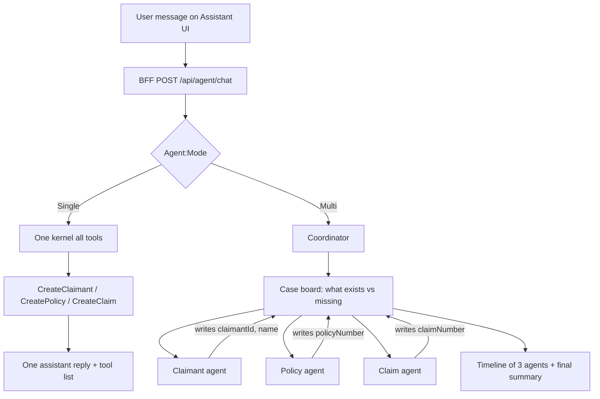
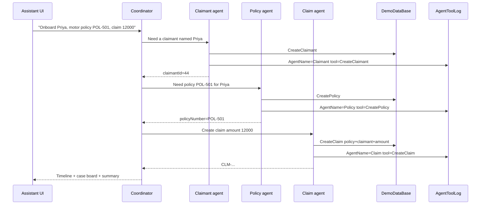

# Multi-agent assistant — proposed design

## Goal

The user should **see and feel** a team of specialists working a case, not one generic “Assistant” that silently calls tools.

A **claim** needs both:

- a **claimant** (person)
- a **policy** (contract)

Today one Semantic Kernel chat on the BFF has two plugins (`claims`, `policies`) and **no CreateClaimant tool**. The UI prints one reply plus a tool-name list.

This design adds:

1. `CreateClaimant` as a first-class tool  
2. **Two runtimes**, selected in appsettings: **single agent + many tools**, or **three specialist agents**  
3. An Assistant page that shows **who did what**, **handoffs**, and **shared case data**

Azure stays on one BFF chat endpoint. JWT still never goes to the browser.

---

## Current vs proposed

| Area | Today | Proposed |
|---|---|---|
| Tools | `GetClaimants`, `CreateClaim`, `GetPolicies`, `CreatePolicy` | Add `CreateClaimant` (name, email, phone) |
| Kernel | One chat, all tools | `Agent:Mode` = `Single` or `Multi` |
| Multi | N/A | Claimant agent, Policy agent, Claim agent; coordinator routes and shares a case board |
| UI | `You` / `Assistant` + tool names | Agent timeline, status (waiting / working / done), handoff arrows, case board |
| Audit | `dbo.AgentToolLog` | Same table + `AgentName` |

Domain rule the model must not skip:

```text
CreateClaim is invalid until policyNumber exists AND claimant exists (claimantId or full name).
```

---

## Configuration (appsettings)

BFF `appsettings.Development.json` (local). Production keeps `UseSemanticKernel: false` until you enable it on Azure.

```json
"Agent": {
  "UseSemanticKernel": true,
  "Mode": "Multi",
  "Orchestrator": "Coordinator",
  "Agents": {
    "Claimant": { "Enabled": true, "DisplayName": "Claimant agent", "Tools": [ "claimants.CreateClaimant", "claimants.GetClaimants" ] },
    "Policy":   { "Enabled": true, "DisplayName": "Policy agent",   "Tools": [ "policies.CreatePolicy", "policies.GetPolicies" ] },
    "Claim":    { "Enabled": true, "DisplayName": "Claim agent",    "Tools": [ "claims.CreateClaim", "claims.GetClaimants" ] }
  }
}
```

| `Agent:Mode` | Behaviour |
|---|---|
| `Single` | One kernel, **all enabled tools**. Same chat as today, plus CreateClaimant. UI still shows tool chips, labelled “Assistant”. |
| `Multi` | Three specialist kernels. Each kernel **only** gets its tool list. A coordinator plans order, copies results onto a **case board**, and calls the next agent. UI shows three agents. |

Switching mode is config-only. No second UI page. The Assistant reads `GET /api/agent/meta` (`mode`, agent display names) so the layout can change without a rebuild.

If `Mode=Multi` but an agent is `Enabled: false`, the coordinator skips it and asks the user or uses an existing record (e.g. policy already in DB).

---

## Agents and work sharing

### Case board (shared memory)

One object per chat turn (and kept for the conversation), stored in BFF memory (and optionally a row in SQL later):

```text
CaseBoard
  claimant: { id, fullName, email, phone, status }
  policy:   { id, policyNumber, holderName, product, premium, status }
  claim:    { id, claimNumber, amount, status }
  missing:  [ "claimant.email?", "policy.number", "claim.amount" ]
  handoffs: [ { from, to, reason, utc } ]
```

Specialists **do not** invent the next agent’s fields. They write only their slice, then return.

### Order (intake → claim)

Default pipeline when the user wants “set this person up and file a claim”:

1. **Claimant agent** — find or `CreateClaimant`  
2. **Policy agent** — find or `CreatePolicy` (holder can be the claimant name)  
3. **Claim agent** — `CreateClaim` with `policyNumber` + `claimantId` / name + `amount`

If the user only says “add claimant Priya”, only agent 1 runs. If policy and claimant already exist, only agent 3 runs.





Coordinator is **not** a fourth domain worker. It has **no** Create\* tools. It only: parse intent, fill the board, invoke specialists in order, merge replies.

---

## Tools

| Plugin | Tool | Agent in Multi | Notes |
|---|---|---|---|
| `claimants` | `CreateClaimant(fullName, email?, phone?)` | Claimant | **New.** Uses existing `ClaimsService.CreateClaimantAsync` |
| `claimants` | `GetClaimants` | Claimant | Already exists (today under `claims`) |
| `policies` | `CreatePolicy` / `GetPolicies` | Policy | Existing |
| `claims` | `CreateClaim(policyNumber, claimantName or claimantId, amount)` | Claim | Prefer `claimantId` from the board |

Claim agent system prompt: **refuse** CreateClaim if board (or arguments) lack policy number or claimant.

Move `GetClaimants` / `CreateClaimant` into a `ClaimantsTools` class so Multi mode can attach that plugin only to the Claimant agent.

---

## API contract (UI)

Extend `AgentChatResponse` (do not break `Reply` / `ToolsCalled`):

```text
AgentChatResponse
  Mode: Single | Multi
  Reply: string                 // final user-facing summary
  ToolsCalled: string[]         // keep for Single
  CaseBoard: { claimant, policy, claim, missing }
  Steps: [
    { AgentKey, DisplayName, Status, Message, Tools[], Utc }
  ]
```

`Status`: `skipped` | `working` | `done` | `needs_input` | `failed`.

For live “feel”, optional later: SignalR events `AgentStep` on the existing BFF hub so the UI can show Working before the HTTP call returns. **Phase 1** can wait for the full JSON (one POST).

---

## Assistant UI

Keep `/assistant`. Change the **body**, not the route.

**Single mode**

- One column chat (You / Assistant)  
- Tool chips under the assistant bubble  

**Multi mode**

- Left: chat  
- Right (or stacked on mobile): **Case board** cards — Claimant / Policy / Claim with empty, in progress, or created  
- In the thread, each specialist is a **named block** (colour + initials), not the word “Assistant”  
- Between blocks, a short **handoff line**: `Claimant agent → Policy agent: Priya is claimant #44`  
- While the POST is in flight, show three rows: Claimant / Policy / Claim as pending, then fill as the response arrives (or via SignalR in phase 2)

User feeling we want:

> Claimant agent created Priya → Policy agent issued POL-501 → Claim agent filed CLM-… against that policy.

Do not show JWT, SQL, or raw HTTP.

---

## Logging

`dbo.AgentToolLog` already stores request, response, time, details.

Add nullable `AgentName NVARCHAR(100)` (`Claimant` / `Policy` / `Claim` / `Single`). Filter in SSMS:

```sql
SELECT LoggedUtc, AgentName, PluginName, ToolName, RequestJson, ResponseJson, DurationMs, Succeeded
FROM dbo.AgentToolLog
ORDER BY LoggedUtc DESC;
```

---

## What we will not do

- Do not put three agents in the Blazor WASM process. Kernels stay on the BFF.  
- Do not send JWT to the browser.  
- Do not require Python agents (`UsePythonAgents` stays a separate switch).  
- Do not host extra APIs. Tools keep using the same SQL/`ClaimsService` path as now.  
- Do not change Azure hosts in this work. Local `Mode` in Development json only.

---

## Implementation order

1. **Tools:** `CreateClaimant`; split `ClaimantsTools`; Claim agent requires policy + claimant.  
2. **Config:** `Agent:Mode` + `Agent:Agents:*`.  
3. **Single mode:** one kernel, all tools, existing UI + claimant tool.  
4. **Multi mode:** coordinator + three kernels + case board + `Steps` on the response.  
5. **UI:** timeline + case board when `Mode=Multi`.  
6. **Log column** `AgentName`.  
7. Optional: SignalR live steps.

---

## Example user utterances

| User says | Single | Multi |
|---|---|---|
| “Add claimant Priya, email p@x.com” | Assistant calls CreateClaimant | Only Claimant agent runs |
| “Create policy POL-501 for Priya, Motor, 8000” | CreatePolicy | Only Policy agent |
| “File claim 12000 on POL-501 for Priya” | CreateClaim | Only Claim agent |
| “Onboard Priya, give her POL-501 motor 8k, file 12k claim” | One agent, three tools | All three agents, in order, board filled |

If a field is missing, that specialist returns `needs_input` and the coordinator asks **one** question (not a loop of “claim vs policy”).
