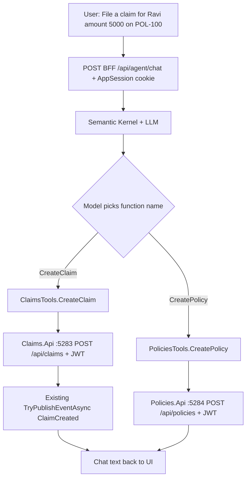

# Semantic Kernel — paste guide (chat over Claims vs Policies)

You paste these changes. Default is **off**: the UI stays forms-only (Add claim / Add policy).  
When **`Agent:UseSemanticKernel` is `true`** and an OpenAI/Azure OpenAI key is set, BFF runs Semantic Kernel. The chat page calls **BFF only** (cookie). SK **tools** call Claims.Api / Policies.Api with the **same JWT** as the BFF proxy.

Later: **`Agent:UsePythonAgents` = true** sends the same chat payload to a Python microservice (LangGraph/CrewAI). Do not run both flags true.

**Do not** put the model API key in git. Use User Secrets / Key Vault.

---

## Why we name an API a “tool”

| Word | Meaning here |
| --- | --- |
| **API** | HTTP service you already have (`Claims.Api` on `:5283`, `Policies.Api` on `:5284`). Controllers, JWT, SQL. |
| **Tool** | A **C# method** you register with Semantic Kernel. The **LLM is allowed to call that method by name**. Inside the method you `HttpClient` the API. |

The model **cannot** open `http://localhost:5283`. It can only say: “run tool `CreateClaim` with these arguments.” SK then runs **your** method. That is why SK docs say **tool / kernel function / plugin**, not “the model calls the REST API.”

Same idea as a human:

- Human clicks **Save claim** → UI → BFF → Claims API.
- Chat says “file a claim for Ravi” → LLM picks tool `CreateClaim` → same BFF JWT → same Claims API.

One API can expose **several tools** (`GetClaimants`, `CreateClaim`, `ApproveClaim`). Two APIs ⇒ **two tool classes** so a claims method never contains a policies URL.

---

## Why two separate tools (not one “call any API” tool)

```text
ClaimsTools  (plugin name: claims)
  GetClaimants  → GET  {Downstream:Claims}/api/claimants
  CreateClaim   → POST {Downstream:Claims}/api/claims

PoliciesTools (plugin name: policies)
  GetPolicies   → GET  {Downstream:Policies}/api/policies
  CreatePolicy  → POST {Downstream:Policies}/api/policies
```

If you gave the model a single tool `HttpGet(url)`, it could type a Policies URL while talking about claims. **Do not do that.**

Two plugins means:

1. **Code boundary** — `CreateClaim` is hardcoded to Claims host (`5283` locally). It cannot hit Policies even if the model is confused.
2. **Descriptions** — the model reads `[Description("Create a CLAIM / loss…")]` vs `[Description("Create a POLICY / contract…")]`.
3. **Evaluation** — logs show function name `claims-CreateClaim` vs `policies-CreatePolicy`, and the HTTP host matches.

**How SK decides which tool**

1. You send the user sentence + the list of function names/descriptions to the model.
2. Model returns a **function call** (name + JSON args), not a URL.
3. SK invokes that C# method.
4. Method result goes back to the model; it writes the chat reply.

Vague prompt (“add something for Ravi”) → model might pick the wrong **tool**. Then ask a clarifying question, or only import `ClaimsTools` on a “Claims assistant” page. The wrong tool still cannot change which **API host** that class uses.



---

## Flags

| Flag | Behaviour |
| --- | --- |
| `Agent:UseSemanticKernel` false | `POST /api/agent/chat` returns 404. No OpenAI call. |
| `UseSemanticKernel` true, `UsePythonAgents` false | BFF runs SK tools → Claims/Policies. |
| `UsePythonAgents` true | BFF forwards the chat body to `Agent:PythonBaseUrl` (later). SK in-process skipped. |

Keep **`UseGateway`** as it is today. Agent tools should call **Downstream:Claims / Policies** directly (same as BFF when gateway is off) so a blocked Ocelot does not break the bot. Optional later: tools go through `GatewayBaseUrl` when `UseGateway` is true.

---

## Order (paste in this order)

### Step 0 — Azure OpenAI or OpenAI key (not code)

SK needs a chat model. Without a key, the flag-on chat returns 500.

- Azure OpenAI: endpoint, deployment name, key  
- or OpenAI.com: API key, model `gpt-4o-mini`

User Secrets on BFF (example OpenAI):

```bat
cd Authentication.Bff.Api
dotnet user-secrets init
dotnet user-secrets set "Agent:OpenAI:ApiKey" "sk-..."
dotnet user-secrets set "Agent:OpenAI:Model" "gpt-4o-mini"
```

Azure variant keys (if you use Azure instead of OpenAI.com):

```bat
dotnet user-secrets set "Agent:AzureOpenAI:Endpoint" "https://YOUR.openai.azure.com/"
dotnet user-secrets set "Agent:AzureOpenAI:ApiKey" "..."
dotnet user-secrets set "Agent:AzureOpenAI:Deployment" "gpt-4o-mini"
```

---

### Step 1 — Package on BFF

**File:** `Authentication.Bff.Api\Authentication.Bff.Api.csproj`

```xml
<PackageReference Include="Microsoft.SemanticKernel" Version="1.54.0" />
```

Use a newer 1.x if NuGet offers one. Restore:

```bat
dotnet restore Authentication.Bff.Api\Authentication.Bff.Api.csproj
```

---

### Step 2 — BFF appsettings (flag off until ready)

**File:** `Authentication.Bff.Api\appsettings.json`  
Add next to existing `UseGateway` / `Downstream` (do not remove those):

```json
  "Agent": {
    "UseSemanticKernel": false,
    "UsePythonAgents": false,
    "PythonBaseUrl": "http://localhost:5290",
    "OpenAI": {
      "ApiKey": "",
      "Model": "gpt-4o-mini"
    },
    "AzureOpenAI": {
      "Endpoint": "",
      "ApiKey": "",
      "Deployment": ""
    }
  }
```

Put real keys in **User Secrets**, not this file.

---

### Step 3 — DTOs

**New file:** `Insurance.Contracts\Agent\AgentChatRequest.cs`

```csharp
namespace Insurance.Contracts.Agent;

public sealed class AgentChatRequest
{
    public string Message { get; set; } = "";
}

public sealed class AgentChatResponse
{
    public string Reply { get; set; } = "";
    public string[] ToolsCalled { get; set; } = [];
}
```

---

### Step 4 — Two tool classes (this is the Claims vs Policies split)

JWT is passed in so tools use the **logged-in user**, not a service account.

**New file:** `Authentication.Bff.Api\Agent\ClaimsTools.cs`

```csharp
using System.ComponentModel;
using System.Net.Http.Headers;
using System.Net.Http.Json;
using System.Text.Json;
using Insurance.Contracts.Claims;
using Microsoft.SemanticKernel;

namespace Authentication.Bff.Api.Agent;

public sealed class ClaimsTools
{
    private readonly HttpClient _http;

    public ClaimsTools(HttpClient http, string accessToken)
    {
        _http = http;
        _http.DefaultRequestHeaders.Authorization = new AuthenticationHeaderValue("Bearer", accessToken);
    }

    [KernelFunction]
    [Description("List insurance claimants (people). Use when the user asks who the claimants are.")]
    public async Task<string> GetClaimants()
    {
        var rows = await _http.GetFromJsonAsync<InsuranceClaimantDto[]>("api/claimants") ?? [];
        return JsonSerializer.Serialize(rows);
    }

    [KernelFunction]
    [Description("Create an insurance CLAIM (a loss/file against an existing policy). Not for creating a policy contract. Requires policyNumber, claimantName, amount.")]
    public async Task<string> CreateClaim(
        [Description("Policy number the claim is filed against, e.g. POL-100")] string policyNumber,
        [Description("Claimant full name")] string claimantName,
        [Description("Claim amount")] decimal amount,
        [Description("Optional claim number; leave empty to auto-generate")] string claimNumber = "")
    {
        var response = await _http.PostAsJsonAsync("api/claims", new CreateClaimRequest
        {
            PolicyNumber = policyNumber,
            ClaimantName = claimantName,
            Amount = amount,
            ClaimNumber = claimNumber
        });
        var body = await response.Content.ReadAsStringAsync();
        return $"HTTP {(int)response.StatusCode} {body}";
    }
}
```

**New file:** `Authentication.Bff.Api\Agent\PoliciesTools.cs`

```csharp
using System.ComponentModel;
using System.Net.Http.Headers;
using System.Net.Http.Json;
using System.Text.Json;
using Insurance.Contracts.Policies;
using Microsoft.SemanticKernel;

namespace Authentication.Bff.Api.Agent;

public sealed class PoliciesTools
{
    private readonly HttpClient _http;

    public PoliciesTools(HttpClient http, string accessToken)
    {
        _http = http;
        _http.DefaultRequestHeaders.Authorization = new AuthenticationHeaderValue("Bearer", accessToken);
    }

    [KernelFunction]
    [Description("List insurance POLICIES (contracts). Use when the user asks about policy numbers or holders. Not for claims.")]
    public async Task<string> GetPolicies()
    {
        var rows = await _http.GetFromJsonAsync<InsurancePolicyDto[]>("api/policies") ?? [];
        return JsonSerializer.Serialize(rows);
    }

    [KernelFunction]
    [Description("Create an insurance POLICY (a contract for a holder). Not for filing a claim/loss.")]
    public async Task<string> CreatePolicy(
        [Description("Policy number")] string policyNumber,
        [Description("Policy holder name")] string holderName,
        [Description("Product name e.g. Auto")] string productName,
        [Description("Premium amount")] decimal premium)
    {
        var response = await _http.PostAsJsonAsync("api/policies", new UpsertPolicyRequest
        {
            PolicyNumber = policyNumber,
            HolderName = holderName,
            ProductName = productName,
            Premium = premium,
            Status = "Active"
        });
        var body = await response.Content.ReadAsStringAsync();
        return $"HTTP {(int)response.StatusCode} {body}";
    }
}
```

Set each `HttpClient.BaseAddress` in the runner (Step 5) to `Downstream:Claims` vs `Downstream:Policies`. **Never share one BaseAddress for both plugins.**

---

### Step 5 — SK runner + Python fork (same BFF entry)

**New file:** `Authentication.Bff.Api\Agent\AgentChatService.cs`

```csharp
using Insurance.Contracts.Agent;
using Microsoft.SemanticKernel;
using Microsoft.SemanticKernel.ChatCompletion;
using Microsoft.SemanticKernel.Connectors.OpenAI;

namespace Authentication.Bff.Api.Agent;

public sealed class AgentChatService
{
    private readonly IConfiguration _config;
    private readonly IHttpClientFactory _http;

    public AgentChatService(IConfiguration config, IHttpClientFactory http)
    {
        _config = config;
        _http = http;
    }

    public async Task<AgentChatResponse> ChatAsync(string message, string accessToken, CancellationToken cancellationToken)
    {
        if (_config.GetValue("Agent:UsePythonAgents", false))
            return await ForwardPythonAsync(message, accessToken, cancellationToken);

        var claimsBase = (_config["Downstream:Claims"] ?? "http://localhost:5283").TrimEnd('/');
        var policiesBase = (_config["Downstream:Policies"] ?? "http://localhost:5284").TrimEnd('/');

        var claimsClient = _http.CreateClient("AgentClaims");
        claimsClient.BaseAddress = new Uri(claimsBase + "/");
        var policiesClient = _http.CreateClient("AgentPolicies");
        policiesClient.BaseAddress = new Uri(policiesBase + "/");

        var builder = Kernel.CreateBuilder();
        var azureEndpoint = _config["Agent:AzureOpenAI:Endpoint"];
        if (!string.IsNullOrWhiteSpace(azureEndpoint))
        {
            builder.AddAzureOpenAIChatCompletion(
                _config["Agent:AzureOpenAI:Deployment"] ?? "gpt-4o-mini",
                azureEndpoint,
                _config["Agent:AzureOpenAI:ApiKey"] ?? "");
        }
        else
        {
            builder.AddOpenAIChatCompletion(
                _config["Agent:OpenAI:Model"] ?? "gpt-4o-mini",
                _config["Agent:OpenAI:ApiKey"] ?? "");
        }

        var kernel = builder.Build();
        kernel.ImportPluginFromObject(new ClaimsTools(claimsClient, accessToken), "claims");
        kernel.ImportPluginFromObject(new PoliciesTools(policiesClient, accessToken), "policies");

        var history = new ChatHistory(
            "You are the Insurance Platform assistant. " +
            "Use claims tools for losses/claimants. Use policies tools for policy contracts. " +
            "If the user is unclear, ask whether they mean a claim or a policy. " +
            "Never invent URLs.");
        history.AddUserMessage(message);

        var toolsCalled = new List<string>();
        kernel.FunctionInvocationFilters.Add(new ToolNameFilter(toolsCalled));

        var chat = kernel.GetRequiredService<IChatCompletionService>();
        var settings = new OpenAIPromptExecutionSettings
        {
            FunctionChoiceBehavior = FunctionChoiceBehavior.Auto()
        };
        var result = await chat.GetChatMessageContentAsync(history, settings, kernel, cancellationToken);
        return new AgentChatResponse
        {
            Reply = result.Content ?? "",
            ToolsCalled = toolsCalled.ToArray()
        };
    }

    private async Task<AgentChatResponse> ForwardPythonAsync(string message, string accessToken, CancellationToken cancellationToken)
    {
        var python = (_config["Agent:PythonBaseUrl"] ?? "http://localhost:5290").TrimEnd('/');
        var client = _http.CreateClient("AgentPython");
        using var req = new HttpRequestMessage(HttpMethod.Post, python + "/chat")
        {
            Content = JsonContent.Create(new AgentChatRequest { Message = message })
        };
        req.Headers.Authorization = new System.Net.Http.Headers.AuthenticationHeaderValue("Bearer", accessToken);
        var response = await client.SendAsync(req, cancellationToken);
        var body = await response.Content.ReadAsStringAsync(cancellationToken);
        if (!response.IsSuccessStatusCode)
            return new AgentChatResponse { Reply = $"Python agent HTTP {(int)response.StatusCode}: {body}" };
        return System.Text.Json.JsonSerializer.Deserialize<AgentChatResponse>(body,
            new System.Text.Json.JsonSerializerOptions { PropertyNameCaseInsensitive = true })
            ?? new AgentChatResponse { Reply = body };
    }
}

file sealed class ToolNameFilter : IFunctionInvocationFilter
{
    private readonly List<string> _names;
    public ToolNameFilter(List<string> names) => _names = names;

    public async Task OnFunctionInvocationAsync(FunctionInvocationContext context, Func<FunctionInvocationContext, Task> next)
    {
        _names.Add($"{context.Function.PluginName}-{context.Function.Name}");
        await next(context);
    }
}
```

If `IFunctionInvocationFilter` / `file` local class fails to compile on your SK version: log `result.Items` or skip `ToolsCalled` and watch BFF stdout instead.

**File:** `Authentication.Bff.Api\Program.cs` — after existing `AddHttpClient("Gateway"...);`

```csharp
builder.Services.AddHttpClient("AgentClaims");
builder.Services.AddHttpClient("AgentPolicies");
builder.Services.AddHttpClient("AgentPython");
builder.Services.AddScoped<Authentication.Bff.Api.Agent.AgentChatService>();
```

---

### Step 6 — BFF chat endpoint (cookie in, JWT to tools)

**New file:** `Authentication.Bff.Api\Controllers\AgentController.cs`  
Reuse the same cookie split as `BffProxyController.TryReadSession` (copy that private method or share a helper). Inject `LoginService` like the proxy.

```csharp
using Authentication.Bff.Api.Agent;
using Authentication.Bff.Api.Services;
using Insurance.Contracts.Agent;
using Insurance.Contracts.Common;
using Insurance.Helpers;
using Microsoft.AspNetCore.Mvc;

namespace Authentication.Bff.Api.Controllers;

[ApiController]
[Route("api/agent")]
public sealed class AgentController : ControllerBase
{
    private readonly LoginService _login;
    private readonly AgentChatService _agent;
    private readonly IConfiguration _config;

    public AgentController(LoginService login, AgentChatService agent, IConfiguration config)
    {
        _login = login;
        _agent = agent;
        _config = config;
    }

    [HttpPost("chat")]
    public async Task<ActionResult<AgentChatResponse>> Chat([FromBody] AgentChatRequest request, CancellationToken cancellationToken)
    {
        if (!_config.GetValue("Agent:UseSemanticKernel", false) && !_config.GetValue("Agent:UsePythonAgents", false))
            return NotFound(new ApiMessage { Message = "Agent is off (Agent:UseSemanticKernel / UsePythonAgents)." });

        if (string.IsNullOrWhiteSpace(request.Message))
            return BadRequest(new ApiMessage { Message = "Message is required." });

        if (!TryReadSession(out var sessionId, out var rawToken))
            return Unauthorized();

        var accessToken = await _login.GetAccessTokenAsync(sessionId, rawToken);
        if (string.IsNullOrWhiteSpace(accessToken))
            return Unauthorized();

        var result = await _agent.ChatAsync(request.Message, accessToken, cancellationToken);
        return Ok(result);
    }

    private bool TryReadSession(out Guid sessionId, out string rawToken)
    {
        sessionId = Guid.Empty;
        rawToken = "";
        if (!Request.Cookies.TryGetValue(CookieSettings.Name(Request.IsHttps), out var value))
            return false;
        var parts = value.Split('.', 2);
        return parts.Length == 2 && Guid.TryParse(parts[0], out sessionId) && !string.IsNullOrWhiteSpace(rawToken = parts[1]);
    }
}
```

UI still **never** sees the JWT. Chat is cookie → BFF → tools → APIs.

Existing `BffProxyController` already publishes SignalR on successful `POST claims` / `POST policies`. When the **tool** posts to those APIs **directly**, the proxy **will not** see it. Either:

- point tools at **BFF loopback** `http://localhost:5281/api/...` with the cookie (awkward), or  
- after `CreateClaim` succeeds, call `NotificationPublisher` from the tool (optional extra paste), or  
- accept that form-created claims notify, chat-created claims show up on refresh until you add publish in the tool.

Recommended later: inject `NotificationPublisher` into `ClaimsTools` and publish `ClaimCreated` on 2xx. Not required for first chat compile.

---

### Step 7 — UI chat page

**File:** `Insurance.UI.BlazorWasm\wwwroot\appsettings.json` — add:

```json
  "Agent": {
    "Enabled": false
  }
```

Keep `BffBaseUrl` / `SignalR` as they are. Turn `Enabled` true together with BFF `UseSemanticKernel`.

**New file:** `Insurance.UI.BlazorWasm\Services\AgentApi.cs`

```csharp
using System.Net.Http.Json;
using Insurance.Contracts.Agent;

namespace Insurance.UI.BlazorWasm.Services;

public sealed class AgentApi
{
    private readonly HttpClient _http;
    public AgentApi(HttpClient http) => _http = http;

    public async Task<AgentChatResponse> ChatAsync(string message)
    {
        var response = await _http.PostAsJsonAsync("api/agent/chat", new AgentChatRequest { Message = message });
        if (!response.IsSuccessStatusCode)
            return new AgentChatResponse { Reply = $"HTTP {(int)response.StatusCode} {await response.Content.ReadAsStringAsync()}" };
        return await response.Content.ReadFromJsonAsync<AgentChatResponse>()
            ?? new AgentChatResponse { Reply = "" };
    }
}
```

**File:** `Insurance.UI.BlazorWasm\Program.cs` — with the other `AddScoped`:

```csharp
builder.Services.AddScoped<AgentApi>();
```

**New file:** `Insurance.UI.BlazorWasm\Pages\Assistant.razor`

```razor
@page "/assistant"
@using Insurance.Contracts.Agent
@using Insurance.UI.BlazorWasm.Services
@using Microsoft.AspNetCore.Authorization
@attribute [Authorize]
@inject AgentApi Agent
@inject IConfiguration Config

<PageTitle>Assistant</PageTitle>
<h1>Assistant</h1>
<p class="text-muted">Chat uses Semantic Kernel tools. Claims tools hit Claims.Api; policy tools hit Policies.Api. Cookie stays on BFF.</p>

@if (!Config.GetValue("Agent:Enabled", false))
{
    <div class="alert alert-warning">Set Agent:Enabled true in UI appsettings and Agent:UseSemanticKernel true on BFF.</div>
}
else
{
    <div class="mb-3" style="max-width: 720px;">
        @foreach (var line in lines)
        {
            <p><strong>@line.Who:</strong> @line.Text</p>
            @if (line.Tools is { Length: > 0 })
            {
                <p class="form-text">Tools: @string.Join(", ", line.Tools)</p>
            }
        }
    </div>
    <div class="row g-2" style="max-width: 720px;">
        <div class="col">
            <input class="form-control" placeholder="e.g. File a claim for Ravi, amount 5000, policy POL-100" @bind="draft" @bind:event="oninput" />
        </div>
        <div class="col-auto">
            <button class="btn btn-primary" @onclick="Send" disabled="@busy">Send</button>
        </div>
    </div>
}

@code {
    private string draft = "";
    private bool busy;
    private readonly List<(string Who, string Text, string[]? Tools)> lines = [];

    private async Task Send()
    {
        if (string.IsNullOrWhiteSpace(draft)) return;
        var text = draft.Trim();
        draft = "";
        lines.Add(("You", text, null));
        busy = true;
        var result = await Agent.ChatAsync(text);
        lines.Add(("Assistant", result.Reply, result.ToolsCalled));
        busy = false;
    }
}
```

**File:** `Insurance.UI.BlazorWasm\Layout\NavMenu.razor` — under Alerts, next to Notifications:

```razor
                <div class="nav-item px-3">
                    <NavLink class="nav-link" href="assistant">
                        <span class="nav-ico" aria-hidden="true">◎</span> Assistant
                    </NavLink>
                </div>
```

---

## Turning the feature **on**

1. Paste Steps 1–7, restore, build BFF + UI.  
2. User Secrets for the model key.  
3. BFF `"Agent": { "UseSemanticKernel": true }` (Python flag **false**).  
4. UI `"Agent": { "Enabled": true }`.  
5. Restart **BFF** then **UI**. Claims `:5283` and Policies `:5284` must be up.  
6. Login → Assistant.  

**Evaluate Claims vs Policies**

| You type | Expect `ToolsCalled` | HTTP |
| --- | --- | --- |
| File a claim for Ravi amount 5000 on POL-100 | `claims-CreateClaim` | POST `:5283/api/claims` |
| List claimants | `claims-GetClaimants` | GET `:5283/api/claimants` |
| Create policy POL-200 for Anita Auto premium 1200 | `policies-CreatePolicy` | POST `:5284/api/policies` |
| List policies | `policies-GetPolicies` | GET `:5284/api/policies` |

Watch BFF console (filter) and Claims vs Policies console. If the model picks the wrong **function**, tighten `[Description]` or ask a follow-up. If it picked `CreateClaim` but traffic hit `:5284`, the `HttpClient` BaseAddress is wrong — that is a **code** bug, not an LLM bug.

---

## Guardrails (yes — paste these)

The LLM only **proposes** a tool. A **guardrail** is your code that **allows, blocks, or asks** before HTTP runs. That is how this stays agentic without letting the model write anything it wants.

```text
User message
  → input checks (empty, length, jailbreak-ish “ignore tools”)
  → SK picks claims-CreateClaim vs policies-CreatePolicy
  → invocation filter (allow-list, writes vs reads, required args)
  → Claims.Api / Policies.Api still [Authorize] JWT + permissions
  → Azure OpenAI content filter (if Azure)
  → reply to UI
```

**Layers (use all of them; none is enough alone)**

| Layer | What it stops |
| --- | --- |
| Two plugins, no URL tool | Model cannot pick a hostname |
| System prompt | Soft: “claims vs policies; ask if unclear” |
| `IFunctionInvocationFilter` | Hard: block unknown tools, cap writes, require policyNumber |
| JWT on the API | User without `Claims.View` still gets 401/403 even if SK called `GetClaimants` |
| Azure OpenAI content filter | Hate/self-harm style output (platform, not your C#) |
| UI | Optional: confirm before CreateClaim / CreatePolicy |

### Step 8 — Invocation filter (hard guardrail)

**New file:** `Authentication.Bff.Api\Agent\AgentGuardrailFilter.cs`

```csharp
using Microsoft.SemanticKernel;

namespace Authentication.Bff.Api.Agent;

public sealed class AgentGuardrailFilter : IFunctionInvocationFilter
{
    private static readonly HashSet<string> Allowed = new(StringComparer.OrdinalIgnoreCase)
    {
        "claims-GetClaimants",
        "claims-CreateClaim",
        "policies-GetPolicies",
        "policies-CreatePolicy"
    };

    private static readonly HashSet<string> Writes = new(StringComparer.OrdinalIgnoreCase)
    {
        "claims-CreateClaim",
        "policies-CreatePolicy"
    };

    private readonly List<string> _toolsCalled;
    private int _writeCount;

    public AgentGuardrailFilter(List<string> toolsCalled) => _toolsCalled = toolsCalled;

    public async Task OnFunctionInvocationAsync(FunctionInvocationContext context, Func<FunctionInvocationContext, Task> next)
    {
        var name = $"{context.Function.PluginName}-{context.Function.Name}";
        if (!Allowed.Contains(name))
        {
            context.Result = new FunctionResult(context.Function, $"Blocked: tool {name} is not on the allow-list.");
            return;
        }

        if (Writes.Contains(name))
        {
            _writeCount++;
            if (_writeCount > 2)
            {
                context.Result = new FunctionResult(context.Function, "Blocked: too many create calls in one chat turn.");
                return;
            }
        }

        if (name.Equals("claims-CreateClaim", StringComparison.OrdinalIgnoreCase))
        {
            var policy = context.Arguments.TryGetValue("policyNumber", out var p) ? p?.ToString() : "";
            var claimant = context.Arguments.TryGetValue("claimantName", out var c) ? c?.ToString() : "";
            if (string.IsNullOrWhiteSpace(policy) || string.IsNullOrWhiteSpace(claimant))
            {
                context.Result = new FunctionResult(context.Function,
                    "Blocked: CreateClaim needs policyNumber and claimantName. Ask the user.");
                return;
            }
        }

        _toolsCalled.Add(name);
        await next(context);
    }
}
```

In `AgentChatService`, **replace** `ToolNameFilter` with this filter:

```csharp
var toolsCalled = new List<string>();
kernel.FunctionInvocationFilters.Add(new AgentGuardrailFilter(toolsCalled));
```

Keep the system prompt (soft rail). Add a max message length in `AgentController` before SK runs:

```csharp
if (request.Message.Length > 2000)
    return BadRequest(new ApiMessage { Message = "Message too long." });
```

**Optional later:** do not register `CreateClaim` unless the JWT has `Claims.View`; do not add `ApproveClaim` as a tool until you want the agent to change status (high risk — better a UI confirm).

**Python later:** the same allow-list lives in the Python service. BFF still checks cookie, length, and flags.

---

## Later: Python microservice (do not paste until you have that API)

Python listens on `5290`, same JWT, same two HTTP clients (claims base vs policies base). BFF:

```json
"UseSemanticKernel": false,
"UsePythonAgents": true,
"PythonBaseUrl": "http://localhost:5290"
```

UI still `POST /api/agent/chat` + cookie. BFF forwards to Python. Tools stay split the same way.

---

## Do not change

- Browser JWT for REST (still none)
- Hub path / `role:Admin`
- Putting SK inside Blazor WASM (no API key in the browser)
- One generic tool that takes a URL

---

## Checklist

- [ ] Step 0 model key in User Secrets  
- [ ] Step 1 SK package  
- [ ] Step 2 `Agent` block, flags false until ready  
- [ ] Step 3 DTOs  
- [ ] Step 4 `ClaimsTools` + `PoliciesTools` (two BaseAddresses)  
- [ ] Step 5 `AgentChatService` + HttpClients in `Program.cs`  
- [ ] Step 6 `POST api/agent/chat`  
- [ ] Step 7 UI `AgentApi` + `/assistant` + nav  
- [ ] Both flags: BFF `UseSemanticKernel` + UI `Agent:Enabled`  
- [ ] Golden prompts: claim tool vs policy tool in `ToolsCalled`  
- [ ] Step 8 guardrail filter (allow-list + CreateClaim args + write cap)  
  
