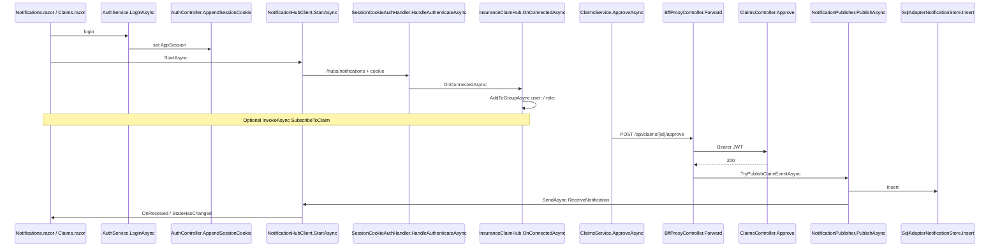
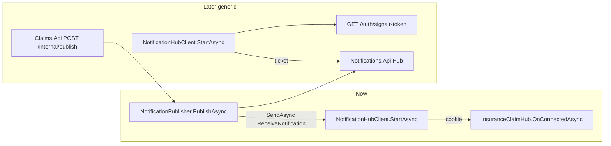

# SignalR — you implement this (Insurance Platform)

**Where:** `E:\pvkumar_git\insuranceplateform`  
**Not** MetaUIEngine / GenAiApi. That app has **no Users/Roles**. This app already has `dbo.Users`, `dbo.Roles`, `dbo.UserRoles`, `dbo.Permissions`, BFF cookie, Blazor WASM.

**Auth model:** cookie/BFF (not JWT query `access_token`). The Word guide says: do **not** copy the JWT `OnMessageReceived` sample when you use cookies.

**SQL for notifications:** `SqlConnection` + `SqlDataAdapter` / `SqlCommand` only (no Dapper on the notification table).

---

## Why this project


|                              | Clinic / Admin.razor | Insurance (`AuthService.cs`)        |
| ---------------------------- | -------------------- | ----------------------------------- |
| Login                        | No                   | Yes — cookie to BFF                 |
| Users / roles / permissions  | No                   | Yes — `DemoDataBase`                |
| Blazor WASM                  | Yes                  | Yes                                 |
| Who can get a private notice | Cannot know the user | `user:{UserName}`                   |
| Who can get a role notice    | Cannot               | `role:Admin`, `role:ClaimsAdjuster` |


Hub lives on **Authentication.Bff.Api** (`http://localhost:5281/hubs/notifications`) **for this first implementation**.  
WASM talks **only to the BFF**. JWT stays **behind** the BFF (Ocelot). Do **not** put the hub behind Ocelot (WebSockets).

**Later (generic):** move the Hub to a dedicated **Notifications.Api**. Same DTO, same method names (`ReceiveNotification`, `SubscribeToClaim`, `PublishAsync`). Claims/Policies/Clinic would call `POST /internal/publish`. Blazor would connect with a short-lived ticket from `GET /auth/signalr-token` (cookie does not cross ports). Do **not** do that in the first pass.

---

## Mental model (pub/sub)

```text
Approve claim (REST) → SQL commit → IHubContext publishes "ReceiveNotification"
        → only connections in group user:X or role:Admin receive it
Blazor HubConnection.On("ReceiveNotification") updates the page
```

- **Publisher:** BFF after a successful business call (not the Hub class itself).  
- **Subscribers:** browsers that connected and were put in groups **by the server**.  
- **Hub:** door + groups. Thin.

---

## Complete flow (method names)

### Now — Hub on BFF

```text
1) Login
   Login.razor.Submit
     → AuthService.LoginAsync
     → AuthController.Login → LoginService.SignInAsync
     → AuthController.AppendSessionCookie   (HttpOnly AppSession)

2) Open live page
   Notifications.razor.OnInitializedAsync
     → NotificationHubClient.StartAsync
     → HubConnection.StartAsync  (cookie via CookieSendingHandler)
     → GET/WebSocket  http://localhost:5281/hubs/notifications
     → SessionCookieAuthHandler.HandleAuthenticateAsync
     → LoginService.GetCurrentAsync
     → InsuranceClaimHub.OnConnectedAsync
          Groups.AddToGroupAsync  user:{UserName}
          Groups.AddToGroupAsync  role:{Role}

3) Optional watch one claim
   NotificationHubClient / page
     → hub.InvokeAsync("SubscribeToClaim", claimId)
     → InsuranceClaimHub.SubscribeToClaim
          (checks permission Claims.View)
          Groups.AddToGroupAsync  claim:{claimId}

4) Approve (REST still does the write)
   Claims.razor.Approve
     → ClaimsService.ApproveAsync
     → POST /api/claims/{id}/approve   (BFF cookie)
     → BffProxyController.Forward
     → LoginService.GetAccessTokenAsync
     → ClaimsController.Approve → ClaimsService.ApproveAsync  (SQL)

5) Push only after 2xx
   BffProxyController.TryPublishClaimEventAsync
     → NotificationPublisher.PublishAsync
     → SqlAdapterNotificationStore.Insert
     → IHubContext.Clients.User(name).SendAsync("ReceiveNotification", dto)
     → IHubContext.Clients.Group("role:Admin").SendAsync("ReceiveNotification", dto)
     → IHubContext.Clients.Group("claim:{id}").SendAsync("ReceiveNotification", dto)

6) UI
   HubConnection.On("ReceiveNotification", ...)
     → NotificationHubClient.Received
     → Notifications.razor.OnReceived → StateHasChanged
     → Claims.razor.OnHub → ClaimsService.GetAsync (reload grid)
```




### Later — generic Notifications.Api (same method names)

Do this **after** the BFF Hub works. Extract Hub + `NotificationPublisher` + SqlDataAdapter store into **Notifications.Api**.

```text
Login (unchanged)
  AuthService.LoginAsync → AuthController.Login → AppendSessionCookie

Ticket for the generic Hub
  AuthService.GetSignalRTokenAsync
    → GET /auth/signalr-token   (BFF, cookie)
    → returns short JWT  audience=notifications

Connect
  NotificationHubClient.StartAsync
    → HubUrl = http://localhost:5286/hubs/notifications
    → AccessTokenProvider = ticket
    → InsuranceClaimHub.OnConnectedAsync   (same groups)

Approve (unchanged REST through BFF)
  ClaimsController.Approve  200
    → Claims.Api calls Notifications POST /internal/publish
    → NotificationPublisher.PublishAsync
    → SendAsync("ReceiveNotification")

Clinic / other apps later
  same POST /internal/publish  EventType=DepartmentChanged
```




Method names **do not change** when you go generic: `StartAsync`, `OnConnectedAsync`, `SubscribeToClaim`, `PublishAsync`, `SendAsync("ReceiveNotification")`, `Insert`. Only **where** they run changes (BFF vs Notifications.Api).

---

## Step 0 — SQL table (SSMS)

Run on `(localdb)\MSSQLLocalDB` / `DemoDataBase`:

```sql
USE DemoDataBase;
GO

IF OBJECT_ID('dbo.InsuranceNotification', 'U') IS NULL
BEGIN
    CREATE TABLE dbo.InsuranceNotification
    (
        NotificationId INT IDENTITY(1,1) NOT NULL PRIMARY KEY,
        EventType NVARCHAR(64) NOT NULL,
        EntityName NVARCHAR(64) NOT NULL,
        EntityId NVARCHAR(64) NOT NULL,
        Title NVARCHAR(200) NOT NULL,
        Message NVARCHAR(1000) NOT NULL,
        TargetUserName NVARCHAR(100) NULL,  -- one user; null = not user-targeted
        TargetRole NVARCHAR(100) NULL,      -- one role; null = not role-targeted
        OccurredUtc DATETIME2 NOT NULL DEFAULT (SYSUTCDATETIME())
    );
END
```

You already have Users/Roles. **Do not** recreate those.

### Test data — claimants (`Sql\003_InsuranceClaimants.sql`)

Claims store `ClaimantName` as text. The **Add claimant** / **Add claim** screens use `dbo.InsuranceClaimants` so you can insert Open claims and then approve them.

```sql
USE DemoDataBase;
GO

IF OBJECT_ID('dbo.InsuranceClaimants', 'U') IS NULL
BEGIN
    CREATE TABLE dbo.InsuranceClaimants
    (
        ClaimantId INT IDENTITY(1,1) NOT NULL PRIMARY KEY,
        FullName NVARCHAR(200) NOT NULL,
        Email NVARCHAR(200) NULL,
        Phone NVARCHAR(50) NULL,
        CreatedUtc DATETIME2 NOT NULL CONSTRAINT DF_Claimants_CreatedUtc DEFAULT (SYSUTCDATETIME())
    );
END
GO

INSERT INTO dbo.InsuranceClaimants (FullName)
SELECT DISTINCT c.ClaimantName
FROM dbo.InsuranceClaims c
WHERE NOT EXISTS (
    SELECT 1 FROM dbo.InsuranceClaimants x WHERE x.FullName = c.ClaimantName
);
GO
```

APIs (through BFF + Ocelot → Claims.Api): `GET/POST /api/claimants`, `POST /api/claims`. Creating a claim does **not** publish SignalR; **approve / delete** does.

---

## Step 1 — Shared DTO (`Insurance.Contracts`)

New file: `Insurance.Contracts\Notifications\InsuranceNotificationDto.cs`

```csharp
namespace Insurance.Contracts.Notifications;

// Small payload only. Do not send the whole claim row or secrets.
public sealed class InsuranceNotificationDto
{
    public int NotificationId { get; set; }
    public string EventType { get; set; } = "";      // ClaimUpdated, ClaimDeleted, ManagerAlert
    public string EntityName { get; set; } = "";     // InsuranceClaim
    public string EntityId { get; set; } = "";       // claim id as string
    public string Title { get; set; } = "";
    public string Message { get; set; } = "";
    public string? TargetUserName { get; set; }
    public string? TargetRole { get; set; }
    public DateTime OccurredUtc { get; set; } = DateTime.UtcNow;
}

public static class NotificationEvents
{
    // MUST match Blazor: hub.On<...>(NotificationEvents.ClientMethod, ...)
    public const string ClientMethod = "ReceiveNotification";
}
```

**Why contracts project:** API publisher and WASM handler must use the **same** type and **same** method name.

---

## Step 2 — Cookie helper (`Insurance.Helpers`)

You already parse the cookie in `AuthController`. Reuse one helper so the Hub can authenticate the same way.

`Insurance.Helpers\SessionCookie.cs`

```csharp
using Microsoft.AspNetCore.Http;

namespace Insurance.Helpers;

public static class SessionCookie
{
    // Cookie value is "{sessionId:N}.{rawToken}" — same as AppendSessionCookie.
    public static bool TryRead(HttpRequest request, out Guid sessionId, out string rawToken)
    {
        sessionId = Guid.Empty;
        rawToken = "";
        if (!request.Cookies.TryGetValue(CookieSettings.Name(request.IsHttps), out var value))
            return false;
        var parts = value.Split('.', 2);
        return parts.Length == 2
            && Guid.TryParse(parts[0], out sessionId)
            && !string.IsNullOrWhiteSpace(rawToken = parts[1]);
    }
}
```

---

## Step 3 — Notification store with SqlDataAdapter (`Insurance.Helpers`)

`Insurance.Helpers\SqlAdapterNotificationStore.cs`

```csharp
using System.Data;
using Insurance.Contracts.Notifications;
using Microsoft.Data.SqlClient;

namespace Insurance.Helpers;

public sealed class SqlAdapterNotificationStore
{
    private readonly string _connectionString;
    public SqlAdapterNotificationStore(string connectionString) => _connectionString = connectionString;

    public int Insert(InsuranceNotificationDto dto)
    {
        using var connection = new SqlConnection(_connectionString);
        using var command = new SqlCommand("""
            SET NOCOUNT ON;
            INSERT INTO dbo.InsuranceNotification
                (EventType, EntityName, EntityId, Title, Message, TargetUserName, TargetRole, OccurredUtc)
            VALUES (@EventType, @EntityName, @EntityId, @Title, @Message, @TargetUserName, @TargetRole, @OccurredUtc);
            SELECT CAST(SCOPE_IDENTITY() AS int);
            """, connection);
        command.Parameters.AddWithValue("@EventType", dto.EventType);
        command.Parameters.AddWithValue("@EntityName", dto.EntityName);
        command.Parameters.AddWithValue("@EntityId", dto.EntityId);
        command.Parameters.AddWithValue("@Title", dto.Title);
        command.Parameters.AddWithValue("@Message", dto.Message);
        command.Parameters.AddWithValue("@TargetUserName", (object?)dto.TargetUserName ?? DBNull.Value);
        command.Parameters.AddWithValue("@TargetRole", (object?)dto.TargetRole ?? DBNull.Value);
        command.Parameters.AddWithValue("@OccurredUtc", dto.OccurredUtc);

        // Do not SqlDataAdapter.Fill an INSERT batch: the first result has no columns
        // and throws IndexOutOfRangeException. ExecuteScalar reads SCOPE_IDENTITY.
        connection.Open();
        var id = command.ExecuteScalar();
        dto.NotificationId = id is null or DBNull ? 0 : Convert.ToInt32(id);
        return dto.NotificationId;
    }

    public IReadOnlyList<InsuranceNotificationDto> Recent(int take = 50)
    {
        using var connection = new SqlConnection(_connectionString);
        using var adapter = new SqlDataAdapter("""
            SELECT TOP (@Take) NotificationId, EventType, EntityName, EntityId, Title, Message,
                   TargetUserName, TargetRole, OccurredUtc
            FROM dbo.InsuranceNotification
            ORDER BY NotificationId DESC
            """, connection);
        adapter.SelectCommand!.Parameters.AddWithValue("@Take", take);
        var table = new DataTable();
        adapter.Fill(table);
        return table.Rows.Cast<DataRow>().Select(row => new InsuranceNotificationDto
        {
            NotificationId = Convert.ToInt32(row["NotificationId"]),
            EventType = Convert.ToString(row["EventType"]) ?? "",
            EntityName = Convert.ToString(row["EntityName"]) ?? "",
            EntityId = Convert.ToString(row["EntityId"]) ?? "",
            Title = Convert.ToString(row["Title"]) ?? "",
            Message = Convert.ToString(row["Message"]) ?? "",
            TargetUserName = row["TargetUserName"] as string,
            TargetRole = row["TargetRole"] as string,
            OccurredUtc = Convert.ToDateTime(row["OccurredUtc"])
        }).ToList();
    }
}
```

Register next to Dapper executor in `ServiceRegistration.cs`:

```csharp
var connection = configuration.GetConnectionString("DemoDataBase") ?? "...";
services.AddSingleton(new SqlCommandExecutor(connection));
services.AddSingleton(new SqlAdapterNotificationStore(connection)); // add this
```

---

## Step 4 — Cookie authentication for the Hub (BFF)

JWT on this BFF is **outbound** to Ocelot. Inbound UI is the **session cookie**. Hub must use the cookie.

`Authentication.Bff.Api\Auth\SessionCookieAuthHandler.cs`

```csharp
using System.Security.Claims;
using System.Text.Encodings.Web;
using Authentication.Bff.Api.Services;
using Insurance.Helpers;
using Microsoft.AspNetCore.Authentication;
using Microsoft.Extensions.Options;

namespace Authentication.Bff.Api.Auth;

public sealed class SessionCookieAuthHandler : AuthenticationHandler<AuthenticationSchemeOptions>
{
    public const string SchemeName = "SessionCookie";
    private readonly LoginService _login;

    public SessionCookieAuthHandler(
        IOptionsMonitor<AuthenticationSchemeOptions> options,
        ILoggerFactory logger,
        UrlEncoder encoder,
        LoginService login)
        : base(options, logger, encoder)
    {
        _login = login;
    }

    protected override async Task<AuthenticateResult> HandleAuthenticateAsync()
    {
        // Same cookie AuthController uses. WASM cannot read HttpOnly; browser sends it.
        if (!SessionCookie.TryRead(Request, out var sessionId, out var rawToken))
            return AuthenticateResult.NoResult();

        var user = await _login.GetCurrentAsync(sessionId, rawToken);
        if (user is null)
            return AuthenticateResult.Fail("Invalid session.");

        var claims = new List<Claim>
        {
            // Clients.User(...) uses NameIdentifier by default.
            new(ClaimTypes.NameIdentifier, user.UserName),
            new(ClaimTypes.Name, user.UserName)
        };
        claims.AddRange(user.Roles.Select(r => new Claim(ClaimTypes.Role, r)));
        claims.AddRange(user.Permissions.Select(p => new Claim("permission", p)));

        var identity = new ClaimsIdentity(claims, SchemeName);
        var ticket = new AuthenticationTicket(new ClaimsPrincipal(identity), SchemeName);
        return AuthenticateResult.Success(ticket);
    }
}
```

**Why:** so `Context.User` on the Hub is a real user, and `Clients.User("Praveen")` works.

---

## Step 5 — Hub class (thin)

`Authentication.Bff.Api\Hubs\InsuranceClaimHub.cs`

```csharp
using Insurance.Contracts.Security;
using Microsoft.AspNetCore.Authorization;
using Microsoft.AspNetCore.SignalR;
using System.Security.Claims;

namespace Authentication.Bff.Api.Hubs;

// Connection is rejected if cookie session is missing (see MapHub RequireAuthorization).
[Authorize]
public sealed class InsuranceClaimHub : Hub
{
    public override async Task OnConnectedAsync()
    {
        var userName = Context.UserIdentifier; // NameIdentifier from handler
        if (string.IsNullOrWhiteSpace(userName))
        {
            Context.Abort();
            return;
        }

        // Private inbox: only this login's browsers.
        await Groups.AddToGroupAsync(Context.ConnectionId, UserGroup(userName));

        // Role inbox: every connected Admin, every connected Adjuster, etc.
        // Server reads roles from the cookie session — client cannot fake them.
        foreach (var role in Context.User!.FindAll(ClaimTypes.Role).Select(c => c.Value))
            await Groups.AddToGroupAsync(Context.ConnectionId, RoleGroup(role));

        await base.OnConnectedAsync();
    }

    // Client may ASK to watch one claim. Server still checks permission.
    public async Task SubscribeToClaim(string claimId)
    {
        if (string.IsNullOrWhiteSpace(claimId))
            throw new HubException("Claim id is required.");

        if (Context.User?.HasClaim("permission", PermissionKeys.ClaimsView) != true)
            throw new HubException("You cannot subscribe to this claim.");

        await Groups.AddToGroupAsync(Context.ConnectionId, ClaimGroup(claimId));
    }

    public Task UnsubscribeFromClaim(string claimId) =>
        Groups.RemoveFromGroupAsync(Context.ConnectionId, ClaimGroup(claimId));

    public static string UserGroup(string userName) => "user:" + userName;
    public static string RoleGroup(string role) => "role:" + role;
    public static string ClaimGroup(string claimId) => "claim:" + claimId;
}
```

**Why groups are assigned here:** SignalR does **not** auto-create `role:Admin`. If you skip this, `Clients.Group("role:Admin")` sends to nobody.

---

## Step 6 — Publisher (after SQL succeeds)

`Authentication.Bff.Api\Services\NotificationPublisher.cs`

```csharp
using Authentication.Bff.Api.Hubs;
using Insurance.Contracts.Notifications;
using Insurance.Helpers;
using Microsoft.AspNetCore.SignalR;

namespace Authentication.Bff.Api.Services;

public sealed class NotificationPublisher
{
    private readonly IHubContext<InsuranceClaimHub> _hub;
    private readonly SqlAdapterNotificationStore _store;
    private readonly IConfiguration _config;

    public NotificationPublisher(
        IHubContext<InsuranceClaimHub> hub,
        SqlAdapterNotificationStore store,
        IConfiguration config)
    {
        _hub = hub;
        _store = store;
        _config = config;
    }

    public async Task PublishAsync(InsuranceNotificationDto dto, CancellationToken ct = default)
    {
        if (!_config.GetValue("SignalR:Enabled", true))
            return;

        dto.OccurredUtc = DateTime.UtcNow;
        if (_config.GetValue("SignalR:PersistToSql", true))
            _store.Insert(dto); // history for refresh; SignalR is not a durable queue

        var method = _config["SignalR:ClientMethodName"] ?? NotificationEvents.ClientMethod;

        // One named user (Praveen). Other logins do not get this.
        if (!string.IsNullOrWhiteSpace(dto.TargetUserName))
            await _hub.Clients.User(dto.TargetUserName).SendAsync(method, dto, ct);

        // All currently connected users with that role.
        if (!string.IsNullOrWhiteSpace(dto.TargetRole))
            await _hub.Clients.Group(InsuranceClaimHub.RoleGroup(dto.TargetRole))
                .SendAsync(method, dto, ct);

        // Optional: everyone watching this claim id (after SubscribeToClaim).
        if (dto.EntityName == "InsuranceClaim" && !string.IsNullOrWhiteSpace(dto.EntityId))
            await _hub.Clients.Group(InsuranceClaimHub.ClaimGroup(dto.EntityId))
                .SendAsync(method, dto, ct);
    }
}
```

**Why `IHubContext`:** approve happens in a **controller**, not inside the Hub. HubContext sends without a caller connection.

**Configurable targeting:** `TargetRole` / `TargetUserName` on the DTO, later from `appsettings` rules.

---

## Step 7 — `Program.cs` (BFF only)

In `Authentication.Bff.Api\Program.cs` **add** (keep existing CORS `WithOrigins` + `AllowCredentials` — already correct):

```csharp
using Authentication.Bff.Api.Auth;
using Authentication.Bff.Api.Hubs;
using Authentication.Bff.Api.Services;

builder.Services.AddSignalR();
builder.Services.AddScoped<NotificationPublisher>();
builder.Services.AddAuthentication(SessionCookieAuthHandler.SchemeName)
    .AddScheme<AuthenticationSchemeOptions, SessionCookieAuthHandler>(
        SessionCookieAuthHandler.SchemeName, _ => { });
builder.Services.AddAuthorization();

// existing: AddCors WithOrigins(UiOrigin).AllowCredentials()  -- required for WASM cookies

var app = builder.Build();
app.UseCors();
app.UseAuthentication(); // must be before UseAuthorization
app.UseAuthorization();
app.MapControllers();

app.MapHub<InsuranceClaimHub>("/hubs/notifications")
    .RequireAuthorization(); // no cookie → 401, cannot join groups
```

`appsettings.json` on BFF:

```json
"SignalR": {
  "Enabled": true,
  "HubPath": "/hubs/notifications",
  "ClientMethodName": "ReceiveNotification",
  "PersistToSql": true
}
```

CORS is already `http://localhost:5280` + credentials. **Do not** switch to `AllowAnyOrigin`.

---

## Step 8 — Publish after claim approve/delete

In `BffProxyController.Forward`, **after** a successful response (2xx), if the path is a claim mutation:

```csharp
var response = await client.SendAsync(message);
var body = await response.Content.ReadAsStringAsync();

if (response.IsSuccessStatusCode)
    await TryPublishClaimEventAsync(path, Request.Method);

// existing ContentResult...
```

Inject `NotificationPublisher`. Example:

```csharp
private async Task TryPublishClaimEventAsync(string path, string method)
{
    // path is like "claims/5/approve" or "claims/5"
    var parts = path.Split('/', StringSplitOptions.RemoveEmptyEntries);
    if (parts.Length < 2 || !parts[0].Equals("claims", StringComparison.OrdinalIgnoreCase))
        return;

    var dto = new InsuranceNotificationDto
    {
        EntityName = "InsuranceClaim",
        EntityId = parts[1],
        EventType = method.Equals("DELETE", StringComparison.OrdinalIgnoreCase) ? "ClaimDeleted" : "ClaimUpdated",
        Title = method.Equals("DELETE", StringComparison.OrdinalIgnoreCase) ? "Claim deleted" : "Claim updated",
        Message = $"{method} {path}",
        TargetRole = "Admin" // configurable later via SignalR:Rules
        // TargetUserName = "Praveen"  // optional private target
    };
    await _publisher.PublishAsync(dto);
}
```

**Why after success:** never notify if SQL/API failed.

**GET `/api/claims` (list)** has `path = "claims"` so `parts.Length < 2` and this method **returns**. That is correct. Publish only on `claims/{id}/approve` (POST) and `claims/{id}` (DELETE).

**HTTP 415 on approve:** when forwarding the body, copy `Request.ContentType` onto `StreamContent`. Without it, Claims.Api rejects JSON.

**IndexOutOfRangeException on `PublishAsync`:** usually `SqlAdapterNotificationStore.Insert` using `Fill` on INSERT+SELECT. Use `ExecuteScalar` as in Step 3.

---

## Step 9 — Optional REST for missed messages

`GET /auth/notifications/recent` (cookie required) using `_store.Recent()`. SignalR does not replay history.

---

## Step 10 — Blazor package

In `Insurance.UI.BlazorWasm`:

```bat
dotnet add package Microsoft.AspNetCore.SignalR.Client
```

`wwwroot/appsettings.json`:

```json
{
  "BffBaseUrl": "http://localhost:5281",
  "SignalR": {
    "Enabled": true,
    "HubUrl": "http://localhost:5281/hubs/notifications",
    "ClientMethodName": "ReceiveNotification"
  }
}
```

---

## Step 11 — WASM hub client (cookies)

Reuse the same idea as `CookieHandler`: **include credentials** so the HttpOnly cookie goes on negotiate + WebSocket.

`Services\NotificationHubClient.cs`

```csharp
using Insurance.Contracts.Notifications;
using Microsoft.AspNetCore.Components.WebAssembly.Http;
using Microsoft.AspNetCore.SignalR.Client;

namespace Insurance.UI.BlazorWasm.Services;

public sealed class NotificationHubClient : IAsyncDisposable
{
    private readonly IConfiguration _config;
    private HubConnection? _connection;

    public event Action<InsuranceNotificationDto>? Received;
    public List<InsuranceNotificationDto> Items { get; } = [];

    public NotificationHubClient(IConfiguration config) => _config = config;

    public async Task StartAsync()
    {
        if (_connection is { State: HubConnectionState.Connected or HubConnectionState.Connecting })
            return;

        var url = _config["SignalR:HubUrl"] ?? "http://localhost:5281/hubs/notifications";
        var method = _config["SignalR:ClientMethodName"] ?? NotificationEvents.ClientMethod;

        _connection = new HubConnectionBuilder()
            .WithUrl(url, options =>
            {
                // Browser must send AppSession cookie to the BFF (cross-origin 5280 → 5281).
                options.HttpMessageHandlerFactory = inner => new CookieSendingHandler { InnerHandler = inner };
            })
            .WithAutomaticReconnect()
            .Build();

        // Register BEFORE StartAsync so an early message is not missed.
        _connection.On<InsuranceNotificationDto>(method, dto =>
        {
            Items.Insert(0, dto);
            Received?.Invoke(dto);
        });

        await _connection.StartAsync();
    }

    public async ValueTask DisposeAsync()
    {
        if (_connection is not null)
            await _connection.DisposeAsync();
    }

    private sealed class CookieSendingHandler : DelegatingHandler
    {
        protected override Task<HttpResponseMessage> SendAsync(
            HttpRequestMessage request, CancellationToken cancellationToken)
        {
            request.SetBrowserRequestCredentials(BrowserRequestCredentials.Include);
            return base.SendAsync(request, cancellationToken);
        }
    }
}
```

`Program.cs` (WASM):

```csharp
builder.Services.AddScoped<NotificationHubClient>();
```

**Why UI code:** only the browser can open the socket and call `StateHasChanged`.  
**Why not JWT AccessTokenProvider:** cookie is HttpOnly; BFF session is the identity.

---

## Step 12 — Razor pages

### `Pages\Notifications.razor` (`/notifications`)

```razor
@page "/notifications"
@attribute [Authorize]
@inject NotificationHubClient Hub
@implements IDisposable

<PageTitle>Notifications</PageTitle>
<h1>Notifications</h1>
<p>Live push from BFF hub. Groups: your user + your roles (Admin / ClaimsAdjuster).</p>

@if (Hub.NotificationItems.Count == 0)
{
    <p>No events yet. Approve a claim on another browser while this page is open.</p>
}
else
{
    <ul>
        @foreach (var n in Hub.NotificationItems)
        {
            <li><strong>@n.EventType</strong> @n.Message
                <span class="text-muted">@n.OccurredUtc.ToLocalTime()</span></li>
        }
    </ul>
}

@code {
    protected override async Task OnInitializedAsync()
    {
        Hub.NotificationReceived += OnReceived;
        await Hub.StartAsync();
    }

    private void OnReceived(InsuranceNotificationDto _) => InvokeAsync(StateHasChanged);

    public void Dispose() => Hub.NotificationReceived -= OnReceived;
}
```

Left menu (`Layout\NavMenu.razor`) — keep **Notifications** above Sign out so it is not clipped:

Dashboard, Claims, Add claim (`/claims/new`), Claimants (`/claimants`), Add claimant (`/claimants/new`), Policies, Notifications, Admin, Sign out.

`Pages\AddClaimant.razor` posts `api/claimants`. `Pages\AddClaim.razor` posts `api/claims` (Status = Open). Then approve from Claims to test SignalR.

Live events are **not** Fetch/XHR. In DevTools: Network → **WS** / **Socket** → `hubs/notifications`. Approve REST is `POST api/claims/{id}/approve`.

### Optional: start once in `MainLayout` for logged-in users so Claims.razor also hears events.

### `Claims.razor` — refresh grid on event

```csharp
@inject NotificationHubClient Hub
@implements IDisposable

protected override async Task OnInitializedAsync()
{
    Hub.NotificationReceived += OnHub;
    await Hub.StartAsync();
    rows = await ClaimsApi.GetAsync() ?? [];
}

private async void OnHub(InsuranceNotificationDto dto)
{
    if (dto.EntityName != "InsuranceClaim") return;
    rows = await ClaimsApi.GetAsync() ?? [];
    await InvokeAsync(StateHasChanged);
}

public void Dispose() => Hub.NotificationReceived -= OnHub;
```

---

## Step 13 — How targeting works (you configure this)


| Goal            | What you send                                                    | Who receives          |
| --------------- | ---------------------------------------------------------------- | --------------------- |
| Only Praveen    | `TargetUserName = "Praveen"` → `Clients.User("Praveen")`         | His tabs only         |
| All Admins      | `TargetRole = "Admin"` → `Group("role:Admin")`                   | Every connected Admin |
| Adjusters       | `TargetRole = "ClaimsAdjuster"`                                  | Adjuster logins       |
| Watch one claim | client `SubscribeToClaim("5")` after server checks `Claims.View` | That group only       |


**Do not** let the browser pass `targetUserName` for someone else and trust it. Publisher is **server-side** after SQL.

Later, move role lists to `appsettings`:

```json
"SignalR": {
  "Rules": [
    { "EventType": "ClaimUpdated", "SendToRoles": [ "Admin" ], "SendToTargetUser": false }
  ]
}
```

---

## Step 14 — Manual test

1. Run BFF `5281` + UI `5280` + gateway + Claims API (same as README). Restart Claims.Api and Ocelot after claimant routes.
2. Login **Praveen** → **Add claimant** (if needed) → **Add claim** (Open) → **Claims** → Approve.
3. Browser A: login **Praveen** (Admin) → open `/notifications`.
4. Browser B: login **Adjuster** → open `/notifications`.
5. Browser A: approve a claim.
6. If `TargetRole = "Admin"`: **only A** (and other Admins) get the line. Adjuster does not.
7. Change publisher to `TargetUserName = "Adjuster"`: only B.
8. Incognito without login: hub `/hubs/notifications` should **401**.

---

## Order checklist

1. SQL `InsuranceNotification` (+ `InsuranceClaimants` for test inserts)
2. DTO in Contracts
3. `SessionCookie` + `SqlAdapterNotificationStore` (`ExecuteScalar` on Insert) + DI
4. `SessionCookieAuthHandler`
5. Hub at `/hubs/notifications`
6. `NotificationPublisher`
7. BFF `Program.cs` MapHub
8. Publish from `BffProxyController` after 2xx (copy Content-Type; skip GET list)
9. WASM package + `NotificationHubClient`
10. `Notifications.razor` + NavMenu (Notifications above Sign out)
11. Add claimant / Add claim screens → approve to test
12. Two-user test

---

## Q&A (from the Word guide, applied here)

**Q. Pub/sub?**  
**A.** Yes-style: publisher = `NotificationPublisher`; subscribers = WASM `.On("ReceiveNotification")`. The Hub is the pipe, not the whole pattern.

**Q. Where is the Hub?**  
**A.** **Now:** BFF `Authentication.Bff.Api`, URL `/hubs/notifications`. Not Blazor, not Ocelot. **Later:** generic `Notifications.Api` + `GET /auth/signalr-token`; same method names.

**Q. Why API and UI?**  
**A.** API has SQL + cookie identity + socket list. UI must open the socket and render.

**Q. JWT query token?**  
**A.** No. Cookie/BFF. Browser sends HttpOnly cookie because of `SetBrowserRequestCredentials(Include)`.

**Q. `Clients.User` vs group?**  
**A.** `User` = one login (`NameIdentifier` = user name). `Group("role:Admin")` = all Admins currently connected. Groups are not security by themselves — you only join after cookie auth.

**Q. Can UI decide who gets it?**  
**A.** No. UI only connects. Server assigns groups and publishes.

**Q. Missed messages while offline?**  
**A.** SignalR will not replay. `SqlAdapterNotificationStore.Recent` + GET is the backlog.

**Q. Clinic Admin.razor instead?**  
**A.** Not until that API has users/roles. Implement **here** first. Clinic can join the **generic** Notifications.Api later via `POST /internal/publish`.

Copy files in this order. If a step fails (401 on hub, CORS, empty group), say which step number and the error.